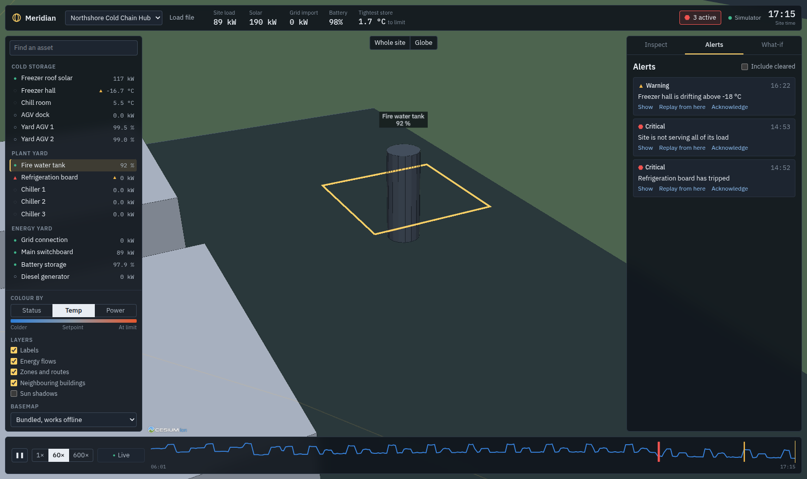
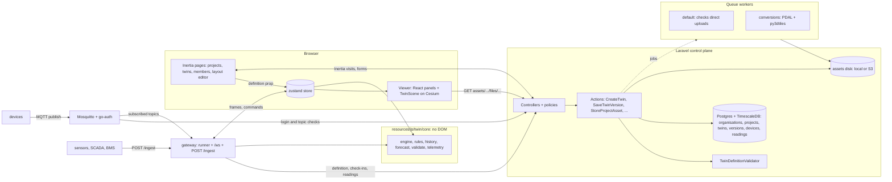
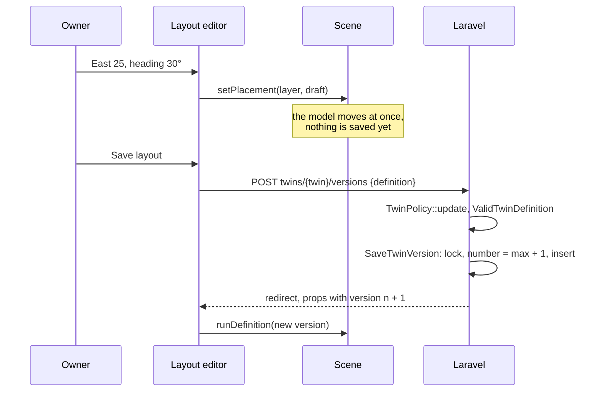
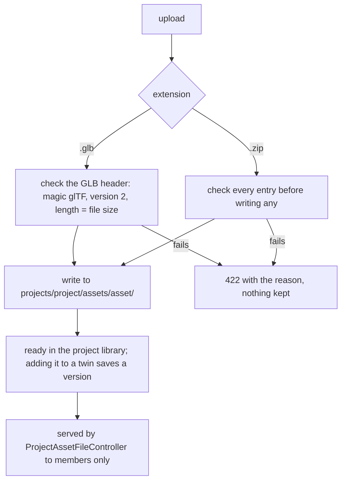
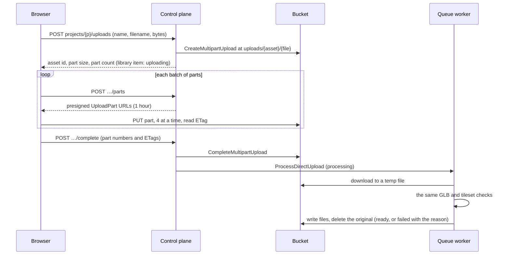
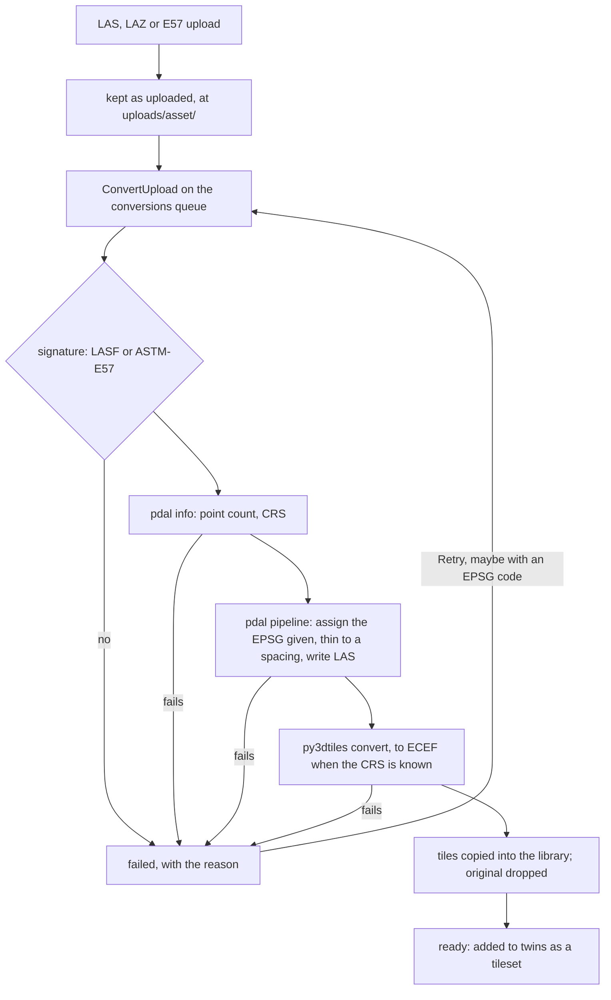
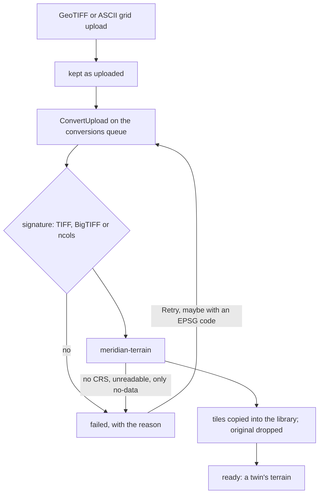
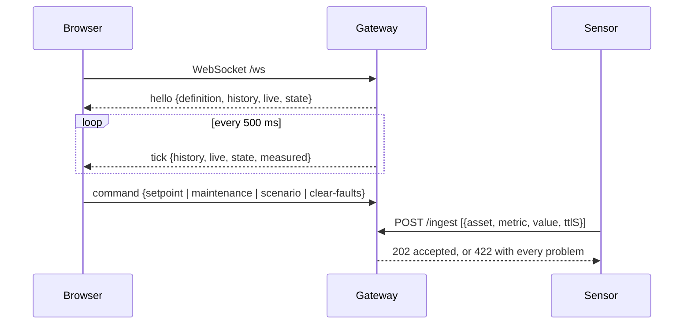
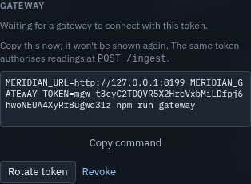
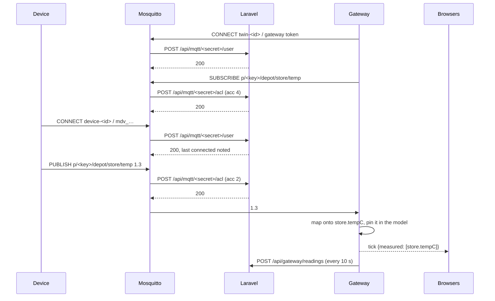

# Meridian

A digital twin platform: a [CesiumJS](https://cesium.com/platform/cesiumjs/) viewer and physics model, plus a Laravel control plane for organisations, projects, versioned twins, and a shared library of uploaded models and 3D Tiles.

A twin is a JSON definition. Meridian turns it into a running physical model, a 3D scene on a real globe, an asset tree, alerting, time travel and what-if forecasts. Teams keep their twins in the control plane: every edit is a version, uploads are checked and served privately, and roles decide who can change a twin and who can only operate or watch it.


**New to Meridian?** The [user manual](docs/manual/README.md) walks through every part of it, step by step, with screenshots: projects and uploads, point clouds, the viewer, alerts and what-if, layout and versions, gateways, devices and MQTT, and running it yourself.

The sample twin, **Northshore Cold Chain Hub**, is a fictional refrigerated logistics campus in Brisbane. It has two cold stores, three chillers, rooftop and canopy solar, a battery, a diesel generator, electric trucks, yard AGVs and a fire water tank described as a custom asset type. A second sample, **Harbour Depot** in Auckland, is a one-store, grid-only site, there to show that nothing in the platform is specific to the first twin.

## What it does

|                                    |                                                                                                                                                                                                                                                                                                                                                |
| ---------------------------------- | ---------------------------------------------------------------------------------------------------------------------------------------------------------------------------------------------------------------------------------------------------------------------------------------------------------------------------------------------- |
| **Organisations and roles**        | Every project and twin belongs to an organisation. Owners and admins edit twins and manage members, operators send commands, viewers watch. People can belong to several organisations and switch between them.                                                                                                                                |
| **Versioned twins**                | Each save appends an immutable version: a layout change, an upload, a replaced definition or a restore. Any version can be downloaded as JSON or restored as a new one.                                                                                                                                                                        |
| **Projects and uploads**           | Projects group twins with a library of models (`.glb` or `.ifc`), zipped 3D Tiles tilesets and point clouds that any of their twins can show, so one scan serves several twins. Archives are checked entry by entry before anything is written, and files are served only to members of the organisation.                                      |
| **Point clouds**                   | LAS, LAZ and E57 scans are converted to 3D Tiles by a queued job (PDAL, then py3dtiles), reprojected onto the globe from their own coordinate system or an EPSG code you give, and optionally thinned. Progress, a log and retries show in the library.                                                                                        |
| **Terrain**                        | DEMs (GeoTIFF or ASCII grid) are converted to quantized-mesh terrain by the same queue (GDAL, pydelatin and quantized-mesh-encoder), and a twin can use one as its ground: the site is lifted onto it, zones and routes drape over it, and hills hide what's behind them.                                                                      |
| **BIM models**                     | IFC files are converted to one GLB by the same queue (IfcOpenShell), each element a node named by its GlobalId with its name, class and storey. A georeferenced model (IfcMapConversion, or the site's latitude and longitude) is added to a twin where it belongs.                                                                            |
| **Placement**                      | Models and local-coordinate tilesets are placed in metres east, north and up from the twin's origin, with heading and scale. Edits preview live in the scene, and **Place on map** moves a layer to wherever you click on the ground.                                                                                                          |
| **Custom asset types**             | Equipment the simulator has no physics for, described as data: metrics with units and defaults, a colour and a shape, plus behaviour written as safe expressions: derived metrics, states and transitions, setpoints operators can change, and power drawn from the feed tree. Each organisation keeps a library of types its twins copy from. |
| **Live physics**                   | A microgrid power balance (solar, battery dispatch with peak shaving, grid, generator start delay, load shedding by priority) feeding a refrigeration plant (chiller capacity and COP that derate with ambient air, store thermal mass, door losses, stock spoilage). Vehicles drive their routes and queue for chargers.                      |
| **3D scene**                       | The twin opens with a flight down from orbit, and **Globe** pulls back to the whole Earth, lit for the simulated time of day. Assets are extruded from their footprints. Energy and cooling flows animate along arcs, scaled by kW. Alerts raise a beacon over the asset. You can colour by status, temperature or power.                      |
| **Alerting, time travel, what-if** | Threshold, rate-of-change and expression rules with hold times and hysteresis. A 24-hour history to scrub through. Forecasts that fork the current state and run it ahead with and without an event, then apply the event live if you choose.                                                                                                  |
| **Devices and MQTT**               | Devices registered per project, each with its own broker login. The broker asks the control plane about every login and topic, so a device can only publish below its own project's prefix. Topics are mapped onto any asset's metrics, and every reading is kept for charts beyond the live window.                                           |
| **Gateway**                        | A Node service that runs the model, streams it over WebSocket, and takes readings from MQTT topics or `POST /ingest`. A reading pins its metric and the model integrates from it, so the twin follows reality where sensors report and fills the gaps where they don't.                                                                        |


_A project: two twins, a library holding a model, a tileset and a converted laser scan, and the devices allowed to publish readings._


_The layout editor on Harbour Depot: an uploaded `.glb` placed 38 m west and 30 m south of the origin, turned 30° and doubled in size. The scene follows the numbers as you type; **Save layout** writes them as a new version._


_What-if: if the refrigeration board trips now, the freezer passes its limit in under four hours. The forecast lists every alert that would follow, with cost, diesel, unserved load and stock at risk compared side by side._



_The same event applied live, coloured by temperature: a red beacon over the tripped board, de-energised chillers, both stores warming, and the alerts stacking up on the timeline._

## Quick start

Needs PHP 8.5 (with `zip`), Composer, and Node 22 or later.

```bash
composer install
cp .env.example .env && php artisan key:generate
touch database/database.sqlite && php artisan migrate --seed
npm install                  # also copies Cesium's static assets to public/vendor/cesium
composer run dev             # Laravel and Vite (Vite on port 5199)
```

Log in at the app URL as `test@example.com` with password `password`; you land on the organisation's projects. The seed creates **Northshore Logistics** with both sample twins, plus `operator@example.com` and `viewer@example.com` (same password) to try the other roles. The sample twins also run without an account at `/demo`.

To try uploads, use `public/samples/models/pump-skid.glb` as a model, and zip `public/tilesets/context/` for a tileset:

```bash
(cd public/tilesets/context && zip -q ../../../context.zip tileset.json context.glb)
```

Point clouds need PDAL and py3dtiles, terrain needs `meridian-terrain` (`docker/converter/meridian-terrain`, with GDAL, pydelatin and quantized-mesh-encoder), IFC models need `meridian-ifc` (`docker/converter/meridian-ifc`, with IfcOpenShell and GDAL), and all need a worker on the conversions queue. The Docker stack's `converter` service has all of them. Without Docker, install them (`pdal` from conda-forge, `pip install "py3dtiles[las]"`) and run:

```bash
php artisan queue:work conversions --queue=conversions --timeout=14400
```

### The gateway

```bash
npm run gateway              # http://127.0.0.1:8787, socket at /ws
# then open /demo?gateway=ws://127.0.0.1:8787/ws
```

Send it a reading, and watch the freezer turn red and the chillers respond:

```bash
curl -X POST http://127.0.0.1:8787/ingest \
  -H 'content-type: application/json' \
  -d '{"asset":"freezer","metric":"tempC","value":-11.5,"ttlS":900}'
```

Custom types take readings the same way, for example `{"asset":"fire-tank","metric":"levelPct","value":48}` raises the _Fire water low_ alert.

### Scripts

| Command                       |                                                                                                                                                                     |
| ----------------------------- | ------------------------------------------------------------------------------------------------------------------------------------------------------------------- |
| `composer run dev`            | Laravel, queue, logs and Vite together                                                                                                                              |
| `composer test`               | Everything CI runs: Pint, Rector, the formatter and linter, PHPStan, `tsc`, 100% type coverage, Pest with 100% code coverage, and Vitest                            |
| `npm run test:twin`           | Vitest only: physics, rules, history, forecasting, validation, gateway                                                                                              |
| `npm run test:e2e`            | Playwright in real Chrome with software WebGL (needs `npm run build` first)                                                                                         |
| `npm run gateway [twin.json]` | The gateway, serving `public/samples/northshore.json` unless you name another                                                                                       |
| `npm run generate:context`    | Rebuilds the sample 3D Tiles tileset                                                                                                                                |
| `npm run generate:model`      | Rebuilds the sample pump skid model                                                                                                                                 |
| `npm run screenshots`         | Regenerates `docs/images` by walking through a seeded app with the real broker and converter (needs `npm run build`, Docker and the `meridian-converter:dev` image) |

## Architecture



The TypeScript in `resources/js/twin/core` has no browser or Cesium dependencies, so the same model runs in the viewer and in the Node gateway. The viewer only sees the `TwinSource` interface, so an in-browser simulator and a remote feed are interchangeable.

The control plane follows [Nuno Maduro's strict starter kit](https://github.com/nunomaduro/laravel-starter-kit-inertia-react): business logic in single-purpose `app/Actions` classes, thin controllers that authorise and delegate, policies for every twin and organisation decision, PHPStan at max, and 100% code and type coverage.

React doesn't render the scene. `TwinScene` is a plain class that owns the Cesium viewer and subscribes to the store directly, so a 4 Hz frame stream never becomes component re-renders. Building bodies are instances in a single Cesium `Primitive`, and a colour change writes straight to that instance's attribute.

### One definition, two validators

The browser validates a definition before running it, and the server validates it before saving it. The two must agree, or the control plane could accept a twin the viewer refuses.

The shape of a definition (which fields, of what type, in what range) lives in one JSON Schema, `resources/js/twin/core/definition.schema.json`, which both sides read: ajv in the browser and gateway, opis/json-schema on the server. Each check carries its message (`x-message`, with `{0:id}` naming the list item and `{value}` the value found), and the same schema tells the definition editor which fields to show and how (`title`, `description`, `x-form`). What needs the whole definition (references to zones, routes, types and assets, duplicates, feed cycles, the main bus, expressions) stays in code: `app/Support/TwinDefinitionValidator.php` mirrors `resources/js/twin/core/validate.ts` message for message. Schema problems come first, ordered by where they are in the definition, then the rest. Both are tested against the same cases in `tests/fixtures/definition-cases.json`:

```text
for each case in definition-cases.json:
    definition ← copy of the base sample, with the case's set / unset / push edits
    expect validateDefinition(definition)        == case.errors     # Vitest
    expect TwinDefinitionValidator→errors(def)   == case.errors     # Pest
```

Every message, and the order they come in, is part of the contract. A change to one validator fails the other's tests until both match.

### Saving a version



Versions are never edited. Adding or removing a library upload, replacing the definition and restoring an old version all go through `SaveTwinVersion`, so the history is the complete record of what the twin looked like and who changed it.

### Uploads



A tileset zip comes from someone else, so `ExtractTilesetArchive` trusts nothing in it:

```text
for each entry in the zip:
    skip directories, __MACOSX/ and .DS_Store
    refuse if the path is absolute, has a drive letter, a backslash, a NUL,
        or an empty, "." or ".." segment                     # zip slip
    refuse if the entry is a Unix symlink
    refuse if the extension isn't a tile format (json, b3dm, i3dm, pnts, cmpt,
        glb, gltf, bin, subtree, png, jpg, webp, ktx2)
    refuse once the file count or the declared size passes the limits

root ← "tileset.json" at the top, or inside the zip's single top-level folder
refuse unless root parses as JSON with "asset" and "root"

for each entry:
    stream it to the disk, counting real bytes, and stop at the size budget
        # the zip's own size headers can lie; the stream can't

on any failure: delete everything written so far
```

#### Direct uploads

With an `s3` assets disk and `MERIDIAN_DIRECT_UPLOADS=true`, the browser sends files straight to the bucket in parts, so a large scan never passes through PHP or its upload limits:



Cancelling, or deleting an item still uploading, aborts the multipart upload. The page polls while anything is processing. Part URLs are signed for `MERIDIAN_DIRECT_UPLOADS_ENDPOINT`, since the app reaches RustFS inside Docker at an address browsers can't. The bucket needs a CORS rule allowing `PUT` from the app and exposing `ETag`; `docker/rustfs/create-buckets.sh` sets one. Only ready items can be added to a twin. A processing job that keeps failing (the store is down, say) is retried three times, then marked failed.

#### Point clouds




_A wharf scan at 45%: the log shows each step as the converter reaches it._


_The same scan, georeferenced in NZTM (EPSG:2193), landing beside Harbour Depot with no placement of its own._

The job runs only in the `converter` image (`docker/converter`): Alpine's PDAL has no E57 reader and py3dtiles needs glibc, so that image is Debian with PDAL from conda-forge and py3dtiles from PyPI. Conversions get their own queue connection, `conversions`, whose `retry_after` outlasts the four-hour job timeout; it uses the same driver as `QUEUE_CONNECTION`. A failed conversion keeps the original and the last lines from the tool that failed, and is tried once, so the reason is on screen rather than lost in a retry. py3dtiles is always run with `--pyproj-always-xy`: LAS stores easting as X whatever the CRS's axis order, and without it a northing-first system such as NZTM lands on the other side of the planet. A cloud with no coordinate system (common for E57) is tiled in its own metres and starts placed at the twin's origin.

#### Terrain



`meridian-terrain` is a short script in the converter image:

```text
reproject the DEM to WGS84 longitude and latitude (GDAL), with overviews
deepest zoom ← where one tile's 256 cells are about as fine as the DEM's pixels
for each zoom, each tile of Cesium's geographic grid over the DEM
(and both whole-hemisphere tiles at zoom 0, so the globe is complete):
    sample 257 × 257 heights over the tile; no data is 0, the ellipsoid
    triangulate to half a cell of error at that zoom (Delatin)
    write {z}/{x}/{y}.terrain with oct-encoded vertex normals
write layer.json: the zooms and tile ranges available
print the CRS, tile count, deepest zoom and height range
```

Heights are used as the DEM gives them, so a DEM in metres above sea level puts the ground a few tens of metres off the ellipsoid; the twin only cares about the height at its origin. The real-tool tests tile a DEM of Auckland with a hill 400 m north of its centre and check the summit lands north, at 100 m: pydelatin counts rows from the south, and getting that wrong flips every tile.

#### BIM models

An `.ifc` upload goes through the same queue to `meridian-ifc`, a short script in the converter image:

```text
check the STEP signature (ISO-10303-21)
triangulate every element with geometry (IfcOpenShell, world coordinates, in metres whatever the file's units)
write model.glb: one node per element, named by its GlobalId, with its name,
    IFC class and storey in the node's extras; a material per surface colour;
    IFC's Z-up turned to glTF's Y-up
write elements.json: the same, as a list
where is it?
    IfcMapConversion: eastings and northings reprojected from its CRS to WGS84
        (GDAL), and the rotation of the project's x axis from grid east
    otherwise IfcSite's RefLatitude and RefLongitude, turned by the model
        context's TrueNorth
    otherwise nowhere: the model starts at a twin's origin
a model drawn more than a kilometre from its origin is moved back to it
    (float32 vertices lose millimetres that far out), and the georeference follows
print the schema, element and triangle counts, size and georeference
```

Adding a georeferenced model to a twin gives it a placement at that spot, in metres east and north of the twin's origin with the file's heading. One more than 50 km away is probably meant for another site, so it starts at the origin, as an unreferenced one does; either way it's placed like any model. The real-tool tests build a 20 m by 12 m shed in millimetres with `scripts/generate-ifc.py`, once with a map conversion in NZTM and once by its site and true north drawn 5 km off, and check its size, its elements, and where it lands.

#### The library

Uploads go into the project's library (`project_assets`), and adding one to a twin saves a version with a layer pointing at it. Removing a layer leaves the upload in the library; deleting it from the library takes it out of every twin in the project first. Files are served from `assets/{asset}/files/{path}` after `ProjectPolicy::view` on the upload's project. The URL names neither twin nor project, so layers keep working as twins change. Each response has a fixed content type per extension, `X-Content-Type-Options: nosniff` and `Content-Security-Policy: default-src 'none'; sandbox`, so an uploaded file can never run as a page. The path is checked for `.` and `..` segments too.

### Roles

|                                                                     | Owner | Admin | Operator | Viewer |
| ------------------------------------------------------------------- | :---: | :---: | :------: | :----: |
| See projects and twins, and stream them                             |   ✓   |   ✓   |    ✓     |   ✓    |
| Send commands (setpoints, maintenance, scenarios)                   |   ✓   |   ✓   |    ✓     |        |
| Create projects and twins, upload, place, save and restore versions |   ✓   |   ✓   |          |        |
| Import, save and delete types in the type library                   |   ✓   |   ✓   |          |        |
| Issue gateway tokens, add devices, map telemetry                    |   ✓   |   ✓   |          |        |
| Add members and change roles                                        |   ✓   |   ✓   |          |        |

An organisation always keeps at least one owner: demoting or removing the last one is refused. A viewer's controls are disabled in the inspector, and the store drops their commands too.

### The model, per 5-second step

```text
weather    ← daily sine + slow smooth noise + heatwave fault
demand     ← each store's PI-style call on its chillers, from last step's temperature
desired    ← what every consumer would draw if energised
supply     ← solar (irradiance), grid (unless outage), battery (unless locked out),
             generator (once the grid has been gone for startDelayS)

energised  ← walk the feed tree from the main bus, skipping tripped breakers
while desired load > supply:
    shed the next consumer by shedPriority          # admin before refrigeration
if still short: black out

dispatch   ← solar first; battery peak-shaves in the peak tariff window;
             grid or generator covers the rest; surplus charges battery, then exports
             (or is curtailed when islanded)
plant      ← cooling = demand × capacity(ambient); power = cooling / COP(ambient, wear)
stores     ← T += (envelope + door + internal − cooling) × dt / thermal mass
             excursion minutes past the limit put stock at risk after a grace period
custom     ← unchanged: their metrics hold until ingest supplies a reading
roll-up    ← site load, cost by tariff, CO₂, unserved energy
```

Everything the model remembers lives in one flat `values` map of `asset.metric` keys. Noise is a pure function of `(seed, step, channel)`. Together these make the state a plain JSON object that can be cloned, sent over a socket or forked, and a fork with no new faults reproduces the original run exactly. That's what makes the what-if comparison fair: both futures share the same weather and the same noise, so every difference comes from the event.

### Gateway protocol



The gateway binds to `127.0.0.1` by default, and browser sockets are accepted only from localhost origins. To expose it:

| Variable          |                                                                  |
| ----------------- | ---------------------------------------------------------------- |
| `GATEWAY_PORT`    | Port, default `8787`                                             |
| `GATEWAY_HOST`    | Bind address, default `127.0.0.1`                                |
| `GATEWAY_TOKEN`   | If set, `POST /ingest` needs `Authorization: Bearer <token>`     |
| `GATEWAY_ORIGINS` | Comma-separated extra browser origins allowed to open the socket |

### Running a twin from the control plane

Instead of a JSON file, a gateway can serve a twin saved in the control plane. Open the twin's **Layout** panel, choose **Issue token**, and run the command it shows (the token is shown once; only its hash is stored):

```bash
MERIDIAN_URL=http://localhost:8000 MERIDIAN_GATEWAY_TOKEN=mgw_… npm run gateway
```

The gateway fetches the twin's latest version from `GET /api/gateway/definition`, polls it every few seconds (answered `304` while nothing changed), and restarts the model on each new version. Every poll is also a check-in that reports where browsers can reach it. While it has checked in within the last 30 seconds, the twin page offers a **Simulator / Live** switch and follows the gateway.



Browsers get in with a ticket the control plane signs for each page view. The HMAC key is the token's SHA-256, which both sides can compute without the control plane holding the token. The ticket names the twin, the user and whether they may operate, so a viewer's socket can watch but not send commands. The same token authorises `POST /ingest`. Rotating or revoking the token cuts the gateway off.

| Variable                         |                                                                     |
| -------------------------------- | ------------------------------------------------------------------- |
| `MERIDIAN_URL`                   | The control plane, e.g. `http://localhost:8000`                     |
| `MERIDIAN_GATEWAY_TOKEN`         | The twin's gateway token                                            |
| `GATEWAY_PUBLIC_URL`             | Where browsers reach the socket, default `ws://127.0.0.1:<port>/ws` |
| `GATEWAY_POLL_MS`                | How often to poll for new versions, default `5000`                  |
| `MQTT_URL`                       | A broker to take readings from, e.g. `mqtt://localhost:1883`        |
| `MQTT_USERNAME`, `MQTT_PASSWORD` | Another broker login; by default `twin-<id>` with the gateway token |

### MQTT and history



Every project has a topic prefix, `p/<key>/`, where the key is the project's first name as a slug plus four random characters (`p/pilot-sites-ayjl/`). It doesn't change when the project is renamed. Each project's MQTT traffic sits below its prefix.

A twin's `telemetry` maps MQTT topics, written relative to that prefix, onto asset metrics. Edit the mappings in the **Telemetry** section of the **Layout** panel; saving makes a new version, and the twin's gateway follows it, subscribing to new topics and dropping old ones.

```json
"telemetry": [
  { "topic": "depot/store/temp", "asset": "store", "metric": "tempC", "ttlS": 900 },
  { "topic": "depot/+/power", "asset": "plant", "metric": "powerKw", "path": "meter.w", "scale": 0.001 }
]
```

Each message, in the gateway:

```text
for each mapping whose topic filter matches (prefix + topic):
    value ← the payload as a number
            or JSON: the number at path (dotted keys), else at "value"
    if no number: count it on /health as unmapped, and skip
    value ← value × scale + offset
    pin asset.metric at value for ttlS seconds      # the model integrates from it
    add {asset, metric, value, at} to the outbox
```

`+` matches one topic level and a final `#` the rest. A payload is a bare number, or JSON with the number at `path` (dotted keys) or at `value`. The value is multiplied by `scale` and then `offset` is added. Mappings onto a metric the asset doesn't have are skipped with a warning, and messages without a number are counted on the gateway's `/health`.


Every reading, from MQTT or `/ingest`, is also sent to the control plane at `POST /api/gateway/readings` in batches every 10 seconds, authenticated with the gateway's token. While the control plane can't be reached the gateway keeps up to 10,000 readings, dropping the oldest first. The asset's inspector charts what was recorded over the last 24 hours, 7 days or 30 days, in real time rather than the simulated clock.

```text
outbox: up to 10,000 readings, oldest dropped first
every 10 s:
    while the outbox has readings:
        send the oldest 1,000 to POST /api/gateway/readings
        refused or unreachable? keep them all and try again next time
        accepted? drop them from the outbox
control plane: check each against the twin's assets and a recent time window, then insert
```


_What the store's probe reported over the last day, with the morning's spike, charted from the readings table rather than the model._

Readings are kept for `MERIDIAN_READINGS_RETENTION_DAYS`. In Docker, Postgres runs TimescaleDB: readings become a hypertable in day chunks, compressed after a week, and old chunks are dropped automatically. On plain Postgres or SQLite they stay an ordinary table that the scheduled `model:prune` trims.

### Devices and the broker

Add devices under **Devices** on the project page. Each one gets a broker login, `device-<id>`, and a password that is shown once and can be reset; only its SHA-256 is kept. The page shows when each device last connected.


Mosquitto asks the control plane about every login and topic, through [mosquitto-go-auth](https://github.com/iegomez/mosquitto-go-auth)'s HTTP backend:

```text
login(username, password):
    device-<uuid> → the device exists and sha256(password) matches; note last connected
    twin-<uuid>   → sha256(password) matches the twin's gateway token
    otherwise     → refuse

acl(username, topic, acc):                 # acc: 1 read, 2 write, 4 subscribe
    device → acc is write,            project ← the device's project
    twin   → acc is read or subscribe, project ← the twin's project (while it has a token)
    allow only if topic starts with p/<project key>/ and has something after it
```

- **Devices** may publish below their project's prefix, and nothing else: no subscribing, and no other project's topics.
- **Gateways** log in as `twin-<id>` with the twin's gateway token. They may subscribe to and receive their twin's project topics, and may not publish.
- **Everyone else** is refused, including anonymous clients, and nobody can reach `$SYS`.

The plugin calls `POST /api/mqtt/<secret>/user` and `/acl`. The secret is `MERIDIAN_MQTT_AUTH_SECRET`, which the broker and the app share; without it both routes answer 404. Logins are limited to 30 a minute per username. Each answer is cached for about 30 seconds, so a deleted device or reset password is shut out within a minute. Every check-in also reports whether the gateway is connected to the broker, and the twin's Gateway panel shows it.

The Docker `gateway` profile starts the broker on port 1883. Set the same `MERIDIAN_MQTT_AUTH_SECRET` in `docker/.env` and the app's `.env`, add a device, and publish with the command shown next to its password:

```bash
mosquitto_pub -h localhost -p 1883 -u device-<id> -P mdv_… -t 'p/pilot-sites-ayjl/depot/store/temp' -m -17.5
```


The broker speaks plain MQTT. Put it behind TLS (port 8883) before devices connect over networks you don't control.

## Writing a twin

Positions are in metres east and north of `origin`. The [Northshore definition](public/samples/northshore.json) uses every feature, and [Harbour Depot](public/samples/harbour-depot.json) is close to the minimum. The smallest twin that runs is what **New twin → An empty site at a location** creates (`app/Support/BlankTwin.php`, pinned in [tests/fixtures/blank-twin.json](tests/fixtures/blank-twin.json)): a site, weather, a grid connection and the one main bus every twin needs.

```jsonc
{
  "id": "harbour-depot",
  "name": "Harbour Depot",
  "origin": { "lon": 174.7855, "lat": -36.8395 },
  "utcOffsetHours": 12,
  "climate": { "meanC": 17, "swingC": 4 },
  "camera": { "headingDeg": 340, "pitchDeg": -35, "rangeM": 220 },
  "tariff": { "offPeakPerKwh": 0.16, "peakPerKwh": 0.34, "peakStartHour": 17, "peakEndHour": 21, ... },
  "zones": [{ "id": "yard", "name": "Depot yard", "footprint": [[-60,-45],[60,-45],[60,45],[-60,45]] }],
  "assets": [
    { "id": "board", "kind": "bus", "footprint": [...], "height": 4 },          // the main bus: no fedBy
    { "id": "plant", "kind": "chiller", "fedBy": "board", "cools": ["store"],
      "params": { "capacityKw": 70, "copNominal": 3.1 } },
    { "id": "store", "kind": "coldstore", "params": { "setpointC": 1, "limitC": 5, "massKwhPerK": 42, ... } }
  ],
  "rules": [
    { "id": "warm", "kind": "coldstore", "metric": "excursionMin", "op": "gt", "threshold": 0.5,
      "severity": "critical", "message": "{asset} is above its temperature limit" }
  ],
  "scenarios": [
    { "id": "trip", "name": "Chiller trips", "faults": [{ "type": "trip", "target": "plant" }] }
  ]
}
```

**Asset kinds:** `site`, `weather`, `grid`, `solar`, `battery`, `genset`, `bus`, `chiller`, `coldstore`, `building`, `charger`, `vehicle` and `custom`. The metrics each built-in kind reports are in [`metrics.ts`](resources/js/twin/core/metrics.ts).

Rules can also compare a metric's change over a window, or raise on an expression; see [Rules](#rules).

**Fault types for scenarios:** `grid-outage`, `trip` (any asset with a target), `door-stuck`, `heatwave`, `bearing-wear`, `genset-fail` and `cloud-cover`. Each can have an `offsetS` and a `durationS`.

### Custom asset types

```jsonc
"types": [{
  "id": "water-tank", "name": "Fire water tank", "primary": "levelPct",
  "metrics": [
    { "key": "levelPct", "label": "Level", "unit": "%", "decimals": 0, "default": 92 },
    { "key": "pressureKpa", "label": "Ring main pressure", "unit": "kPa", "default": 710 }
  ],
  "visual": { "color": "#3a7ca5", "shape": "cylinder", "height": 9 }
}],
"assets": [
  { "id": "fire-tank", "name": "Fire water tank", "kind": "custom", "type": "water-tank",
    "zone": "plant", "position": [134, 70] }
]
```

Type ids are lowercase with `-` or `_`. Metric keys are camelCase like the built-in ones, and `state` is reserved. A custom asset is drawn as its type's shape and colour while it runs, lists its type's metrics in the inspector, and accepts readings for them at `/ingest`.


### Behaviour as data

A type can also say how its asset behaves, with no code: metrics worked out from expressions, states it moves between, setpoints operators can change, and power drawn from the bus it's fed by. Northshore's jockey pump keeps the fire main's pressure between two setpoints:

```jsonc
{
    "id": "jockey-pump",
    "name": "Jockey pump",
    "primary": "powerKw",
    "metrics": [
        { "key": "powerKw", "unit": "kW", "expr": "running ? 7.5 : 0" },
        {
            "key": "runMin",
            "unit": "min",
            "expr": "running ? runMin + dt / 60 : 0",
        },
        {
            "key": "startKpa",
            "unit": "kPa",
            "default": 650,
            "setpoint": { "min": 550, "max": 720, "step": 10 },
        },
        {
            "key": "stopKpa",
            "unit": "kPa",
            "default": 740,
            "setpoint": { "min": 680, "max": 820, "step": 10 },
        },
    ],
    "states": [
        { "id": "idle", "label": "Idle", "status": "standby" },
        { "id": "running", "label": "Running", "status": "running" },
    ],
    "transitions": [
        {
            "from": "idle",
            "to": "running",
            "when": "{fire-tank.pressureKpa} < startKpa && powered",
        },
        {
            "from": "running",
            "to": "idle",
            "when": "{fire-tank.pressureKpa} >= stopKpa || !powered",
        },
    ],
    "visual": { "color": "#5b8fb9", "shape": "box", "height": 3 },
}
```

The tank's pressure is an expression too, leaking slowly and rising while the pump runs: `clamp(pressureKpa + ({jockey.powerKw} > 0 ? 12 : -1.5) * dt / 60, 0, 900)`.

Each 5-second step, for every custom asset:

```text
take the first transition whose from is the current state (or *) and whose when holds
for each metric with an expr, in the order listed:
    value ← the expr, reading this step's values so far (its own last value included)
    no value? (it read something missing, or divided by zero) keep the last one
if the asset has fedBy and a powerKw metric: it draws that from the feed tree,
    and is shed, tripped and blacked out like any other load
state colour ← the current state's status (Off whenever its bus is down)
```

| In an expression      |                                                                                                                                                     |
| --------------------- | --------------------------------------------------------------------------------------------------------------------------------------------------- |
| Numbers and operators | `+ - * / % ^`, `< <= > >= == !=`, `&& \|\| !` and `c ? a : b`. True is 1 and false is 0; anything non-zero counts as true                           |
| Functions             | `min`, `max`, `abs`, `clamp(x, lo, hi)`, `round`, `floor`, `ceil`, `sqrt`                                                                           |
| Bare names            | The asset's own metrics; its type's state ids (1 in that state, 0 otherwise); `dt` (seconds per step), `hour` (site time), `ambientC` and `powered` |
| `{asset.metric}`      | Another asset's metric, such as `{wx.ambientC}` or `{store.tempC}`                                                                                  |

Expressions are parsed by hand in both TypeScript and PHP, so nothing in them can reach either language, and both validators report the same problems: syntax, names a type doesn't have, references to assets that don't exist, setpoints without a range, transitions to unknown states. A setpoint metric gets **−**, **+** and **Apply** in the inspector for operators, and the gateway clamps what it receives to the range.

### The type library

Each organisation keeps a library of types under **Types** in the sidebar, so a pump or a meter is described once and used in any of its twins. A fresh install's library starts with Northshore's two.

- **Import** takes a JSON file holding one type, a list of them, or a whole twin definition (its `types` are taken). Every type is checked as a twin would check it, except whether the assets it reads exist, and a type with the same id as one in the library replaces it. The library lists what each type reads, such as `fire-tank`, because a twin needs assets with those ids to use it.
- In a twin's **Layout** panel, **Types** lists the twin's own types against the library. **Add** copies a library type in, and **Take library's** replaces the twin's type of that id. **Save to library** copies the twin's type out. Each copy into a twin saves a version, and the definition must still be valid: the jockey pump can't go into Harbour Depot, which has no `fire-tank`, and the editor says so.
- Copies are not links. Changing or deleting a library type never changes a twin, and gateways keep reading types from the definition alone. The panel marks a twin's type as **in the library** or as **differs from the library**, comparing them field by field.

### Rules

Three shapes of rule, each on one `asset` or every asset of a `kind`, with an optional `forS` hold:

```jsonc
"rules": [
  // A metric against a threshold, clearing past clearAt.
  { "id": "freezer-drift", "asset": "freezer", "metric": "tempC", "op": "gt", "threshold": -18,
    "forS": 300, "clearAt": -18.6, "severity": "warning", "message": "{asset} is drifting above -18 °C" },
  // How much a metric changed over a window.
  { "id": "freezer-warming-fast", "asset": "freezer", "metric": "tempC", "change": { "overS": 600 },
    "op": "gt", "threshold": 2, "severity": "warning", "message": "{asset} has warmed 2 °C in ten minutes" },
  // An expression, raised while it holds and cleared when it stops (or once clearWhen holds).
  { "id": "jockey-long-run", "asset": "jockey", "when": "running && runMin > 20",
    "severity": "warning", "message": "{asset} has run for 20 minutes: check the ring main for a leak" }
]
```

A change rule waits until it has a full window of readings. An expression rule reads the asset's metrics by name and others as `{asset.metric}`, and waits while anything it reads has no value.

### KPIs and panels

The top bar and site summary can be declared too. Each figure is an expression over `{asset.metric}` references, with a unit and decimals:

```jsonc
// Replaces the built-in top-bar figures (up to eight).
"kpis": [
  { "label": "Site load", "value": "{site.loadKw}", "unit": "kW" },
  { "label": "Margin to limit", "value": "5 - {store.tempC}", "unit": "°C", "decimals": 1 }
],
// Added to the site summary in the inspector, each with optional figures and a chart.
"panels": [{
  "title": "Fire protection",
  "chart": { "label": "Ring main pressure", "value": "{fire-tank.pressureKpa}", "unit": "kPa" },
  "items": [
    { "label": "Tank level", "value": "{fire-tank.levelPct}", "unit": "%" },
    { "label": "Pressure in hand", "value": "{fire-tank.pressureKpa} - {jockey.startKpa}", "unit": "kPa" }
  ]
}]
```

With no `kpis`, the top bar shows site load, solar, grid, battery and the tightest store, as before. A chart is drawn from the history the twin keeps, so it works in replay too. Figures read only `{asset.metric}`, and the validators refuse bare names and references to assets that don't exist.

### Terrain

```jsonc
"terrain": { "name": "Site lidar", "url": "/assets/.../files/layer.json", "assetId": "..." }
```

Quantized-mesh terrain to stand the site on; without it, the site sits on the plain ellipsoid. The viewer samples the terrain's height at the origin and builds the site level at that height, so pick an origin on the pad the site stands on. Zones and routes drape over the ground, and hills hide what's behind them. Choosing **Use as terrain** on a converted DEM in the twin editor writes this for you; a twin has one terrain, so choosing another replaces it. Harbour Depot uses a synthetic one (`scripts/generate-terrain.py`): a 12 m pad, a ridge to the south-west and the harbour to the north.

### Models and tilesets

```jsonc
"models": [{
  "id": "skid", "name": "Pump skid", "url": "/twins/.../files/model.glb",
  "placement": { "east": -38, "north": -30, "up": 0, "headingDeg": 30, "scale": 2 }
}],
"tilesets": [
  { "id": "context", "name": "Neighbouring buildings", "url": "/tilesets/context/tileset.json" },
  { "id": "scan", "name": "Laser scan", "url": "...", "placement": { ... } }
]
```

A model always has a placement. A tileset without one keeps its own georeference, which is right for most exports (photogrammetry, BIM, point clouds converted with py3dtiles). Give it a placement when it was built in local metres. The control plane writes these entries for you when you upload, with `assetId` linking each one back to its files.

Everything a twin lists can also be edited in the app. **Definition** on the twin page has a tab for each list (zones, assets, routes, types, rules, scenarios, KPIs and panels). Choosing an item opens a form built from the schema:

- Only the fields that apply are shown, such as a route for a vehicle, a type for a custom asset, or the stores a chiller cools.
- Nested lists, such as a route's stops, a type's metrics, states and transitions, a scenario's faults and a panel's figures, are edited in place.
- Pickers offer what the definition has: zones, routes, chargers, a rule's metrics for its asset, and a type's own metrics and states.
- Footprints and paths are typed one point per line, as `east, north`, or drawn: **Draw in scene** turns clicks on the ground into points (a tenth of a metre apart at finest), and a point can be dragged to move it. **Undo point** and **Start again** help while drawing. A position has **Place in scene**, where a click moves it.

Every change is checked as you type, with the same messages the server gives, and **Save** stays disabled until there are none. Saving writes one version, with a note naming the lists that changed ("Edited types and rules"). **Discard** drops the draft. Strings in a saved definition are kept exactly as sent: Laravel's trimming and empty-to-null middleware skip requests that carry one, so an empty unit stays empty.

The validator reports every problem at once: unknown kinds, zones and types, dangling `fedBy` and `cools` references, feed cycles, a missing main bus, stops off a route, rules without a target, scenarios aimed at assets that don't exist, malformed types, and layers with no URL or a bad placement.


_Globe view: the site in context, with day and night shading from the simulated clock._

## More views


_The inspector: live readings with six-hour history, what the asset feeds and is fed by, and the commands it accepts._


_Coloured by power after dark: solar has gone quiet, and the battery and grid carry the plant._

## Configuration

| Variable                                       |                                                                                                                        |
| ---------------------------------------------- | ---------------------------------------------------------------------------------------------------------------------- |
| `MERIDIAN_ASSETS_DISK`                         | Filesystem disk for uploads, default `local` (`storage/app/private`). Use `s3` with RustFS or any S3-compatible store. |
| `MERIDIAN_MAX_UPLOAD_KB`                       | Largest upload through PHP, default 512 MB. PHP's `upload_max_filesize` and `post_max_size` must allow it too.         |
| `MERIDIAN_DIRECT_UPLOADS`                      | Upload straight to an `s3` assets disk in parts, default off (on in Docker). Needs a queue worker.                     |
| `MERIDIAN_DIRECT_UPLOADS_ENDPOINT`             | The store's address as browsers see it, when it differs from `AWS_ENDPOINT` (Docker: `http://localhost:9014`)          |
| `MERIDIAN_DIRECT_UPLOADS_PART_MB`              | Part size, default 16 MB (S3 needs at least 5 MB for every part but the last)                                          |
| `MERIDIAN_DIRECT_UPLOADS_MAX_GB`               | Largest direct upload, default 20 GB                                                                                   |
| `MERIDIAN_PDAL`, `MERIDIAN_PY3DTILES`          | The point cloud tools, default `pdal` and `py3dtiles` on the `PATH`                                                    |
| `MERIDIAN_POINT_CLOUD_JOBS`                    | Processes py3dtiles tiles with, default 2                                                                              |
| `MERIDIAN_POINT_CLOUD_TIMEOUT_MINUTES`         | Longest each conversion step may run, default 240                                                                      |
| `MERIDIAN_TERRAIN_TILER`                       | The terrain tiler, default `meridian-terrain` on the `PATH`                                                            |
| `MERIDIAN_TERRAIN_JOBS`                        | Processes it tiles with, default 2                                                                                     |
| `MERIDIAN_TERRAIN_TIMEOUT_MINUTES`             | Longest a terrain conversion may run, default 240                                                                      |
| `MERIDIAN_IFC_CONVERTER`                       | The IFC converter, default `meridian-ifc` on the `PATH`                                                                |
| `MERIDIAN_IFC_TIMEOUT_MINUTES`                 | Longest an IFC conversion may run, default 120                                                                         |
| `MERIDIAN_READINGS_RETENTION_DAYS`             | How long recorded readings are kept, default 365                                                                       |
| `MERIDIAN_MQTT_AUTH_SECRET`                    | Shared with the MQTT broker, which uses it to ask who may log in and use which topics. Unset, those routes answer 404. |
| `MERIDIAN_MQTT_BROKER_URL`                     | Where devices connect, shown on the project page, default `mqtt://localhost:1883`                                      |
| `MERIDIAN_TILESET_MAX_FILES`                   | Most files in a tileset zip, default 20,000                                                                            |
| `MERIDIAN_TILESET_MAX_BYTES`                   | Largest unpacked tileset, default 4 GB                                                                                 |
| `VITE_BASEMAP_URL`, `VITE_BASEMAP_ATTRIBUTION` | A custom `{z}/{x}/{y}` tile provider and the attribution it requires                                                   |

The default basemap is Natural Earth imagery bundled with Cesium. It makes no third-party requests and works offline. You can switch to OpenStreetMap tiles in the Basemap menu, whose [tile usage policy](https://operations.osmfoundation.org/policies/tiles/) suits development rather than production traffic. Meridian doesn't use Cesium ion, so it needs no access token.

## Tests

- **Pest (100% code and type coverage):** every action, policy, model, rule and controller. Roles at each level, outsiders kept out, the last owner kept. Versions number up and restore as new versions. Projects and their libraries: twins created only in the organisation's own projects, uploads added to and removed from twins as versions, and deletions reaching every twin that shows them. Uploads: GLB header checks, tileset extraction, zip slip, symlinks, foreign file types, file count and size limits (including a zip that lies about its sizes), cleanup when anything fails, and file serving headers. Direct uploads against the AWS SDK's mock handler: part URLs signed for the public endpoint, the start, sign, complete and abort lifecycle, uploads no longer open answered with 409, processing in the queue (ready, failed with the reason, retried when the store fails), and only ready uploads reaching twins. Point clouds with PDAL and py3dtiles faked: the commands each step runs, the EPSG and thinning options, signatures, missing and empty files, the tail of a failing tool, the original kept for a retry, and clouds in local metres placed at the origin. DEMs with the tiler faked: TIFF, BigTIFF and ASCII grid signatures, the EPSG option passed on, the tiler's reason kept, a run that writes no `layer.json`, and terrain set, replaced and removed as a twin's ground. IFC models with the converter faked: the signature, the summary in the log, the georeference kept, a run that writes no model, and a model placed by its georeference near the twin, or at the origin when it's far away or says nothing. With the real tools, inside the converter image, LAS and E57 scans of Auckland land within 0.01° of where they should, and a DEM of Auckland tiles to zoom 16 with its summit at 100 m, north of centre where it belongs, or asks for an EPSG code when it has no coordinate system, and a shed drawn in millimetres converts to a 20 m GLB of its six elements, landing where its map conversion or its site says (`docker run --rm -v "$PWD":/var/www/html -e MERIDIAN_CONVERTER_TESTS=1 meridian-converter php vendor/bin/pest tests/Feature/Conversions`). Readings: gateway batches checked against the twin's assets and a recent time window, bucketed history with lows and highs, other organisations kept out, and pruning by retention. Devices: passwords shown once and reset, names unique per project, and only editors manage them. The broker's checks: device and gateway logins, publishing and subscribing only below the project's prefix (not `#`, `p/+/#`, `$SYS` or other projects), revoked tokens and deleted devices shut out, the shared secret, and the per-username login limit. The suite also runs in CI on TimescaleDB Postgres, where readings are a hypertable. The shared definition fixtures, and the shared expression fixtures: the PHP parser refuses exactly what the viewer's does, with the same message. Browser tests for the kit's account pages.
- **Vitest:** power is conserved every step, including while islanded. Stores hold setpoint for a full day. Outages bridge on battery, start the generator and return to grid. Load sheds by priority. Runs are deterministic, and survive cloning and a JSON round trip. The forecast's baseline matches a straight run exactly. Rule hold times and hysteresis. The gateway's socket, commands, ingest, tokens, body limits and origins. MQTT topic matching and payload mapping, topics placed below the project's prefix, the gateway logging in as its twin and reporting the broker connection, the bridge following new mappings, and the readings outbox holding what the control plane refused. The shared definition fixtures. Expressions: precedence, short-circuiting, missing values and every parse error, against the same fixtures as PHP. Custom types with behaviour: derived metrics that integrate, transitions, power drawn from a bus and lost with it, setpoints clamped to range, and the jockey pump holding the fire main between its setpoints for six hours. Expression and change rules, including a window that restarts when time goes backwards.
- **Playwright (real Chrome and WebGL):** an owner logs in, uploads a model, places it, saves, uploads a tileset, reloads and finds both still there. An upload made on the project page is added to a twin and taken out again, staying in the library. A point cloud waits for the converter, shows why its conversion failed, and is retried with an EPSG code. A DEM shows only the EPSG option, converts on the queue, and shows why it failed. A bad archive is refused with its reason. A type imported into the library is added to Northshore, and the jockey pump is refused by Harbour Depot, which has no fire tank. An owner adds a device, is shown its password and an example command once, resets it, is refused a duplicate name and deletes it. An owner maps an MQTT topic below the project's prefix (a bad filter is refused first) and sees recorded readings charted. A viewer can watch but not edit or operate. On `/demo`: no errors and no third-party requests, canvas picking, commands, forecasts and their cascade, time travel, the globe view, the second twin standing on its terrain's 12 m pad, bad files, the gateway path including a real `POST /ingest`, and phone width.

## Project layout

```text
app/Actions/              business logic: organisations, members, projects, libraries, twins, versions
app/Http/Controllers/     thin, authorising controllers
app/Policies/             ProjectPolicy, TwinPolicy, OrganisationPolicy
app/Support/              TwinDefinitionValidator (mirrors validate.ts), SampleTwins
resources/js/pages/       Inertia pages: twins, members, demo, and the kit's account pages
resources/js/components/  twin-editor (layout, uploads, library, history), organisation-switcher
resources/js/twin/core/   model, rules, history, forecast, validation, protocol (no DOM)
resources/js/twin/scene/  TwinScene, the Cesium side
resources/js/twin/ui/     the viewer's React panels and charts
gateway/                  the Node gateway
public/samples/           sample twins and the sample model
tests/fixtures/           definition cases shared by Pest and Vitest
tests/e2e/                Playwright specs
```

## Roadmap

Meridian is meant to be a tool teams run for their own sites: bring in scans, models and live data, organise them by project, and build twins from them, all managed from the control plane. The microgrid and cold chain physics stay as a reference domain, and each milestone moves more of what is fixed in code into data people control.

1. **Control plane and gateway** (done): organisations and roles, versioned twins, uploads, placement, custom types, Docker Compose with Postgres and RustFS, and gateways that load their twin from the control plane, follow new versions and admit browsers with signed tickets.
2. **Projects and a data library** (done): organisations hold projects, and projects hold twins and a shared library of uploads (models, tilesets and point clouds), so one scan can be placed into several twins. New twins start as an empty site at a chosen location (weather, a grid connection and a main board), a sample, or a definition file. Large files go straight to object storage in parts and are checked by a queued job.
3. **Point cloud pipeline** (done): LAS, LAZ and E57 uploaded to the library and converted to 3D Tiles by a queued worker (PDAL to read, assign a coordinate system and thin; py3dtiles to reproject and tile), with progress, logs and retries in the UI, then placed into a twin like any tileset.
4. **IoT: devices, MQTT and history** (done): devices registered per project with their own broker logins, a broker that asks the control plane who may publish and subscribe where, an MQTT bridge mapping topics onto any asset's metrics, gateways issued, rotated and watched from the control plane, and TimescaleDB for long-term readings and charts beyond the live window.
5. **Customisation core** (done): behaviour for custom types as data (derived metrics written as safe expressions, state machines, setpoints, power drawn from the feed tree), expression and rate-of-change rules, KPIs and panels declared in the definition, and a type library per organisation that twins copy types from and save them to.
6. **Terrain** (done): DEMs uploaded to the library and converted to quantized-mesh terrain by the conversions worker, which a twin can stand on.
7. **Definition editor** (done): every list in a twin (zones, assets, routes, types, rules, scenarios, KPIs and panels) is edited in the app, with forms generated from one JSON Schema that also replaced the two hand-kept validators.
8. **Scene editing and BIM** (in progress): drawing footprints and routes in the scene, IFC import, binding tileset features to assets. Done: footprints, paths and positions drawn and dragged on the ground from the definition editor; IFC models converted to GLB with their elements, and placed by their georeference.
9. **OPC UA and actuation:** read from OPC UA servers, and write back through the custom setpoints, off by default and audited.
