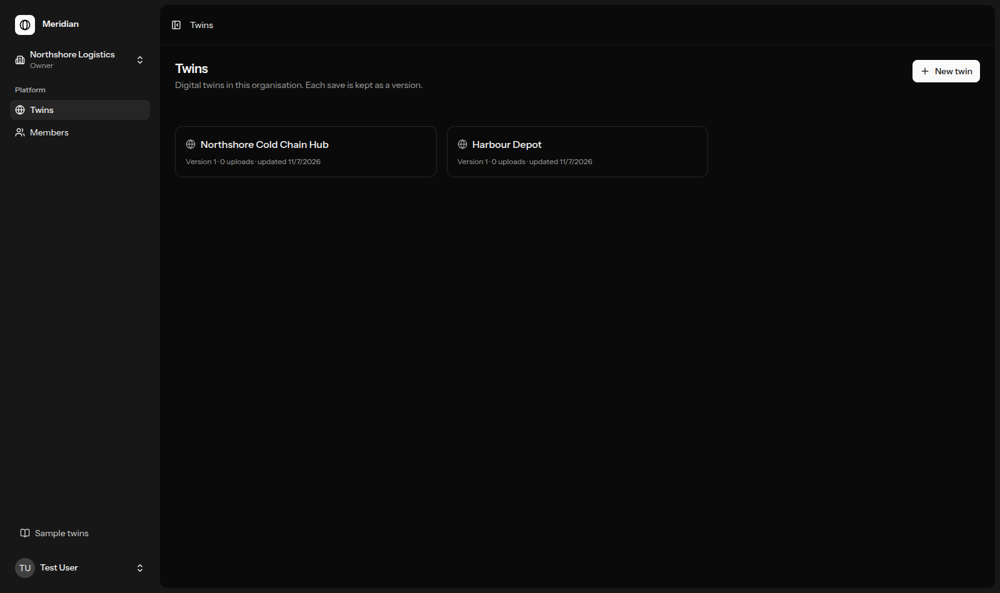
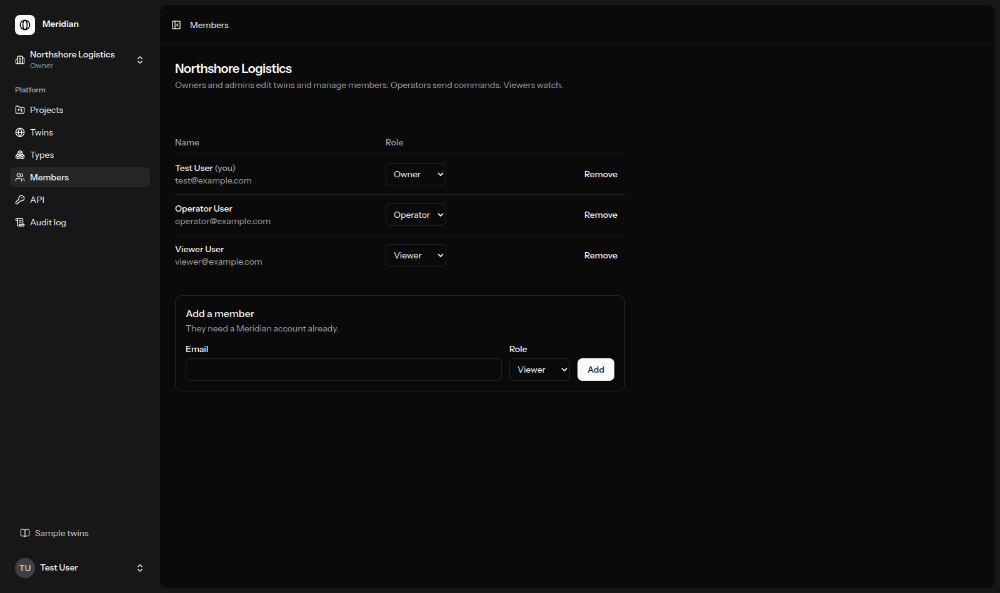
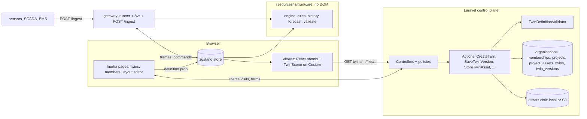
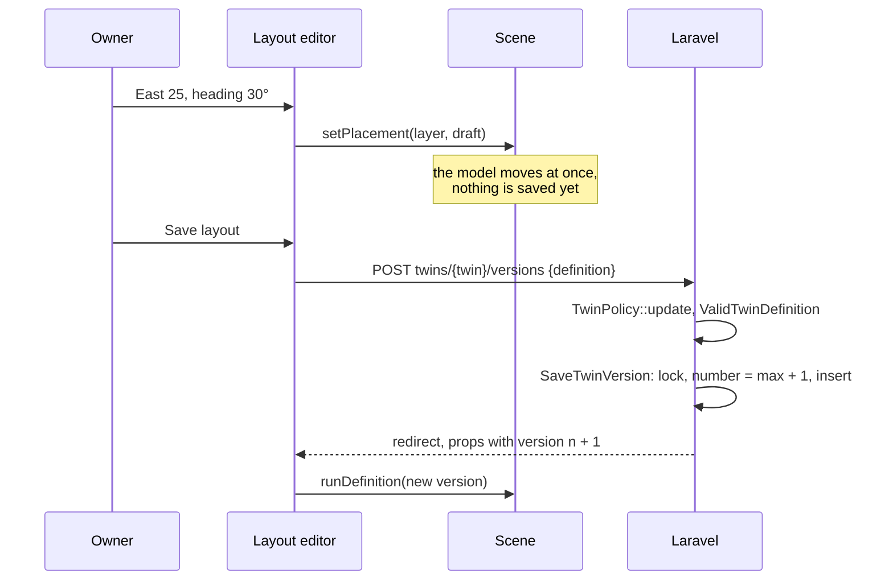
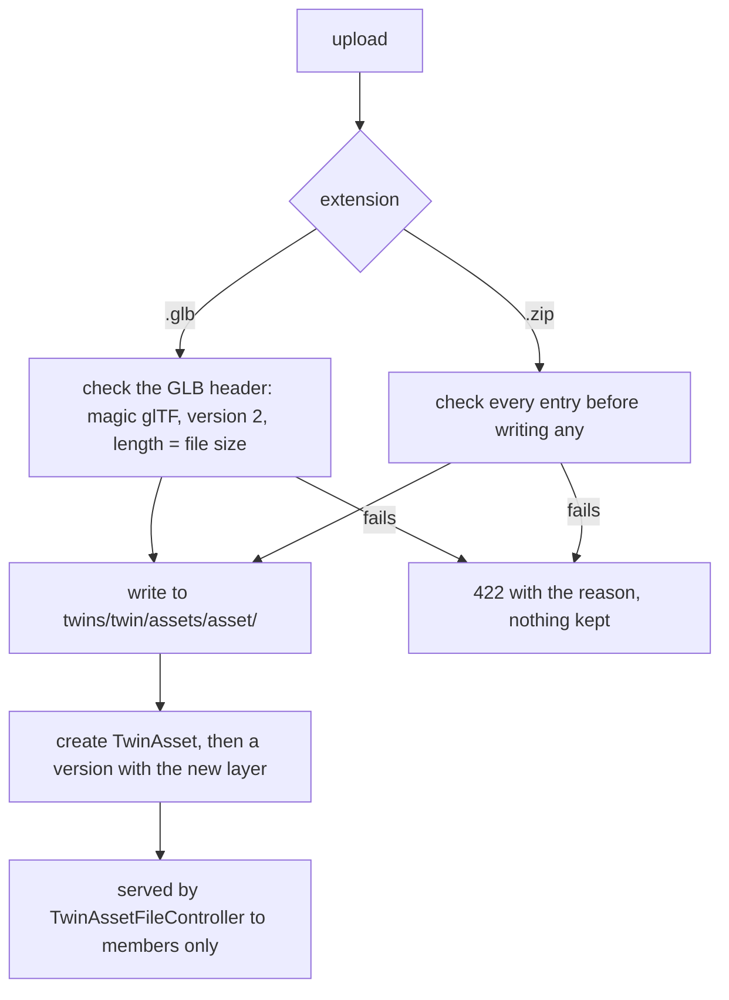
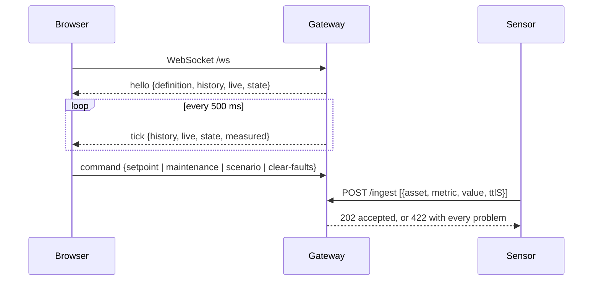

# Meridian

A digital twin platform: a [CesiumJS](https://cesium.com/platform/cesiumjs/) viewer and physics model, plus a Laravel control plane for organisations, projects, versioned twins, and a shared library of uploaded models and 3D Tiles.

A twin is a JSON definition. Meridian turns it into a running physical model, a 3D scene on a real globe, an asset tree, alerting, time travel and what-if forecasts. Teams keep their twins in the control plane: every edit is a version, uploads are checked and served privately, and roles decide who can change a twin and who can only operate or watch it.


The sample twin, **Northshore Cold Chain Hub**, is a fictional refrigerated logistics campus in Brisbane. It has two cold stores, three chillers, rooftop and canopy solar, a battery, a diesel generator, electric trucks, yard AGVs and a fire water tank described as a custom asset type. A second sample, **Harbour Depot** in Auckland, is a one-store, grid-only site, there to show that nothing in the platform is specific to the first twin.

## What it does

|                                    |                                                                                                                                                                                                                                                                                                                           |
| ---------------------------------- | ------------------------------------------------------------------------------------------------------------------------------------------------------------------------------------------------------------------------------------------------------------------------------------------------------------------------- |
| **Organisations and roles**        | Every project and twin belongs to an organisation. Owners and admins edit twins and manage members, operators send commands, viewers watch. People can belong to several organisations and switch between them.                                                                                                           |
| **Versioned twins**                | Each save appends an immutable version: a layout change, an upload, a replaced definition or a restore. Any version can be downloaded as JSON or restored as a new one.                                                                                                                                                   |
| **Projects and uploads**           | Projects group twins with a library of models (`.glb`) and zipped 3D Tiles tilesets that any of their twins can show, so one scan serves several twins. Archives are checked entry by entry before anything is written, and files are served only to members of the organisation.                                         |
| **Placement**                      | Models and local-coordinate tilesets are placed in metres east, north and up from the twin's origin, with heading and scale. Edits preview live in the scene, and **Place on map** moves a layer to wherever you click on the ground.                                                                                     |
| **Custom asset types**             | Equipment the simulator has no physics for, described as data: metrics with units and defaults, a primary metric, a colour and a shape. Readings come from ingest, and rules can alert on them like any other metric.                                                                                                     |
| **Live physics**                   | A microgrid power balance (solar, battery dispatch with peak shaving, grid, generator start delay, load shedding by priority) feeding a refrigeration plant (chiller capacity and COP that derate with ambient air, store thermal mass, door losses, stock spoilage). Vehicles drive their routes and queue for chargers. |
| **3D scene**                       | The twin opens with a flight down from orbit, and **Globe** pulls back to the whole Earth, lit for the simulated time of day. Assets are extruded from their footprints. Energy and cooling flows animate along arcs, scaled by kW. Alerts raise a beacon over the asset. You can colour by status, temperature or power. |
| **Alerting, time travel, what-if** | Threshold rules with hold times and hysteresis. A 24-hour history to scrub through. Forecasts that fork the current state and run it ahead with and without an event, then apply the event live if you choose.                                                                                                            |
| **Gateway**                        | A Node service that runs the model, streams it over WebSocket, and accepts readings at `POST /ingest`. A reading pins its metric and the model integrates from it, so the twin follows reality where sensors report and fills the gaps where they don't.                                                                  |


_The layout editor on Harbour Depot: an uploaded `.glb` placed 38 m west and 30 m south of the origin, turned 30° and doubled in size. The scene follows the numbers as you type; **Save layout** writes them as a new version._






_What-if: if the refrigeration board trips now, the freezer passes its limit in under four hours. The forecast lists every alert that would follow, with cost, diesel, unserved load and stock at risk compared side by side._


_The same event applied live, coloured by temperature: a red beacon over the tripped board, de-energised chillers, both stores warming, and the alerts stacking up on the timeline._

## Quick start

Needs PHP 8.5 (with `zip`), Composer, and Node 22 or later.

```bash
composer install
cp .env.example .env && php artisan key:generate
touch database/database.sqlite && php artisan migrate --seed
npm install                  # also copies Cesium's static assets to public/vendor/cesium
composer run dev             # Laravel and Vite (Vite on port 5199)
```

Log in at the app URL as `test@example.com` with password `password`. The seed creates **Northshore Logistics** with both sample twins, plus `operator@example.com` and `viewer@example.com` (same password) to try the other roles. The sample twins also run without an account at `/demo`.

To try uploads, use `public/samples/models/pump-skid.glb` as a model, and zip `public/tilesets/context/` for a tileset:

```bash
(cd public/tilesets/context && zip -q ../../../context.zip tileset.json context.glb)
```

### The gateway

```bash
npm run gateway              # http://127.0.0.1:8787, socket at /ws
# then open /demo?gateway=ws://127.0.0.1:8787/ws
```

Send it a reading, and watch the freezer turn red and the chillers respond:

```bash
curl -X POST http://127.0.0.1:8787/ingest \
  -H 'content-type: application/json' \
  -d '{"asset":"freezer","metric":"tempC","value":-11.5,"ttlS":900}'
```

Custom types take readings the same way, for example `{"asset":"fire-tank","metric":"levelPct","value":48}` raises the _Fire water low_ alert.

### Scripts

| Command                       |                                                                                                                                          |
| ----------------------------- | ---------------------------------------------------------------------------------------------------------------------------------------- |
| `composer run dev`            | Laravel, queue, logs and Vite together                                                                                                   |
| `composer test`               | Everything CI runs: Pint, Rector, the formatter and linter, PHPStan, `tsc`, 100% type coverage, Pest with 100% code coverage, and Vitest |
| `npm run test:twin`           | Vitest only: physics, rules, history, forecasting, validation, gateway                                                                   |
| `npm run test:e2e`            | Playwright in real Chrome with software WebGL (needs `npm run build` first)                                                              |
| `npm run gateway [twin.json]` | The gateway, serving `public/samples/northshore.json` unless you name another                                                            |
| `npm run generate:context`    | Rebuilds the sample 3D Tiles tileset                                                                                                     |
| `npm run generate:model`      | Rebuilds the sample pump skid model                                                                                                      |
| `npm run screenshots`         | Regenerates `docs/images` (see the script for the server it expects)                                                                     |

## Architecture



The TypeScript in `resources/js/twin/core` has no browser or Cesium dependencies, so the same model runs in the viewer and in the Node gateway. The viewer only sees the `TwinSource` interface, so an in-browser simulator and a remote feed are interchangeable.

The control plane follows [Nuno Maduro's strict starter kit](https://github.com/nunomaduro/laravel-starter-kit-inertia-react): business logic in single-purpose `app/Actions` classes, thin controllers that authorise and delegate, policies for every twin and organisation decision, PHPStan at max, and 100% code and type coverage.

React doesn't render the scene. `TwinScene` is a plain class that owns the Cesium viewer and subscribes to the store directly, so a 4 Hz frame stream never becomes component re-renders. Building bodies are instances in a single Cesium `Primitive`, and a colour change writes straight to that instance's attribute.

### One definition, two validators

The browser validates a definition before running it, and the server validates it before saving it. The two must agree, or the control plane could accept a twin the viewer refuses. So `app/Support/TwinDefinitionValidator.php` mirrors `resources/js/twin/core/validate.ts` message for message, and both are tested against the same cases in `tests/fixtures/definition-cases.json`:

```text
for each case in definition-cases.json:
    definition ← copy of the base sample, with the case's set / unset / push edits
    expect validateDefinition(definition)        == case.errors     # Vitest
    expect TwinDefinitionValidator→errors(def)   == case.errors     # Pest
```

Every message, and the order they come in, is part of the contract. A change to one validator fails the other's tests until both match.

### Saving a version



Versions are never edited. Adding or removing a library upload, replacing the definition and restoring an old version all go through `SaveTwinVersion`, so the history is the complete record of what the twin looked like and who changed it.

### Uploads



A tileset zip comes from someone else, so `ExtractTilesetArchive` trusts nothing in it:

```text
for each entry in the zip:
    skip directories, __MACOSX/ and .DS_Store
    refuse if the path is absolute, has a drive letter, a backslash, a NUL,
        or an empty, "." or ".." segment                     # zip slip
    refuse if the entry is a Unix symlink
    refuse if the extension isn't a tile format (json, b3dm, i3dm, pnts, cmpt,
        glb, gltf, bin, subtree, png, jpg, webp, ktx2)
    refuse once the file count or the declared size passes the limits

root ← "tileset.json" at the top, or inside the zip's single top-level folder
refuse unless root parses as JSON with "asset" and "root"

for each entry:
    stream it to the disk, counting real bytes, and stop at the size budget
        # the zip's own size headers can lie; the stream can't

on any failure: delete everything written so far
```

Uploads go into the project's library (`project_assets`), and adding one to a twin saves a version with a layer pointing at it. Removing a layer leaves the upload in the library; deleting it from the library takes it out of every twin in the project first. Files are served from `assets/{asset}/files/{path}` after `ProjectPolicy::view` on the upload's project. The URL names neither twin nor project, so layers keep working as twins change. Each response has a fixed content type per extension, `X-Content-Type-Options: nosniff` and `Content-Security-Policy: default-src 'none'; sandbox`, so an uploaded file can never run as a page. The path is checked for `.` and `..` segments too.

### Roles

|                                                                     | Owner | Admin | Operator | Viewer |
| ------------------------------------------------------------------- | :---: | :---: | :------: | :----: |
| See projects and twins, and stream them                             |   ✓   |   ✓   |    ✓     |   ✓    |
| Send commands (setpoints, maintenance, scenarios)                   |   ✓   |   ✓   |    ✓     |        |
| Create projects and twins, upload, place, save and restore versions |   ✓   |   ✓   |          |        |
| Add members and change roles                                        |   ✓   |   ✓   |          |        |

An organisation always keeps at least one owner: demoting or removing the last one is refused. A viewer's controls are disabled in the inspector, and the store drops their commands too.

### The model, per 5-second step

```text
weather    ← daily sine + slow smooth noise + heatwave fault
demand     ← each store's PI-style call on its chillers, from last step's temperature
desired    ← what every consumer would draw if energised
supply     ← solar (irradiance), grid (unless outage), battery (unless locked out),
             generator (once the grid has been gone for startDelayS)

energised  ← walk the feed tree from the main bus, skipping tripped breakers
while desired load > supply:
    shed the next consumer by shedPriority          # admin before refrigeration
if still short: black out

dispatch   ← solar first; battery peak-shaves in the peak tariff window;
             grid or generator covers the rest; surplus charges battery, then exports
             (or is curtailed when islanded)
plant      ← cooling = demand × capacity(ambient); power = cooling / COP(ambient, wear)
stores     ← T += (envelope + door + internal − cooling) × dt / thermal mass
             excursion minutes past the limit put stock at risk after a grace period
custom     ← unchanged: their metrics hold until ingest supplies a reading
roll-up    ← site load, cost by tariff, CO₂, unserved energy
```

Everything the model remembers lives in one flat `values` map of `asset.metric` keys. Noise is a pure function of `(seed, step, channel)`. Together these make the state a plain JSON object that can be cloned, sent over a socket or forked, and a fork with no new faults reproduces the original run exactly. That's what makes the what-if comparison fair: both futures share the same weather and the same noise, so every difference comes from the event.

### Gateway protocol



The gateway binds to `127.0.0.1` by default, and browser sockets are accepted only from localhost origins. To expose it:

| Variable          |                                                                  |
| ----------------- | ---------------------------------------------------------------- |
| `GATEWAY_PORT`    | Port, default `8787`                                             |
| `GATEWAY_HOST`    | Bind address, default `127.0.0.1`                                |
| `GATEWAY_TOKEN`   | If set, `POST /ingest` needs `Authorization: Bearer <token>`     |
| `GATEWAY_ORIGINS` | Comma-separated extra browser origins allowed to open the socket |

### Running a twin from the control plane

Instead of a JSON file, a gateway can serve a twin saved in the control plane. Open the twin's **Layout** panel, choose **Issue token**, and run the command it shows (the token is shown once; only its hash is stored):

```bash
MERIDIAN_URL=http://localhost:8000 MERIDIAN_GATEWAY_TOKEN=mgw_… npm run gateway
```

The gateway fetches the twin's latest version from `GET /api/gateway/definition`, polls it every few seconds (answered `304` while nothing changed), and restarts the model on each new version. Every poll is also a check-in that reports where browsers can reach it. While it has checked in within the last 30 seconds, the twin page offers a **Simulator / Live** switch and follows the gateway.

Browsers get in with a ticket the control plane signs for each page view. The HMAC key is the token's SHA-256, which both sides can compute without the control plane holding the token. The ticket names the twin, the user and whether they may operate, so a viewer's socket can watch but not send commands. The same token authorises `POST /ingest`. Rotating or revoking the token cuts the gateway off.

| Variable                 |                                                                     |
| ------------------------ | ------------------------------------------------------------------- |
| `MERIDIAN_URL`           | The control plane, e.g. `http://localhost:8000`                     |
| `MERIDIAN_GATEWAY_TOKEN` | The twin's gateway token                                            |
| `GATEWAY_PUBLIC_URL`     | Where browsers reach the socket, default `ws://127.0.0.1:<port>/ws` |
| `GATEWAY_POLL_MS`        | How often to poll for new versions, default `5000`                  |

## Writing a twin

Positions are in metres east and north of `origin`. The [Northshore definition](public/samples/northshore.json) uses every feature, and [Harbour Depot](public/samples/harbour-depot.json) is close to the minimum. The smallest twin that runs is what **New twin → An empty site at a location** creates (`app/Support/BlankTwin.php`, pinned in [tests/fixtures/blank-twin.json](tests/fixtures/blank-twin.json)): a site, weather, a grid connection and the one main bus every twin needs.

```jsonc
{
  "id": "harbour-depot",
  "name": "Harbour Depot",
  "origin": { "lon": 174.7855, "lat": -36.8395 },
  "utcOffsetHours": 12,
  "climate": { "meanC": 17, "swingC": 4 },
  "camera": { "headingDeg": 340, "pitchDeg": -35, "rangeM": 220 },
  "tariff": { "offPeakPerKwh": 0.16, "peakPerKwh": 0.34, "peakStartHour": 17, "peakEndHour": 21, ... },
  "zones": [{ "id": "yard", "name": "Depot yard", "footprint": [[-60,-45],[60,-45],[60,45],[-60,45]] }],
  "assets": [
    { "id": "board", "kind": "bus", "footprint": [...], "height": 4 },          // the main bus: no fedBy
    { "id": "plant", "kind": "chiller", "fedBy": "board", "cools": ["store"],
      "params": { "capacityKw": 70, "copNominal": 3.1 } },
    { "id": "store", "kind": "coldstore", "params": { "setpointC": 1, "limitC": 5, "massKwhPerK": 42, ... } }
  ],
  "rules": [
    { "id": "warm", "kind": "coldstore", "metric": "excursionMin", "op": "gt", "threshold": 0.5,
      "severity": "critical", "message": "{asset} is above its temperature limit" }
  ],
  "scenarios": [
    { "id": "trip", "name": "Chiller trips", "faults": [{ "type": "trip", "target": "plant" }] }
  ]
}
```

**Asset kinds:** `site`, `weather`, `grid`, `solar`, `battery`, `genset`, `bus`, `chiller`, `coldstore`, `building`, `charger`, `vehicle` and `custom`. The metrics each built-in kind reports are in [`metrics.ts`](resources/js/twin/core/metrics.ts).

**Fault types for scenarios:** `grid-outage`, `trip` (any asset with a target), `door-stuck`, `heatwave`, `bearing-wear`, `genset-fail` and `cloud-cover`. Each can have an `offsetS` and a `durationS`.

### Custom asset types

```jsonc
"types": [{
  "id": "water-tank", "name": "Fire water tank", "primary": "levelPct",
  "metrics": [
    { "key": "levelPct", "label": "Level", "unit": "%", "decimals": 0, "default": 92 },
    { "key": "pressureKpa", "label": "Ring main pressure", "unit": "kPa", "default": 710 }
  ],
  "visual": { "color": "#3a7ca5", "shape": "cylinder", "height": 9 }
}],
"assets": [
  { "id": "fire-tank", "name": "Fire water tank", "kind": "custom", "type": "water-tank",
    "zone": "plant", "position": [134, 70] }
]
```

Type ids are lowercase with `-` or `_`. Metric keys are camelCase like the built-in ones, and `state` is reserved. A custom asset is drawn as its type's shape and colour while it runs, lists its type's metrics in the inspector, and accepts readings for them at `/ingest`.


### Models and tilesets

```jsonc
"models": [{
  "id": "skid", "name": "Pump skid", "url": "/twins/.../files/model.glb",
  "placement": { "east": -38, "north": -30, "up": 0, "headingDeg": 30, "scale": 2 }
}],
"tilesets": [
  { "id": "context", "name": "Neighbouring buildings", "url": "/tilesets/context/tileset.json" },
  { "id": "scan", "name": "Laser scan", "url": "...", "placement": { ... } }
]
```

A model always has a placement. A tileset without one keeps its own georeference, which is right for most exports (photogrammetry, BIM, point clouds converted with py3dtiles). Give it a placement when it was built in local metres. The control plane writes these entries for you when you upload, with `assetId` linking each one back to its files.

The validator reports every problem at once: unknown kinds, zones and types, dangling `fedBy` and `cools` references, feed cycles, a missing main bus, stops off a route, rules without a target, scenarios aimed at assets that don't exist, malformed types, and layers with no URL or a bad placement.


_Globe view: the site in context, with day and night shading from the simulated clock._

## More views


_The inspector: live readings with six-hour history, what the asset feeds and is fed by, and the commands it accepts._


_Coloured by power after dark: solar has gone quiet, and the battery and grid carry the plant._

## Configuration

| Variable                                       |                                                                                                                        |
| ---------------------------------------------- | ---------------------------------------------------------------------------------------------------------------------- |
| `MERIDIAN_ASSETS_DISK`                         | Filesystem disk for uploads, default `local` (`storage/app/private`). Use `s3` with RustFS or any S3-compatible store. |
| `MERIDIAN_MAX_UPLOAD_KB`                       | Largest upload, default 512 MB. PHP's `upload_max_filesize` and `post_max_size` must allow it too.                     |
| `MERIDIAN_TILESET_MAX_FILES`                   | Most files in a tileset zip, default 20,000                                                                            |
| `MERIDIAN_TILESET_MAX_BYTES`                   | Largest unpacked tileset, default 4 GB                                                                                 |
| `VITE_BASEMAP_URL`, `VITE_BASEMAP_ATTRIBUTION` | A custom `{z}/{x}/{y}` tile provider and the attribution it requires                                                   |

The default basemap is Natural Earth imagery bundled with Cesium. It makes no third-party requests and works offline. You can switch to OpenStreetMap tiles in the Basemap menu, whose [tile usage policy](https://operations.osmfoundation.org/policies/tiles/) suits development rather than production traffic. Meridian doesn't use Cesium ion, so it needs no access token.

## Tests

- **Pest (100% code and type coverage):** every action, policy, model, rule and controller. Roles at each level, outsiders kept out, the last owner kept. Versions number up and restore as new versions. Projects and their libraries: twins created only in the organisation's own projects, uploads added to and removed from twins as versions, and deletions reaching every twin that shows them. Uploads: GLB header checks, tileset extraction, zip slip, symlinks, foreign file types, file count and size limits (including a zip that lies about its sizes), cleanup when anything fails, and file serving headers. The shared definition fixtures. Browser tests for the kit's account pages.
- **Vitest:** power is conserved every step, including while islanded. Stores hold setpoint for a full day. Outages bridge on battery, start the generator and return to grid. Load sheds by priority. Runs are deterministic, and survive cloning and a JSON round trip. The forecast's baseline matches a straight run exactly. Rule hold times and hysteresis. The gateway's socket, commands, ingest, tokens, body limits and origins. The shared definition fixtures.
- **Playwright (real Chrome and WebGL):** an owner logs in, uploads a model, places it, saves, uploads a tileset, reloads and finds both still there. An upload made on the project page is added to a twin and taken out again, staying in the library. A bad archive is refused with its reason. A viewer can watch but not edit or operate. On `/demo`: no errors and no third-party requests, canvas picking, commands, forecasts and their cascade, time travel, the globe view, the second twin, bad files, the gateway path including a real `POST /ingest`, and phone width.

## Project layout

```text
app/Actions/              business logic: organisations, members, projects, libraries, twins, versions
app/Http/Controllers/     thin, authorising controllers
app/Policies/             ProjectPolicy, TwinPolicy, OrganisationPolicy
app/Support/              TwinDefinitionValidator (mirrors validate.ts), SampleTwins
resources/js/pages/       Inertia pages: twins, members, demo, and the kit's account pages
resources/js/components/  twin-editor (layout, uploads, library, history), organisation-switcher
resources/js/twin/core/   model, rules, history, forecast, validation, protocol (no DOM)
resources/js/twin/scene/  TwinScene, the Cesium side
resources/js/twin/ui/     the viewer's React panels and charts
gateway/                  the Node gateway
public/samples/           sample twins and the sample model
tests/fixtures/           definition cases shared by Pest and Vitest
tests/e2e/                Playwright specs
```

## Roadmap

Meridian is meant to be a tool teams run for their own sites: bring in scans, models and live data, organise them by project, and build twins from them, all managed from the control plane. The microgrid and cold chain physics stay as a reference domain, and each milestone moves more of what is fixed in code into data people control.

1. **Control plane and gateway** (done): organisations and roles, versioned twins, uploads, placement, custom types, Docker Compose with Postgres and RustFS, and gateways that load their twin from the control plane, follow new versions and admit browsers with signed tickets.
2. **Projects and a data library:** organisations hold projects, and projects hold twins and a shared library of uploads (models, tilesets, later point clouds), so one scan can be placed into several twins. New twins start as an empty site at a chosen location (weather, a grid connection and a main board), a sample, or a definition file. Still to come: large files uploaded straight to object storage in parts rather than through PHP.
3. **Point cloud pipeline:** LAS, LAZ and E57 uploaded to the library and converted to 3D Tiles by a queued worker (PDAL to reproject, filter and thin; py3dtiles to tile), with progress, logs and retries in the UI, then placed into a twin like any tileset.
4. **IoT: devices, MQTT and history:** devices registered per project with their own tokens, an MQTT bridge with topic and tag mapping onto any asset's metrics, gateways managed from the control plane, and TimescaleDB for long-term readings and charts beyond the live window.
5. **Customisation core:** behaviour for custom types as data (derived metrics written as safe expressions, simple state machines, setpoints), KPIs and panels declared in the definition instead of built in, expression and rate-of-change rules, and a type library per organisation.
6. **Definition editor:** edit zones, assets, types, rules and scenarios in the app, with forms generated from one JSON Schema that also replaces the two hand-kept validators.
7. **Scene editing and BIM:** drawing footprints and routes in the scene, IFC import, binding tileset features to assets.
8. **OPC UA and actuation:** read from OPC UA servers, and write back through the custom setpoints, off by default and audited.
