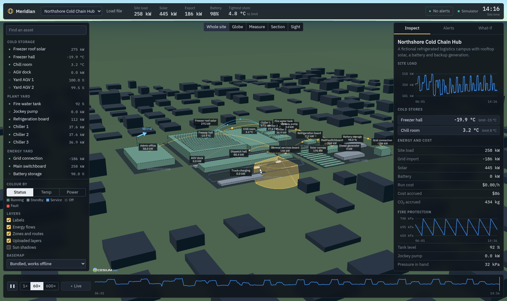
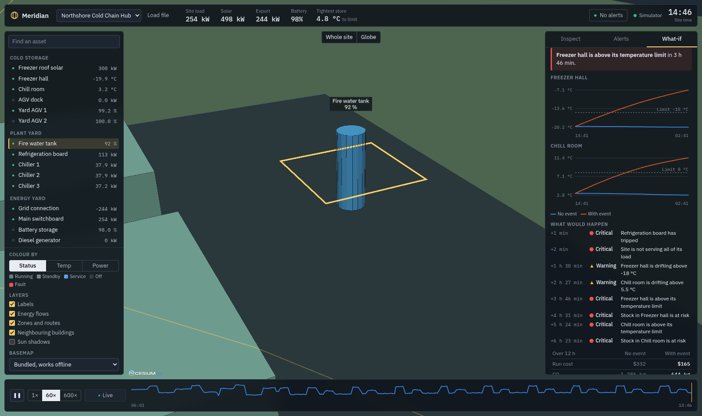
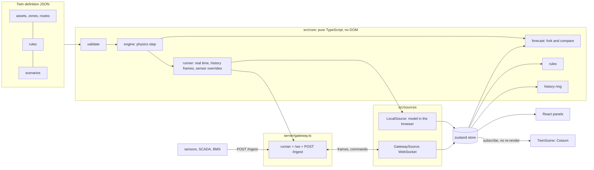
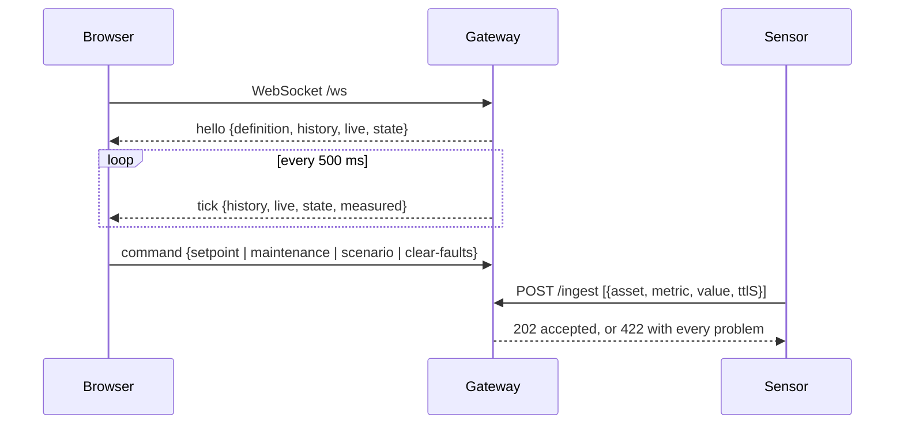
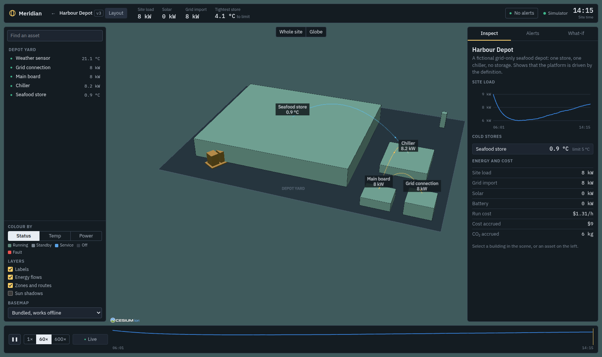
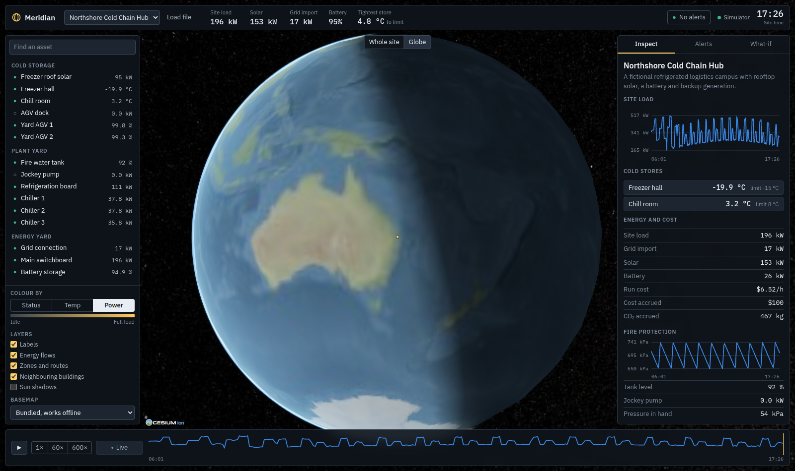
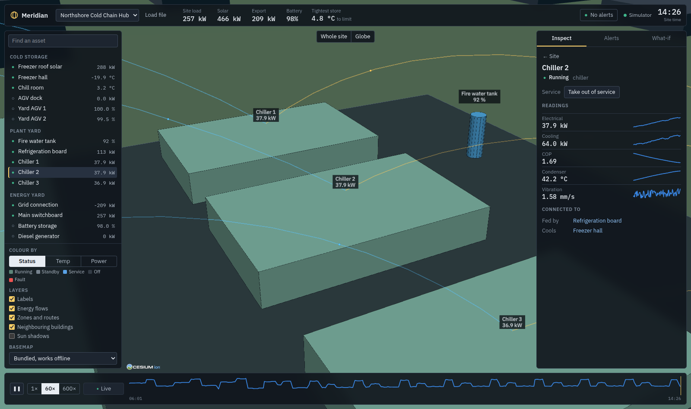
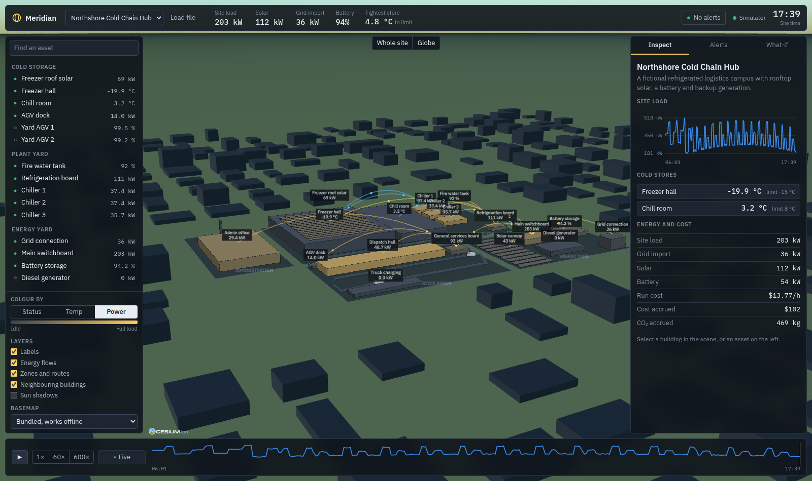

# Meridian

A digital twin platform built with React, Vite and [CesiumJS](https://cesium.com/platform/cesiumjs/).

A twin is a JSON file. Meridian turns it into a running physical model, a 3D scene on a real globe, an asset tree, alerting, time travel and what-if forecasts. The model runs in the browser with no server. You can also point the UI at a gateway that streams the twin to any number of browsers and accepts real sensor readings.



The sample twin, **Northshore Cold Chain Hub**, is a fictional refrigerated logistics campus in Brisbane. It has two cold stores, three chillers, rooftop and canopy solar, a battery, a diesel generator, electric trucks and yard AGVs. A second sample, **Harbour Depot** in Auckland, is a one-store, grid-only site, there to show that nothing in the platform is specific to the first twin.

## What it does

| | |
|---|---|
| **Live physics** | A microgrid power balance (solar, battery dispatch with peak shaving, grid, generator start delay, load shedding by priority) feeding a refrigeration plant (chiller capacity and COP that derate with ambient air, store thermal mass, door losses, stock spoilage). Vehicles drive their routes and queue for chargers. |
| **3D scene** | The twin opens with a flight down from orbit, and **Globe** pulls back to the whole Earth, lit for the simulated time of day. Every asset is extruded from its footprint in metres on that globe. Energy and cooling flows animate along arcs, scaled by kW. Alerts raise a beacon over the asset. You can colour by status, temperature (diverging around setpoint) or power. Lighting follows the site's sun. A real 3D Tiles 1.1 tileset adds the neighbouring buildings. |
| **Asset tree and inspector** | Live readings with six-hour sparklines, upstream and downstream connections, and commands: setpoints, taking a chiller out of service. |
| **Alerting** | Threshold rules with hold times and hysteresis, defined in the twin file. They run in the client on any feed, simulated or real. |
| **Time travel** | A 24-hour history at one frame per simulated minute. Scrub the timeline and the whole scene, every panel and the alert list show that moment. |
| **What-if** | Forks the current state and runs the model ahead twice, with and without an event. Shows what would happen and when, then applies it to the live twin if you choose. |
| **Gateway** | A Node service that runs the model, streams it over WebSocket, and accepts readings at `POST /ingest`. A reading pins its metric, and the model integrates from it, so the twin follows reality where sensors report and fills the gaps where they don't. |



*What-if: if the refrigeration board trips now, the freezer passes its limit in under four hours. The forecast lists every alert that would follow, with cost, diesel, unserved load and stock at risk compared side by side.*


*The same event applied live, coloured by temperature: a red beacon over the tripped board, de-energised chillers, both stores warming, and the alerts stacking up on the timeline.*

## Quick start

```bash
npm install
npm run dev              # http://localhost:5173
```

The page runs the Northshore twin in the browser. Add `?twin=harbour-depot` for the other sample, or use **Load file** to open your own definition.

To run against the gateway instead:

```bash
npm run gateway          # http://127.0.0.1:8787, socket at /ws
# then open http://localhost:5173/?gateway=ws://127.0.0.1:8787/ws
```

Send it a reading, and watch the freezer turn red and the chillers respond:

```bash
curl -X POST http://127.0.0.1:8787/ingest \
  -H 'content-type: application/json' \
  -d '{"asset":"freezer","metric":"tempC","value":-11.5,"ttlS":900}'
```

### Scripts

| Command | |
|---|---|
| `npm run dev` | Vite dev server |
| `npm run build` | Typecheck, then a production build in `dist/` |
| `npm test` | Unit and integration tests (Vitest): physics, rules, history, forecasting, validation, gateway |
| `npm run test:e2e` | Browser tests (Playwright) in real Chrome with software WebGL, so they need no GPU |
| `npm run gateway [twin.json]` | The gateway, serving `public/twins/northshore.json` unless you name another |
| `npm run generate:context` | Rebuilds the sample 3D Tiles tileset |
| `npm run screenshots` | Regenerates `docs/images` (expects `npm run dev` running) |

## Architecture



`src/core` has no browser or Cesium dependencies, so the same model runs in the browser and in Node. The UI only sees the `TwinSource` interface, which means an in-browser simulator and a remote feed are interchangeable. Rules run on whatever frames arrive.

React doesn't render the scene. `TwinScene` is a plain class that owns the Cesium viewer and subscribes to the store directly, so a 4 Hz frame stream never becomes component re-renders. Building bodies are instances in a single Cesium `Primitive`, and a colour change writes straight to that instance's attribute. Doing this through entities would rebuild the geometry in a web worker on every change, and at this update rate the rebuild never catches up.

### The model, per 5-second step

```text
weather    ← daily sine + slow smooth noise + heatwave fault
demand     ← each store's PI-style call on its chillers, from last step's temperature
desired    ← what every consumer would draw if energised
supply     ← solar (irradiance), grid (unless outage), battery (unless locked out),
             generator (once the grid has been gone for startDelayS)

energised  ← walk the feed tree from the main bus, skipping tripped breakers
while desired load > supply:
    shed the next consumer by shedPriority          # admin before refrigeration
if still short: black out

dispatch   ← solar first; battery peak-shaves in the peak tariff window;
             grid or generator covers the rest; surplus charges battery, then exports
             (or is curtailed when islanded)
plant      ← cooling = demand × capacity(ambient); power = cooling / COP(ambient, wear)
stores     ← T += (envelope + door + internal − cooling) × dt / thermal mass
             excursion minutes past the limit put stock at risk after a grace period
roll-up    ← site load, cost by tariff, CO₂, unserved energy
```

Everything the model remembers lives in one flat `values` map of `asset.metric` keys. Noise is a pure function of `(seed, step, channel)`. Together these make the state a plain JSON object that can be cloned, sent over a socket or forked, and a fork with no new faults reproduces the original run exactly. That's what makes the what-if comparison fair: both futures share the same weather and the same noise, so every difference comes from the event.

### Gateway protocol



The gateway binds to `127.0.0.1` by default. Browser sockets are accepted only from localhost origins. To expose it, set these:

| Variable | |
|---|---|
| `GATEWAY_PORT` | Port, default `8787` |
| `GATEWAY_HOST` | Bind address, default `127.0.0.1` |
| `GATEWAY_TOKEN` | If set, `POST /ingest` needs `Authorization: Bearer <token>` |
| `GATEWAY_ORIGINS` | Comma-separated extra browser origins allowed to open the socket |

A batch of readings is validated as a whole: an unknown asset or metric, a non-finite value or a bad TTL rejects the batch with every reason listed.

## Writing a twin

Positions are in metres east and north of `origin`. The [Northshore definition](public/twins/northshore.json) uses every feature, and [Harbour Depot](public/twins/harbour-depot.json) is close to the minimum.

```jsonc
{
  "id": "harbour-depot",
  "name": "Harbour Depot",
  "origin": { "lon": 174.7855, "lat": -36.8395 },
  "utcOffsetHours": 12,
  "climate": { "meanC": 17, "swingC": 4 },
  "camera": { "headingDeg": 340, "pitchDeg": -35, "rangeM": 220 },
  "tariff": { "offPeakPerKwh": 0.16, "peakPerKwh": 0.34, "peakStartHour": 17, "peakEndHour": 21, ... },
  "zones": [{ "id": "yard", "name": "Depot yard", "footprint": [[-60,-45],[60,-45],[60,45],[-60,45]] }],
  "assets": [
    { "id": "board", "kind": "bus", "footprint": [...], "height": 4 },          // the main bus: no fedBy
    { "id": "plant", "kind": "chiller", "fedBy": "board", "cools": ["store"],
      "params": { "capacityKw": 70, "copNominal": 3.1 } },
    { "id": "store", "kind": "coldstore", "params": { "setpointC": 1, "limitC": 5, "massKwhPerK": 42, ... } }
  ],
  "rules": [
    { "id": "warm", "kind": "coldstore", "metric": "excursionMin", "op": "gt", "threshold": 0.5,
      "severity": "critical", "message": "{asset} is above its temperature limit" }
  ],
  "scenarios": [
    { "id": "trip", "name": "Chiller trips", "faults": [{ "type": "trip", "target": "plant" }] }
  ],
  "tilesets": [{ "id": "context", "name": "Neighbouring buildings", "url": "/tilesets/context/tileset.json" }]
}
```

**Asset kinds:** `site`, `weather`, `grid`, `solar`, `battery`, `genset`, `bus`, `chiller`, `coldstore`, `building`, `charger` and `vehicle`. The metrics each one reports are listed in [`src/core/metrics.ts`](src/core/metrics.ts).

**Fault types for scenarios:** `grid-outage`, `trip` (any asset with a target), `door-stuck`, `heatwave`, `bearing-wear`, `genset-fail` and `cloud-cover`. Each can have an `offsetS` and a `durationS`.

**Tilesets:** any OGC 3D Tiles URL, such as a photogrammetry capture or a BIM export. `npm run generate:context` shows how the sample tileset is made: one merged glTF mesh in an east-north-up frame at the origin.

The loader validates a definition before anything runs it, and reports every problem at once. It checks unknown kinds and zones, dangling `fedBy` and `cools` references, feed cycles, missing main bus, stops off a route, rules without a target, and scenarios aimed at assets that don't exist.





*Globe view: the site in context, with day and night shading from the simulated clock.*

## More views



*The inspector: live readings with six-hour history, what the asset feeds and is fed by, and the commands it accepts.*



*Coloured by power after dark: solar has gone quiet, and the battery and grid carry the plant.*

## Basemaps and attribution

The default basemap is Natural Earth imagery bundled with Cesium. It makes no third-party requests and works offline. You can switch to OpenStreetMap tiles in the Basemap menu. Their [tile usage policy](https://operations.osmfoundation.org/policies/tiles/) suits development, not production traffic. To use your own provider, set:

```bash
VITE_BASEMAP_URL='https://tiles.example.com/{z}/{x}/{y}.png'
VITE_BASEMAP_ATTRIBUTION='© Example, © OpenStreetMap contributors'
```

Attribution always shows on screen, not behind a link. Meridian doesn't use Cesium ion, so it needs no access token.

## Tests

- **Unit and integration (Vitest):** power is conserved every step, including while islanded. Stores hold setpoint for a full day. Outages bridge on battery, start the generator and return to grid. Load sheds by priority. An exhausted battery doesn't flicker the site. Runs are deterministic, and survive cloning and a JSON round trip. The forecast's baseline matches a straight run exactly. Bearing wear shows in vibration before efficiency drops. Rule hold times and hysteresis work as specified. The gateway handles WebSocket greeting and streaming, commands, sensor ingest with model follow-through, token checks, oversized bodies and foreign origins.
- **End to end (Playwright, real Chrome and WebGL):** loads with no errors and no third-party requests. Pause holds the model. Clicking a building on the Cesium canvas selects it. Tree search and connection navigation work. Commands reach the model. Forecast leaves the live twin untouched, applying it cascades to geometry colour, alerts and acknowledgement, and clearing recovers. Time travel works. The camera pulls back to the whole Earth and returns. The second twin runs. Bad files report every problem. The gateway path is covered end to end, including a real `POST /ingest`. The layout works at phone width.

## Project layout

```text
src/core/        model, rules, history, forecast, validation, protocol (no DOM)
src/sources/     LocalSource (in-browser) and GatewaySource (WebSocket)
src/state/       zustand store: frames, history, alerts, selection, forecasts
src/scene/       TwinScene, the Cesium side; colours shared with the UI
src/ui/          React panels and the SVG charts
server/          the gateway
scripts/         tileset generator, screenshot capture
public/twins/    twin definitions and the index the picker reads
e2e/             Playwright tests
```
