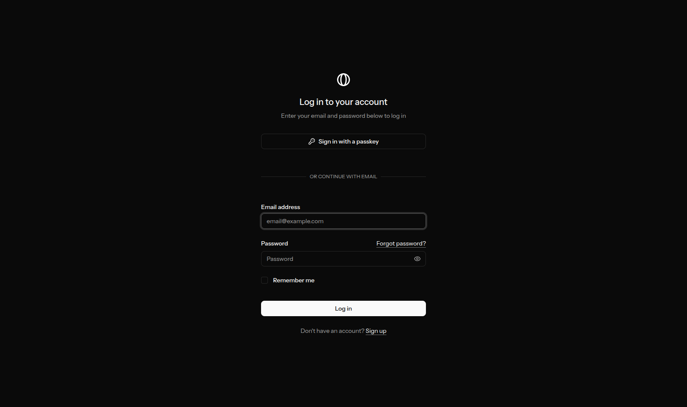
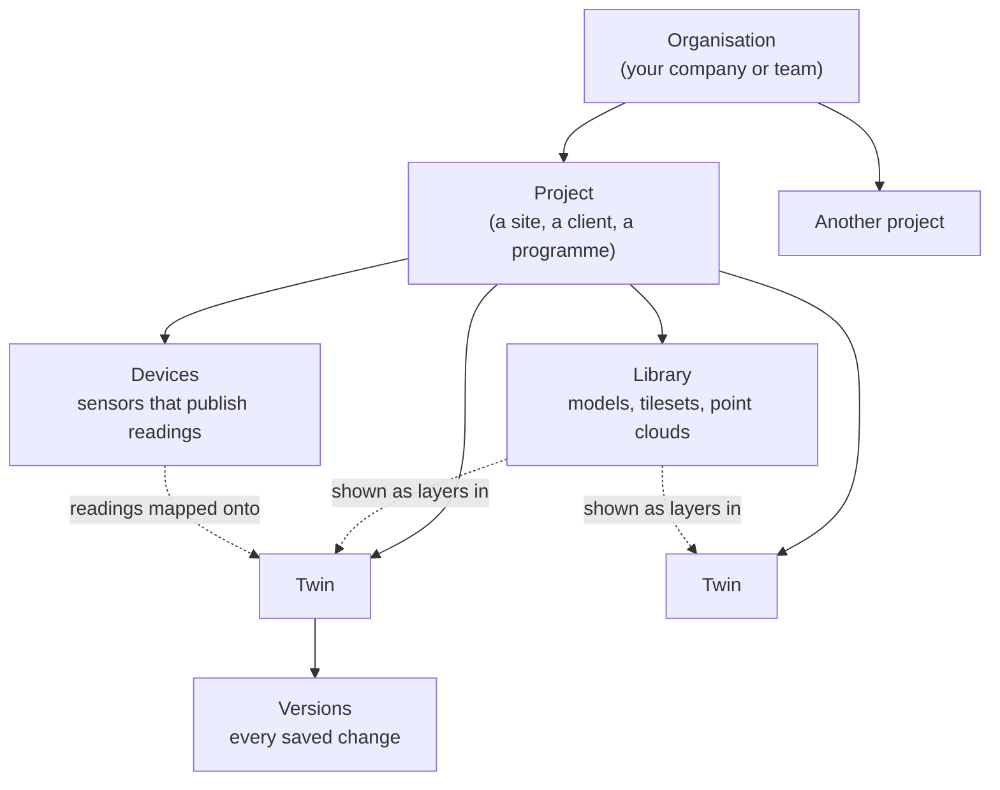
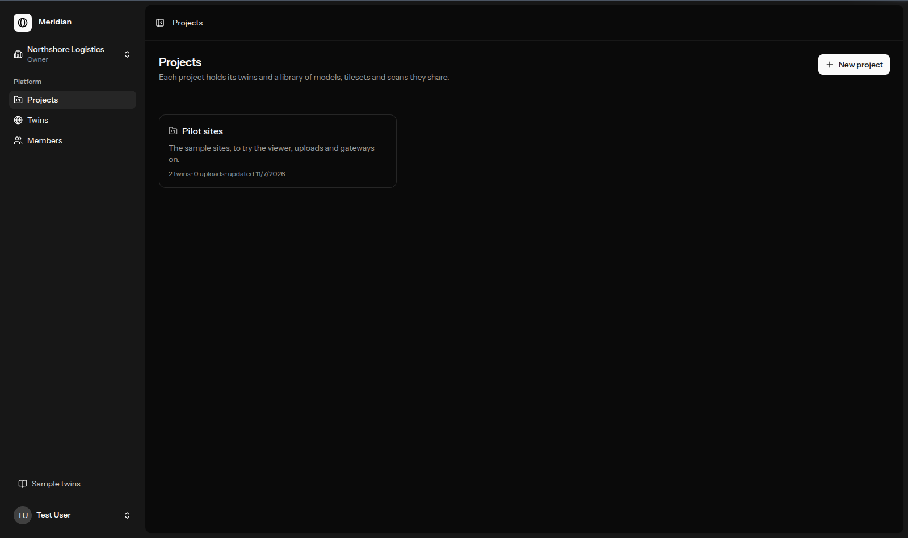
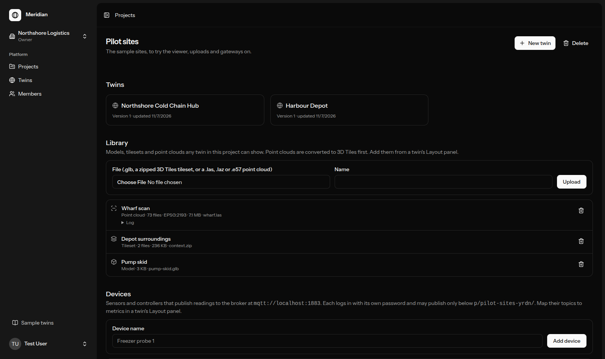
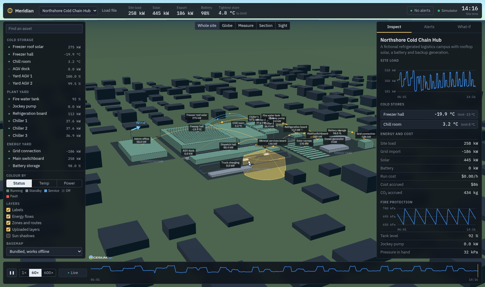

# Getting started

Meridian keeps **digital twins** of real sites: a 3D model of the place on a real globe, the equipment in it, and a running model of how that equipment behaves, fed by live sensor readings where you have them. A team keeps its twins in Meridian's web app, the **control plane**, where every change is saved as a version and roles decide who can change what.

## How it fits together

- An **organisation** is everyone who works together, and everything they share. You can belong to several and switch between them.
- A **project** groups the twins of one site or job with the files and devices they share. Upload a scan once, and every twin in the project can show it.
- A **twin** is a site: its assets (buildings, chillers, batteries, sensors…), their positions, how they connect, the rules that raise alerts, and the uploads it shows. It's stored as a [JSON definition](12-twin-definitions.md), and each change makes a new version.
- A **gateway** runs a twin as a service and feeds it real readings, from HTTP or from **devices** publishing over MQTT. Without one, the twin runs on its built-in simulator in your browser.

## Sign in

1. Open Meridian's address in your browser. On a development machine that's usually `http://localhost:8000` (or `http://localhost:8085` with Docker).
2. Enter your **Email address** and **Password**, and choose **Log in**. If you've added a passkey, choose **Sign in with a passkey** instead. With two-factor authentication on, you're asked for a code next.
3. No account yet? Choose **Sign up**. Someone in your organisation then [adds you as a member](02-organisations-and-members.md#add-a-member). Forgotten your password? Choose **Forgot password?** and follow the link in the email.

> **Trying the demo?** The seeded database has `test@example.com` (an owner), `operator@example.com` and `viewer@example.com`, all with the password `password`. The sample twins also run without an account at `/demo`.

## Find your way around

After signing in you land on **Projects**. The sidebar on the left has:

1. **The organisation switcher** (top): the organisation you're working in and your role there. Choose it to switch organisations or start a new one.
2. **Projects**: every project in the organisation. Open one to see its twins, library and devices.
3. **Twins**: every twin in the organisation, across projects.
4. **Members**: who belongs to the organisation and their roles.
5. **Sample twins** (bottom): the public demo, which needs no account.
6. **Your name** (bottom): settings, appearance and signing out.

A project page has three parts: **Twins**, the **Library** of uploads, and **Devices**. Open a twin to see it in 3D:

The twin page is covered in [Twins and the viewer](06-twins-and-the-viewer.md).

## A first walk-through

1. Open **Pilot sites**, then **Northshore Cold Chain Hub**. The camera flies down from orbit to the site.
2. Choose **Chiller 2** in the list on the left. The inspector on the right shows its readings and what it's connected to.
3. Choose **What-if** at the top of the inspector, pick **Refrigeration board trips**, and choose **Run forecast** to see what would happen. See [Alerts, time travel and what-if](07-alerts-time-and-what-if.md).
4. Back on the project page, upload a model to the **Library**, then add it to **Harbour Depot** from its **Layout** panel. See [Layout and versions](08-layout-and-versions.md).

## See also

- [Organisations and members](02-organisations-and-members.md): who can do what.
- [Twins and the viewer](06-twins-and-the-viewer.md): everything on the twin page.
- [Running Meridian](14-running-meridian.md): installing it for your team.
