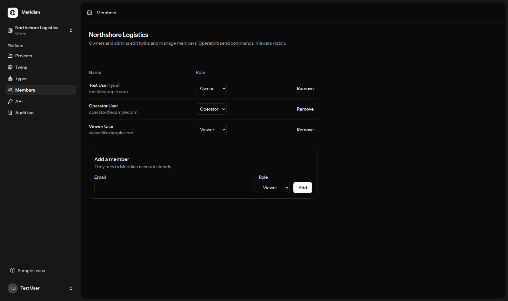
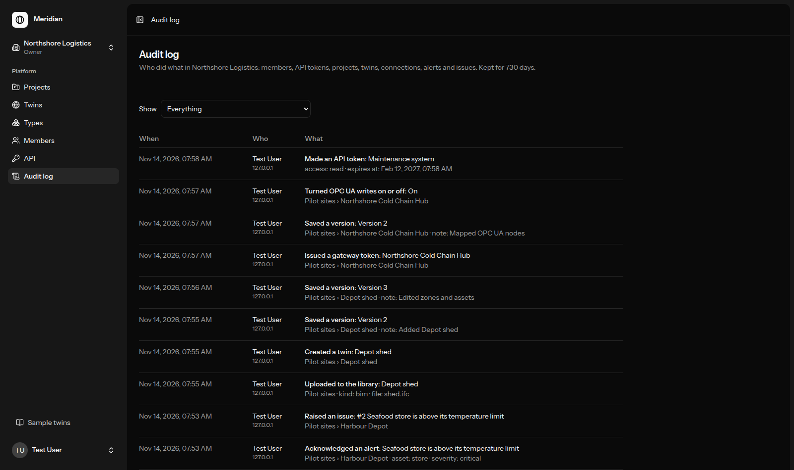
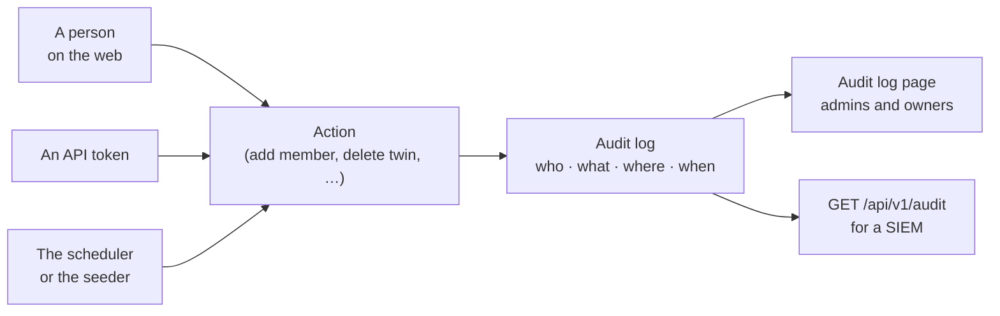

# Organisations and members

Everything in Meridian belongs to an **organisation**: its projects, twins, uploads, devices and its library of custom types. People join an organisation with a **role**, which decides what they can do in it. One person can belong to several organisations, with a different role in each.

## Roles

|                                                                                 | Owner | Admin | Operator | Viewer |
| ------------------------------------------------------------------------------- | :---: | :---: | :------: | :----: |
| See projects and twins, open them, and watch them live                          |   ✓   |   ✓   |    ✓     |   ✓    |
| Raise issues in a twin and comment on them                                      |   ✓   |   ✓   |    ✓     |   ✓    |
| Assign their own issues, and close issues assigned to them                      |   ✓   |   ✓   |    ✓     |   ✓    |
| Save views of a twin and copy links to them                                     |   ✓   |   ✓   |    ✓     |   ✓    |
| Send commands to a twin (setpoints, taking equipment out of service, scenarios) |   ✓   |   ✓   |    ✓     |        |
| Assign, close and reopen anyone's issue                                         |   ✓   |   ✓   |    ✓     |        |
| Create projects and twins, upload, place, save and restore versions             |   ✓   |   ✓   |          |        |
| Share views, and choose the view a twin opens at                                |   ✓   |   ✓   |          |        |
| Issue gateway tokens, add devices, map telemetry                                |   ✓   |   ✓   |          |        |
| Import, save and delete types in the type library                               |   ✓   |   ✓   |          |        |
| Add members and change roles                                                    |   ✓   |   ✓   |          |        |
| Make and revoke [API tokens](15-the-api.md)                                     |   ✓   |   ✓   |          |        |
| Read the [audit log](#the-audit-log)                                            |   ✓   |   ✓   |          |        |

- **Viewers** see everything but change nothing: the inspector's controls are disabled for them, and the twin ignores their commands.
- An organisation always keeps **at least one owner**. Demoting or removing the last owner is refused.
- Everything is private to the organisation: uploaded files are served only to its members, and a gateway's browsers need a pass signed for that user.

## Switch organisations

Choose the organisation's name at the top of the sidebar. The menu lists every organisation you belong to, with a tick beside the current one. Choose another to switch; the pages you see change to its projects and twins.

## Start a new organisation

1. Choose the organisation's name at the top of the sidebar, then **New organisation**.
2. Enter a **Name** and choose **Create**.

You're its owner, and Meridian switches to it straight away. It starts empty: [create a project](03-projects-and-the-library.md#create-a-project) next.

## Add a member

The person needs a Meridian account first: send them the sign-up link, or have them choose **Sign up** on the sign-in page.

1. Choose **Members** in the sidebar.
2. Under **Add a member**, enter their **Email** and choose a **Role**.
3. Choose **Add**.

They see the organisation in their switcher the next time they load a page.

## Change a role or remove someone

On **Members**, owners and admins see a role menu beside each person:

- **Change a role:** choose the new one from the menu. It applies at once.
- **Remove someone:** choose **Remove** at the end of their row and confirm. They lose access to everything in the organisation; nothing they made is deleted.

## The type library

A [custom type](12-twin-definitions.md#custom-asset-types) describes equipment Meridian has no built-in physics for: a fire water tank, a pump, a meter. The **type library** keeps an organisation's types in one place, so each is written once and used in any twin. Choose **Types** in the sidebar to see it.

Each type shows its metrics, how many states it has, and who saved it last. **Reads fire-tank** means the type's expressions read an asset called `fire-tank`, so a twin needs an asset with that id to use it. Everyone can **Download** a type as JSON.

### Import types

1. On **Types**, under **Import types**, choose a JSON file. It can hold one type, a list of them, or a whole twin definition, whose types are taken from it.
2. Choose **Import**.

Every type is checked the way a twin checks it. If any has a problem, nothing is imported and every problem is listed. A type with the same id as one already in the library replaces it.

### Use a type in a twin

In the twin's **Layout** panel, the **Types** section lists the twin's own types and the library's other ones. See [Layout and versions](08-layout-and-versions.md#types). Both ways are copies: changing or deleting a library type never changes a twin that uses it, until that twin takes the new version.

**Delete** takes a type out of the library. Twins that use it keep their copy.

## The audit log

The **audit log** keeps who did what in the organisation, so that months later you can still answer *who removed that device?* or *when did OPC UA writes get turned on, and by whom?* Owners and admins read it: choose **Audit log** in the sidebar.

Each entry gives **when** it happened, **who** did it, from which address, and **what**: the action, what it was done to, the project and twin it happened in, and details such as a role changed *from* and *to*. Choose an area under **Show** to see only that part, and **Older** and **Newer** to page through, 50 at a time.

| Area                                   | What's kept                                                                                                                       |
| -------------------------------------- | --------------------------------------------------------------------------------------------------------------------------------- |
| Members and API tokens                 | Members added, roles changed, members removed; API tokens made (with their access and expiry) and revoked                         |
| Projects, uploads and types            | Projects created and deleted; uploads added to and deleted from a library; types saved to and deleted from the type library       |
| Twins and versions                     | Twins created, renamed or described, and deleted; versions saved, with their note; the opening view changed                       |
| Gateways, devices, OPC UA and channels | Gateway tokens issued and revoked; devices added, their passwords reset, deleted; OPC UA servers added and deleted, and writes turned on or off; notification channels added and deleted |
| Alerts and issues                      | Alerts acknowledged; issues raised, assigned (to whom, and by when), closed, reopened and deleted                                  |

- **Who** is the signed-in person, an API token by its name (such as **Maintenance system (API)**), or **Meridian** when nothing was signed in, as when the scheduler or a setup script did it.
- **Names are kept as they were.** An entry still reads right after its project, twin or person has been deleted or renamed: *Deleted a twin: Harbour Depot* stays, and a rename keeps what it *was*.
- **Nothing secret is kept.** Tokens, device passwords and webhook secrets never reach the log, only that they were made or reset.
- Entries are kept for **two years**, then removed (`MERIDIAN_AUDIT_RETENTION_DAYS`, see [Running Meridian](14-running-meridian.md)). Readings and OPC UA writes have records of their own: the [recorded history](10-devices-and-mqtt.md#see-what-was-recorded) and the twin's [OPC UA writes](11-opc-ua.md#write-setpoints).
- A token can read the log too, to send it to a security system: see [The API](15-the-api.md#the-audit-log).

## Tips

- **Give people the smallest role that works.** A control room that only needs to watch and respond to alerts can be operators; people who only need to look can be viewers.
- **Keep shared equipment in the library.** Save a type from the twin where you got it right, and other twins can take it from there.
- **Check the audit log after a surprise.** If a device stops reporting or a twin looks different, the log says who last changed it and when.
- **Use separate organisations for separate clients.** Nothing is shared between organisations, so a consultant can keep each client's sites apart and switch between them.

## See also

- [Projects and the library](03-projects-and-the-library.md): what editors can upload.
- [Your account](13-your-account.md): two-factor authentication and passkeys.
