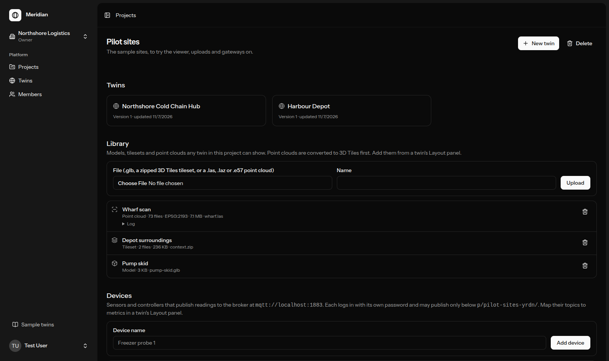
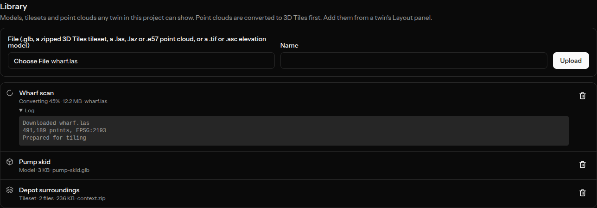
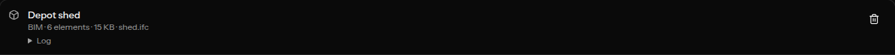

# Projects and the library

A **project** holds the twins of one site, client or programme of work, together with what they share: a **library** of uploaded files and the [devices](10-devices-and-mqtt.md) that send readings. Upload a model or a scan to the library once, and any twin in the project can show it.

## Create a project

1. Choose **Projects** in the sidebar, then **New project**.
2. Enter a **Name** and, if you like, a **Description**: a site, a client or a programme of work.
3. Choose **Create project**. You land on the new project's page.

Only editors (owners and admins) can create projects. The project page shows:

- **Twins**: each with its latest version and when it was last changed. **New twin** starts one in this project; see [Creating a twin](06-twins-and-the-viewer.md#create-a-twin).
- **Library**: uploads any of the project's twins can show.
- **Devices**: sensors and controllers allowed to publish readings; see [Devices and MQTT](10-devices-and-mqtt.md).
- **OPC UA servers**: PLCs and SCADA systems the twins' gateways read from; see [OPC UA](11-opc-ua.md).
- **Modbus devices**: meters, drives and PLCs the twins' gateways poll over Modbus TCP; see [Modbus](19-modbus.md).
- **Alert notifications**: where the twins' alerts are sent, by email, Slack, Teams or webhook; see [Who is told](07-alerts-time-and-what-if.md#who-is-told).

## What you can upload

| File                                  | Becomes                                   | Checked for                                                                                                                                                                                                           |
| ------------------------------------- | ----------------------------------------- | --------------------------------------------------------------------------------------------------------------------------------------------------------------------------------------------------------------------- |
| **`.glb`** (binary glTF)              | A **model**                               | A real glTF 2 header whose length matches the file                                                                                                                                                                    |
| **`.zip`** of a 3D Tiles tileset      | A **tileset**                             | `tileset.json` at the top or inside one top-level folder; only tile files (json, b3dm, i3dm, pnts, cmpt, glb, gltf, bin, subtree and images); no paths that escape the folder; at most 20,000 files and 4 GB unpacked |
| **`.las`**, **`.laz`** or **`.e57`**  | A **point cloud**, converted to a tileset | See [Point clouds](04-point-clouds.md)                                                                                                                                                                                |
| **`.tif`**, **`.tiff`** or **`.asc`** | **Terrain**, converted from a DEM         | See [Terrain](05-terrain.md)                                                                                                                                                                                          |
| **`.ifc`** (IFC2X3 or IFC4)           | A **BIM model**, converted to a model     | See [BIM models](#bim-models)                                                                                                                                                                                         |
| **`.geojson`**, **`.json`**, **`.kml`**, **`.kmz`**, **`.dxf`**, **`.gpkg`**, or a **`.zip`** of a shapefile | A **map layer**, drawn on the ground | See [Map layers and imagery](16-map-layers-and-imagery.md) |
| An **`.obj`**, or a **`.zip`** of a photogrammetry export | A **mesh**, converted to a tileset | See [Photogrammetry meshes](20-photogrammetry-meshes.md) |
| A **`.tif`** or **`.tiff`** orthophoto | **Imagery**, cut into map tiles           | See [Map layers and imagery](16-map-layers-and-imagery.md)                                                                                                                                                            |

- **Models** are things you place by hand: a pump skid, a container, a piece of plant from CAD. You give them a position, heading and scale in the twin.
- **Tilesets** are large or detailed scenes streamed in pieces: photogrammetry, a BIM export, a city model. A tileset usually knows where on Earth it belongs; if it was built in local metres, you can place it like a model.
- **Map layers** and **imagery** are maps of the site: boundaries, plans, survey points, orthophotos. They know where they belong and lie on the ground.
- **BIM models** are buildings from Revit, ArchiCAD or any tool that exports IFC. Meridian converts each one to a model, keeping every element (each wall, slab and pump) as a part you can pick.

## Upload to the library

1. On the project page, under **Library**, choose the file. The **Name** fills in from the file name; change it to something people will recognise.
2. For a point cloud, two more fields appear: **EPSG code** and **Thin to spacing (m)**. See [Point clouds](04-point-clouds.md). A DEM gets **EPSG code** only; see [Terrain](05-terrain.md). A `.tif` or `.zip` also asks what **It is**: terrain or imagery, a tileset or a shapefile; see [Map layers and imagery](16-map-layers-and-imagery.md).
3. Choose **Upload**. The button shows the progress.

Each item in the library shows what it is, its size and the original file name, and its state:

| State                                                                                        | Meaning                                                                                        |
| -------------------------------------------------------------------------------------------- | ---------------------------------------------------------------------------------------------- |
| **Uploading**                                                                                | The browser is still sending it (large uploads only)                                           |
| **Processing** / **Converting N%**                                                           | The server is checking or converting it. The page updates itself while anything is in progress |
| **Model**, **Tileset · N files**, **Point cloud · …**, **Terrain · …**, **BIM · N elements** | Ready. Add it to a twin from the twin's **Layout** panel                                       |
| **Failed**                                                                                   | It couldn't be used. The reason is shown underneath, and nothing half-finished is kept         |

You can also upload from a twin's **Layout** panel: the file goes into the project's library and is added to that twin in one step. See [Layout and versions](08-layout-and-versions.md).

## BIM models

An `.ifc` upload is converted on the server, like a point cloud, and shows **Converting** until it's done. Then the library shows how many elements it has and, when the file says where it is, its coordinate system.

- **Every element is kept.** Each wall, slab, door or pump with a shape becomes a part of the model, with its name, IFC class and storey. In a twin, an asset can stand for one of them; see [Bind an asset to an element](12-twin-definitions.md#bind-an-asset-to-an-element).
- **Units don't matter.** A file drawn in millimetres, feet or metres comes out in metres.
- **It knows where it goes,** if the file says. Meridian reads its map conversion (eastings and northings in a coordinate system), or failing that its site's latitude and longitude, and places it there when it's added to a twin. A model with neither, or more than 50 km from the twin, starts at the twin's origin, and you place it by hand like any model.
- **Colours come from the file:** each surface keeps the colour its material gives it.

If the conversion fails, the reason is shown, as for a point cloud. The usual causes are a file that isn't IFC, or one with no elements that have a shape.

## Large uploads

If your Meridian stores files in object storage (S3, or RustFS in the Docker stack) and direct uploads are switched on, your browser sends files straight to storage in parts. Big scans never pass through the web server, so the limit is 20 GB rather than the server's own upload limit, which is 512 MB unless your administrator changes it.

- The **Upload** button counts up as parts are sent, four at a time.
- **Cancel** stops the upload and discards what was sent.
- When the last part arrives, the item shows **Processing** while the server checks it.

Your administrator sets this up; see [Running Meridian](14-running-meridian.md#uploads-and-storage).

## Delete an upload

Choose the bin icon at the end of the item and confirm. The upload is **removed from every twin in the project** that shows it, each as a new version, and its files are deleted. Older versions that referred to it still open; the layer is just skipped.

To take an upload out of one twin but keep it in the library, remove it from that twin's **Layout** panel instead.

## Delete a project

On the project page, choose **Delete** and confirm. This deletes the project, **all of its twins with their history, and every upload in its library**. It can't be undone.

## Tips

- **Name uploads for people, not machines.** "Wharf scan, March" beats `scan_0003_final.las`.
- **One scan, many twins.** Keep a site's context (surroundings, scans) in the project library and add it to each twin that needs it, rather than uploading it again.
- **Files are private.** Uploads are served only to members of the organisation, with headers that stop a file ever running as a web page.

## See also

- [Point clouds](04-point-clouds.md): converting laser scans.
- [Layout and versions](08-layout-and-versions.md): putting uploads into a twin.
