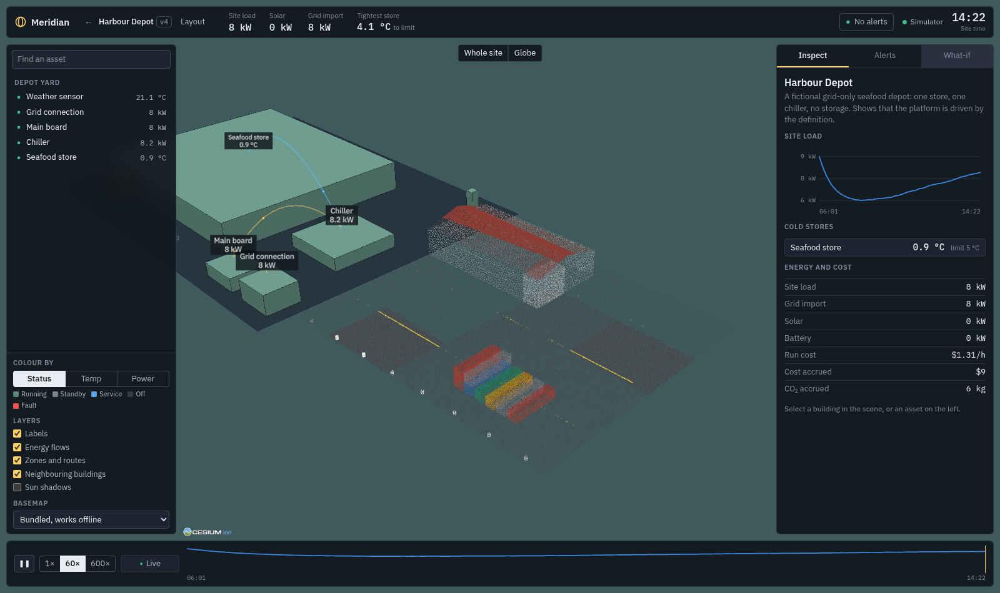
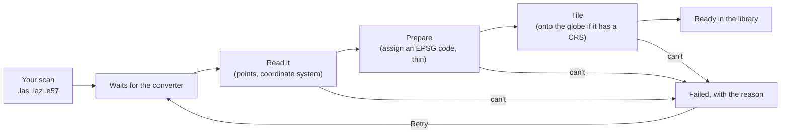
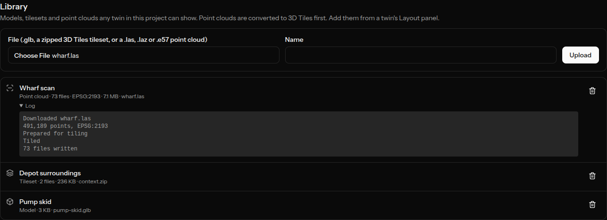

# Point clouds

Laser scans arrive as point clouds: millions of measured points, often with colour. Meridian converts LAS, LAZ and E57 scans into 3D Tiles, which stream into the viewer a piece at a time, so even a huge scan opens quickly. The conversion runs in the background; you can carry on working and watch its progress in the library.



## How it works



- The original file is kept until the conversion succeeds, so a failed conversion can be retried without uploading again.
- A scan with a **coordinate system** (most LAS and LAZ files from a surveyor carry one) is placed on the globe exactly where it was measured.
- A scan **without** one (common for E57 from terrestrial scanners) is tiled in its own metres and starts at the twin's origin. You then move it into place like a model.

## Upload a scan

1. On the project page, under **Library**, choose a `.las`, `.laz` or `.e57` file.
2. Fill in the extra fields if you need them:
    - **EPSG code**: the coordinate system the scan was measured in, such as `2193` for New Zealand Transverse Mercator or `28356` for MGA zone 56. Leave it empty to use the one in the file. Set it when the file has none, or has the wrong one.
    - **Thin to spacing (m)**: keeps one point per cube of this size, for example `0.05` for one point every 5 cm. Leave it empty to keep every point. Thinning makes big scans smaller and faster, at the cost of fine detail.
3. Choose **Upload**.

The item shows **Converting 0%** until the converter picks it up, then counts up as it reads, prepares and tiles the points. Open **Log** to see each step:

```text
Downloaded wharf.las
491,189 points, EPSG:2193
Prepared for tiling
Tiled
73 files written
```

When it's done, the item reads **Point cloud · 73 files · EPSG:2193** (or **local metres** when it had no coordinate system).



## When a conversion fails

The item shows **Failed** and the reason in red, with the last lines the conversion tool printed. Common reasons:

| Reason                                         | What to do                                                                               |
| ---------------------------------------------- | ---------------------------------------------------------------------------------------- |
| **That is not a LAS, LAZ or E57 point cloud.** | The file isn't a scan, or is damaged. Export it again.                                   |
| **PDAL could not read the file**               | The file is damaged or uses a variant PDAL can't read, or the converter isn't installed. |
| **The file has no points.**                    | The export was empty.                                                                    |
| The scan lands in the wrong place              | The file's coordinate system is missing or wrong. Retry with the right **EPSG code**.    |

To retry, enter an EPSG code in the box under the item if you need one, and choose **Retry**.

## Show the scan in a twin

1. Open a twin in the same project and choose **Layout**.
2. Under **Library**, choose **Add** beside the scan. It's added as a layer, and the twin saves a new version.
3. A georeferenced scan appears where it was measured. For one in local metres, set **East**, **North**, **Up**, **Heading** and **Scale**, or choose **Place on map** and click the ground, then **Save layout**. See [Layout and versions](08-layout-and-versions.md).

A scan added to a twin is shown as a tileset layer, and you can switch it off with the other uploads under **Neighbouring buildings** in the viewer's **Layers** list.

## Tips

- **Thin big scans.** A spacing of 2–5 cm is plenty for a site overview, and makes the tiles much smaller.
- **Find the EPSG code** in the surveyor's report, or at [epsg.io](https://epsg.io) by searching for the coordinate system's name.
- **Conversions can take a while.** A scan of a few hundred million points can take an hour or more. The page keeps checking on its own, so you can close it and come back.

## See also

- [Projects and the library](03-projects-and-the-library.md): uploading, and large uploads.
- [Running Meridian](14-running-meridian.md#the-converter): the converter service.
