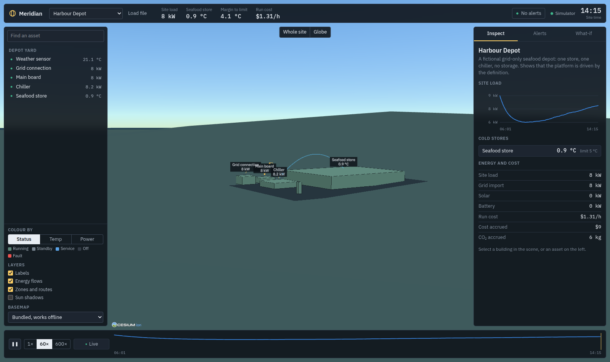
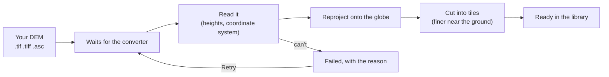
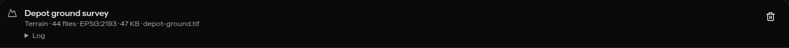

# Terrain

Without terrain, a twin sits on the smooth globe: fine for a flat yard, odd for a site on a hillside or beside a harbour. Upload a **digital elevation model** (DEM), the height grid a surveyor or a national lidar programme gives you, and Meridian turns it into terrain the twin can stand on. Hills rise around the site, zones and routes drape over the ground, and anything behind a ridge is hidden by it.



## How it works



- The converter that turns [point clouds](04-point-clouds.md) into tiles also does terrain. Each zoom level is a mesh that keeps the ground's shape to within a fraction of the DEM's cell size, so flat ground costs almost nothing and detail goes where the ground changes.
- Heights are used as the DEM gives them, usually metres above sea level.
- A twin has **one** terrain. Choosing another replaces it.

## Upload a DEM

1. On the project page, under **Library**, choose a `.tif`, `.tiff` (GeoTIFF) or `.asc` (ASCII grid) file.
2. **EPSG code** is the only extra field. Leave it empty if the file has a coordinate system, as GeoTIFFs usually do. An ASCII grid usually doesn't, so enter its code, such as `2193` for New Zealand Transverse Mercator.
3. Choose **Upload**.

The item shows **Converting** while it works. Open **Log** to see what was made:

```text
Downloaded depot-ground.tif
EPSG:2193, 43 tiles to zoom 14, heights 0 to 96.77 m
44 files written
```

When it's done, the item reads **Terrain · 44 files · EPSG:2193**.



## When a conversion fails

| Reason                                                          | What to do                                                      |
| --------------------------------------------------------------- | --------------------------------------------------------------- |
| **That is not a GeoTIFF or ASCII grid elevation model.**        | Export the DEM again as a GeoTIFF.                              |
| **The DEM has no coordinate system. Retry with its EPSG code.** | Enter the code in the box under the item and choose **Retry**.  |
| **The DEM has no heights, only no-data.**                       | The export covers the wrong area, or every cell was masked out. |
| **The file has no elevation band.**                             | The file is an image, not a height grid.                        |

## Stand a twin on it

1. Open a twin in the same project and choose **Layout**.
2. Under **Library**, choose **Use as terrain** beside the DEM (**Use as terrain instead** if the twin already has one). The twin saves a new version, **Set the terrain to…**.
3. The terrain is listed under **Layers**. **Remove** takes it out again and puts the site back on the plain globe; the DEM stays in the library.

Meridian looks up the ground's height at the twin's **origin** and builds the whole site level at that height.

## Tips

- **Put the origin on the pad.** The site is built at the ground height of its origin, so an origin on a slope lifts or sinks everything. Set the origin where the buildings stand.
- **The site is level.** On sloping ground, assets far from the origin can float above it or sink into it. Keep large sloping sites to a pad, or split them into several twins.
- **Cover more than the site.** A DEM a few hundred metres wider than the site gives the hills and shoreline around it, which is what makes terrain worth having.
- **Lining up with other data:** Meridian doesn't convert sea-level heights to the globe's ellipsoid. Within a twin that doesn't matter, but a georeferenced scan may sit some metres above or below the terrain. Nudge it with **Up** in the Layout panel.

## See also

- [Projects and the library](03-projects-and-the-library.md): uploading.
- [Point clouds](04-point-clouds.md): the same converter, for scans.
- [Running Meridian](14-running-meridian.md#the-converter): the converter service.
