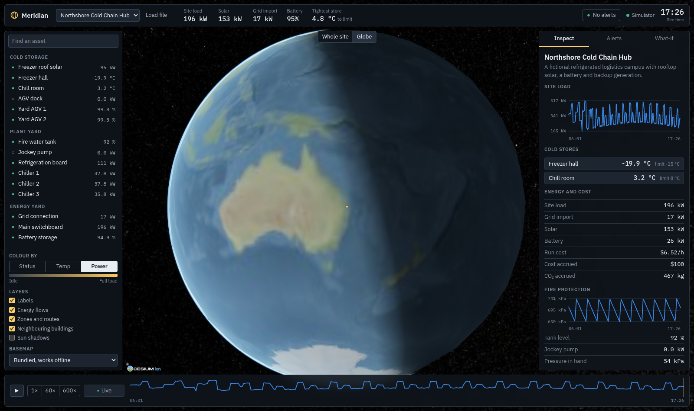
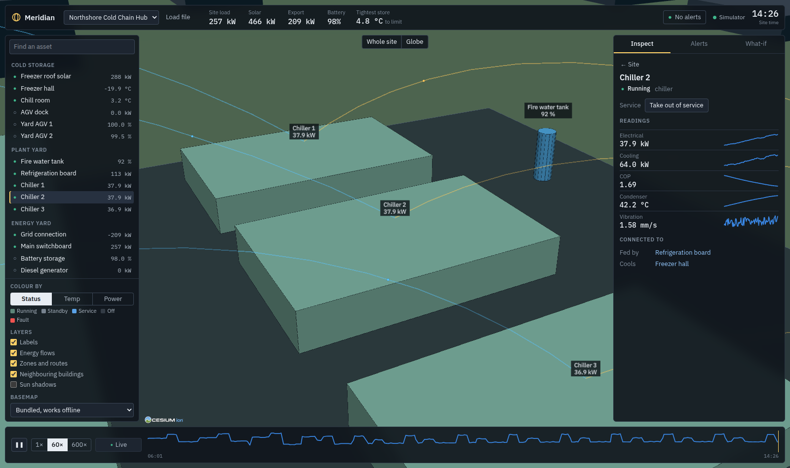
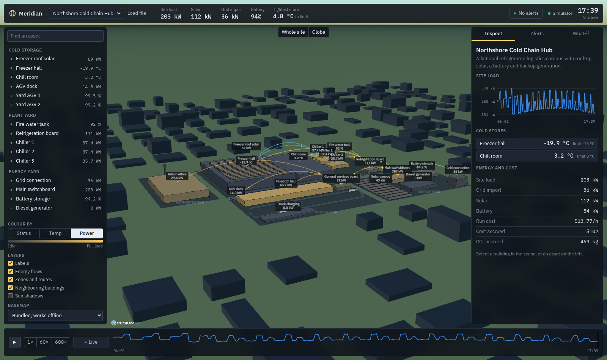

# Twins and the viewer

A **twin** is one site: its buildings and equipment, where they are, how power and cooling flow between them, and the rules that raise alerts. Open one and Meridian runs it: a model of the site steps forward every few seconds, and the 3D scene, readings and charts follow it.

## Create a twin

1. On a project page choose **New twin** (or choose **Twins** in the sidebar, then **New twin**).
2. Check the **Project**, and enter a **Name** and, if you like, a **Description**.
3. Under **Start from**, choose one:
    - **An empty site at a location**: enter the **Latitude**, **Longitude** and **UTC offset (hours)** of the site. The twin starts with weather, a grid connection and a main board, ready for you to add models, scans and equipment.
    - **A sample site**: a copy of **Northshore Cold Chain Hub** or **Harbour Depot**, to explore or adapt.
    - **A definition file**: a twin definition saved as JSON, such as one downloaded from another twin. See [Twin definitions](12-twin-definitions.md).
4. Choose **Create twin**. Meridian checks the definition, saves it as version 1 and opens the twin.

Only editors can create twins. Renaming or deleting a twin isn't in the app yet.

## The twin page

The page has five parts.

### The top bar

From left to right:

- **← and the twin's name**: back to its project.
- **The version chip** (`v4`): the version you're looking at. Every saved change adds one; see [Layout and versions](08-layout-and-versions.md).
- **Simulator / Live**: shown while a [gateway](09-gateways-and-live-data.md) is running the twin. **Live** follows the gateway; **Simulator** runs the model in your browser instead.
- **Layout** (editors only): opens the [Layout panel](08-layout-and-versions.md).
- **Definition** (editors only): opens the [definition editor](12-twin-definitions.md#edit-a-definition), for zones, assets and everything else in the twin.
- **The headline figures**: **Site load**, **Solar**, **Grid import** (or **Export**, or **Lost** during an outage), **Battery** charge, and **Tightest store**, how close the warmest cold store is to its limit. A twin can declare its own figures instead, like Harbour Depot's **Margin to limit** and **Run cost**; see [KPIs and panels](12-twin-definitions.md#kpis-and-panels).
- **The alerts button**: **No alerts**, or how many are active. Choose it to open the **Alerts** tab.
- **The source**: **Simulator**, or the gateway's address, with how many metrics come from real sensors.
- **The clock**: the time at the site. It reads **Replay** while you're looking back in time.

### The asset list (left)

- **Find an asset** filters the list as you type.
- Assets are grouped by zone, each with its main reading (a store's temperature, a chiller's power). A coloured dot shows its state, and a marker shows it has an active alert.
- Choose an asset to select it: the camera flies to it, and the inspector shows it.

Below the list:

- **Colour by** paints the buildings by:
    - **Status**: running, standby, service (out of service), off or fault.
    - **Temp**: each cold store against its own setpoint, blue when colder, grey at the setpoint, red as it nears its limit.
    - **Power**: each asset from dim when idle to bright at full load.
- **Layers** shows or hides **Labels**, **Energy flows** (the animated arcs between assets, sized by kW), **Zones and routes**, **Neighbouring buildings** (and the uploaded tilesets and scans) and **Sun shadows**.
- **Basemap** chooses the ground imagery: **Bundled, works offline** (low-resolution, no third-party requests), **OpenStreetMap** (detailed streets, for development rather than heavy use), or your own tiles if your administrator has set them up.

### The scene (middle)

- Drag to move around, scroll or right-drag to zoom, and Ctrl-drag or middle-drag to tilt and turn.
- Click a building to select it. An asset that stands for part of a model, such as one wall of a BIM model, is selected by clicking that part.
- **Whole site** flies back to the standard view; **Globe** pulls back until you can see the whole Earth, lit for the time at the site.
- **Measure** opens the measuring tools; see [Measure in the scene](#measure-in-the-scene).

### Measure in the scene

Choose **Measure** above the scene, then a tool. Points land on whatever is under the pointer: the ground, terrain, a building, a model or a scan. While a tool is on, clicks measure instead of selecting.

| Tool         | Click                         | You get                                                                                        |
| ------------ | ----------------------------- | ---------------------------------------------------------------------------------------------- |
| **Distance** | Two points                    | The straight distance, how far along the level, and how far up or down, drawn as a right angle |
| **Height**   | A roof, tank or anything else | How high it is above the ground beneath it                                                     |
| **Area**     | Points around the area        | Its area (as seen from above) and perimeter; it closes itself as you go                        |
| **Point**    | One point                     | Its latitude, longitude and height, how high it is above the ground, and the ground's slope    |

For **Distance**, the second point can be held:

- **Free**: wherever you click.
- **Level**: at the first point's height, for a horizontal distance across a gap, such as between two roofs.
- **Vertical**: straight above or below the first point, for a clearance, such as from a floor up to a pipe.

The result follows the pointer until you click. **Clear** starts again with the same tool; **Done** or Esc puts the tools away. Measurements aren't saved, and anyone who can see the twin can measure, viewers included.

Distances are measured on the Earth itself, so they're right at any distance. Heights are above the terrain where a twin has it, and above the site's level ground where it doesn't, so slope only shows on terrain. Points picked on the ground can read a few centimetres off; anything within 20 cm of the ground counts as on it.

### The inspector (right)

With nothing selected, **Inspect** summarises the site: its description, site load over the last hours, every cold store against its limit, and energy and cost so far. A twin can add its own panels here, like Northshore's **Fire protection**; see [KPIs and panels](12-twin-definitions.md#kpis-and-panels).

Select an asset to see:

- **Its status and kind**, and the commands it takes, for operators and up:
    - **Cold stores**: **Setpoint**. Use **−** and **+**, then **Apply**.
    - **Chillers**: **Take out of service** and **Return to service**.
    - **Custom types with setpoints**, like the jockey pump's start and stop pressures: **−** and **+** for each, then **Apply**. Values stay within the type's range.
- **Readings**: every metric with a sparkline of the last six hours. A reading from a real sensor rather than the model is marked as measured.
- **Recorded**: what sensors actually reported over the last **24 h**, **7 days** or **30 days**, when the twin has a gateway sending history. See [Devices and MQTT](10-devices-and-mqtt.md#see-what-was-recorded).
- **Connected to**: what feeds it, what it feeds, and what it cools or is cooled by. Choose a name to jump to that asset.

Choose **← Site** to go back to the summary. The **Alerts** and **What-if** tabs are covered in [Alerts, time travel and what-if](07-alerts-time-and-what-if.md).

Equipment the model has no physics for, like this fire water tank, can still be described as a [custom type](12-twin-definitions.md#custom-asset-types). It shows its own metrics, takes readings from sensors and raises alerts like anything else. A type can also behave on its own: the jockey pump starts and stops on the tank's pressure, and draws power from its board.

### The timeline (bottom)

- **❚❚** pauses the model, and **▶** resumes it.
- **1×**, **60×** and **600×** set how fast site time runs: real time, a minute a second, or ten minutes a second.
- The chart is the site load over the last day, with a mark for each alert. Click or drag along it to **look back** to that moment: the scene, readings and clock all show the past. **Back to live** returns to now.

## Without signing in

`/demo` runs the two sample twins without an account. Choose a twin from the menu in the top bar, or **Load file** to open a definition from your computer. Nothing is saved.

## Tips

- **Speed up to see a day.** At 600× a whole day passes in under two and a half minutes. Colour by **Power** and watch solar fade at dusk.
- **Commands are shared.** When a gateway runs the twin, a setpoint you apply is applied for everyone watching, as it would be on site.

## See also

- [Alerts, time travel and what-if](07-alerts-time-and-what-if.md)
- [Layout and versions](08-layout-and-versions.md)
- [Gateways and live data](09-gateways-and-live-data.md)
