# Twins and the viewer

A **twin** is one site: its buildings and equipment, where they are, how power and cooling flow between them, and the rules that raise alerts. Open one and Meridian runs it: a model of the site steps forward every few seconds, and the 3D scene, readings and charts follow it.

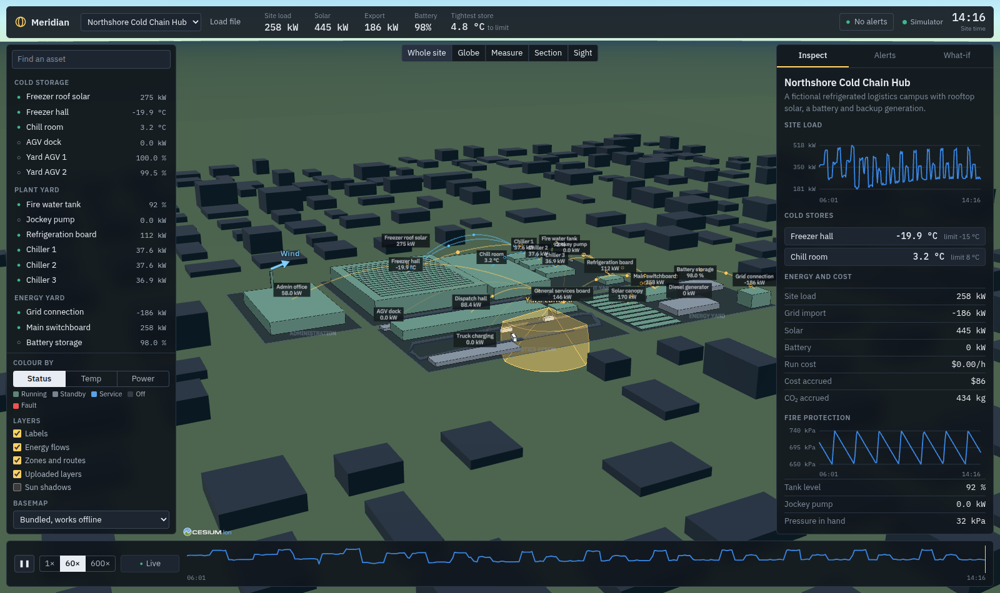

## Create a twin

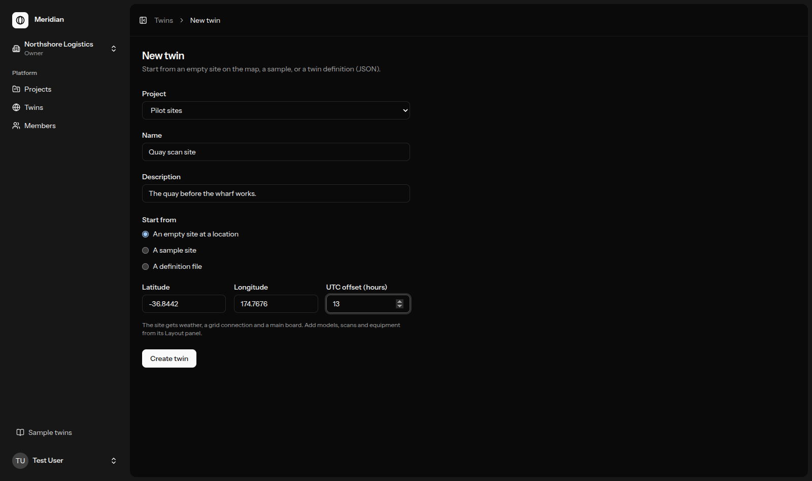

1. On a project page choose **New twin** (or choose **Twins** in the sidebar, then **New twin**).
2. Check the **Project**, and enter a **Name** and, if you like, a **Description**.
3. Under **Start from**, choose one:
    - **A template at a location**: choose a **Template**, then enter the **Latitude**, **Longitude** and **UTC offset (hours)** of the site. The templates are:
        - **Empty**: only the site's outline, ready for models, scans and equipment.
        - **Factory line**: a conveyor feeding two machining cells and a packer, with throughput, spindle temperature and vibration.
        - **Mine site**: a primary crusher, an overland conveyor, a run-of-mine stockpile with a reclaim feeder, and pit dewatering.
        - **Survey and monitoring**: survey control points, slope-monitoring prisms and piezometers, ready for point clouds and terrain.
        - **Site power**: weather, a grid connection and a main board, for a site whose energy is modelled.

      Only **Site power** models electricity. The others are built from [custom asset types](12-twin-definitions.md#custom-asset-types), with their own figures in the top bar and rules, so you can rename, move and change everything in them, and connect real readings through [MQTT](10-devices-and-mqtt.md) or [OPC UA](11-opc-ua.md).

      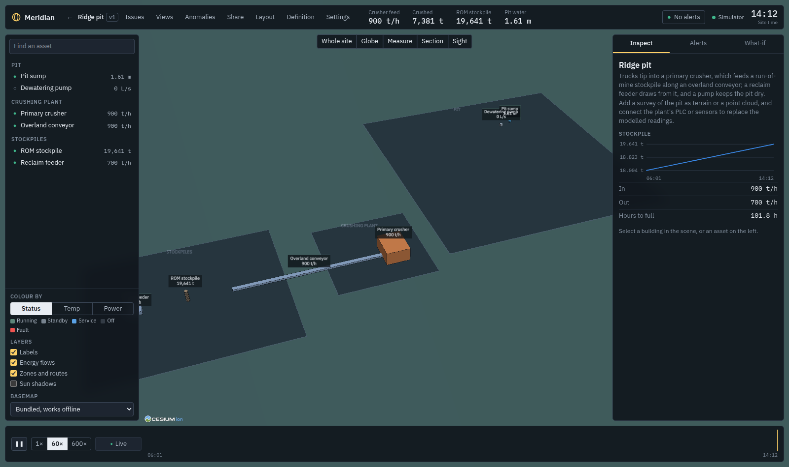

      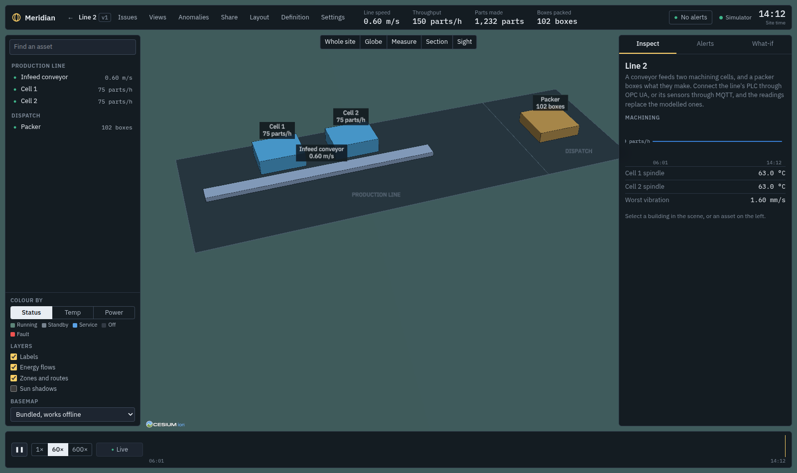
    - **A sample site**: a copy of **Northshore Cold Chain Hub** or **Harbour Depot**, to explore or adapt.
    - **A definition file**: a twin definition saved as JSON, such as one downloaded from another twin. See [Twin definitions](12-twin-definitions.md).
4. Choose **Create twin**. Meridian checks the definition, saves it as version 1 and opens the twin.

Only editors can create twins.

## Rename or delete a twin

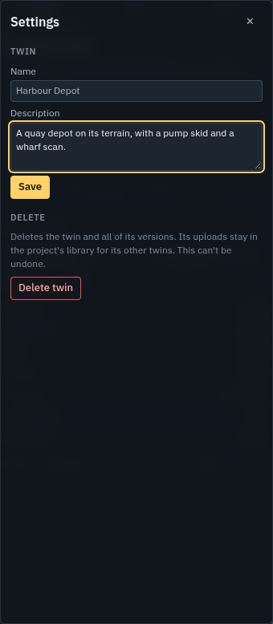

Editors choose **Settings** in the bar above the scene. Change the **Name** or **Description** and choose **Save**; the twin keeps its versions, and the change isn't a new one.

**Delete twin** deletes the twin and all of its versions, after you confirm. Its uploads stay in the project's [library](03-projects-and-the-library.md) for its other twins. It can't be undone.

## The twin page

The page has five parts.

### The top bar

From left to right:

- **← and the twin's name**: back to its project.
- **The version chip** (`v4`): the version you're looking at. Every saved change adds one; see [Layout and versions](08-layout-and-versions.md).
- **Simulator / Live**: shown while a [gateway](09-gateways-and-live-data.md) is running the twin. **Live** follows the gateway; **Simulator** runs the model in your browser instead.
- **Issues**: opens the [Issues panel](#issues-in-the-scene), with how many are open. Everyone who can see the twin has it.
- **Views**: opens the [Views panel](#saved-views-and-links), to save how the twin looks or copy a link to it. Everyone who can see the twin has it.
- **Anomalies**: opens the [Anomalies panel](07-alerts-time-and-what-if.md#anomalies), with how many metrics are unusual now.
- **Volumes**: opens the Volumes panel, for the cut and fill between surveys of the ground; see [Comparing surveys](17-comparing-surveys.md). Everyone who can see the twin has it; editors make comparisons.
- **Layout** (editors only): opens the [Layout panel](08-layout-and-versions.md).
- **Definition** (editors only): opens the [definition editor](12-twin-definitions.md#edit-a-definition), for zones, assets and everything else in the twin.
- **Settings** (editors only): renames, describes or deletes the twin; see [Rename or delete a twin](#rename-or-delete-a-twin).
- **The headline figures**: **Site load**, **Solar**, **Grid import** (or **Export**, or **Lost** during an outage), **Battery** charge, and **Tightest store**, how close the warmest cold store is to its limit. A twin can declare its own figures instead, like Harbour Depot's **Margin to limit** and **Run cost**; see [KPIs and panels](12-twin-definitions.md#kpis-and-panels).
- **The alerts button**: **No alerts**, or how many are active. Choose it to open the **Alerts** tab.
- **The source**: **Simulator**, or the gateway's address, with how many metrics come from real sensors.
- **The clock**: the time at the site. It reads **Replay** while you're looking back in time.

### The asset list (left)

- **Find an asset** filters the list as you type.
- Assets are grouped by zone, each with its main reading (a store's temperature, a chiller's power). A coloured dot shows its state, and a marker shows it has an active alert.
- Choose an asset to select it: the camera flies to it, and the inspector shows it.

Below the list:

- **Colour by** paints the buildings by:
    - **Status**: running, standby, service (out of service), off or fault.
    - **Temp**: each cold store against its own setpoint, blue when colder, grey at the setpoint, red as it nears its limit.
    - **Power**: each asset from dim when idle to bright at full load.
- **Layers** shows or hides **Labels**, **Energy flows** (the animated arcs between assets, sized by kW), **Zones and routes**, **Uploaded layers** (the twin's tilesets, scans, map layers and imagery, when it has any) and **Sun shadows**.
- **Site on**, when any of the twin's uploads is dated, steps through the dates they were captured, showing the site as it was on each; see [The site over time](21-the-site-over-time.md).
- **Basemap** chooses the ground imagery: **Bundled, works offline** (low-resolution, no third-party requests), **OpenStreetMap** (detailed streets, for development rather than heavy use), or your own tiles if your administrator has set them up.

### The scene (middle)

- Drag to move around, scroll or right-drag to zoom, and Ctrl-drag or middle-drag to tilt and turn.
- Click a building to select it. An asset that stands for part of a model, such as one wall of a BIM model, is selected by clicking that part.
- **Whole site** flies back to the standard view; **Globe** pulls back until you can see the whole Earth, lit for the time at the site.
- **Measure** opens the measuring tools; see [Measure in the scene](#measure-in-the-scene).
- **Section** cuts the site open to see inside; see [Cut the site open](#cut-the-site-open).
- **Sight** shows what can be seen from a point; see [See what can be seen](#see-what-can-be-seen).
- Arrows and fans, such as Northshore's wind arrow, are the twin's **shapes**; see [Shapes](12-twin-definitions.md#shapes).


### Measure in the scene

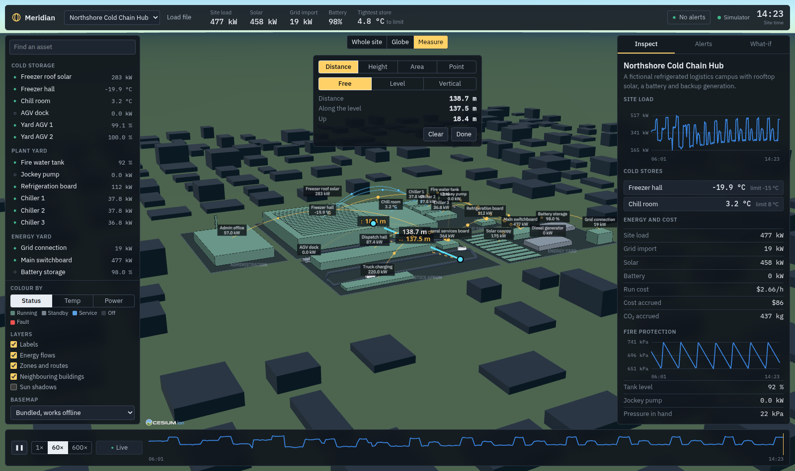

Choose **Measure** above the scene, then a tool. Points land on whatever is under the pointer: the ground, terrain, a building, a model or a scan. While a tool is on, clicks measure instead of selecting.

| Tool         | Click                         | You get                                                                                        |
| ------------ | ----------------------------- | ---------------------------------------------------------------------------------------------- |
| **Distance** | Two points                    | The straight distance, how far along the level, and how far up or down, drawn as a right angle |
| **Height**   | A roof, tank or anything else | How high it is above the ground beneath it                                                     |
| **Area**     | Points around the area        | Its area (as seen from above) and perimeter; it closes itself as you go                        |
| **Point**    | One point                     | Its latitude, longitude and height, how high it is above the ground, and the ground's slope    |

For **Distance**, the second point can be held:

- **Free**: wherever you click.
- **Level**: at the first point's height, for a horizontal distance across a gap, such as between two roofs.
- **Vertical**: straight above or below the first point, for a clearance, such as from a floor up to a pipe.

The result follows the pointer until you click. **Clear** starts again with the same tool; **Done** or Esc puts the tools away. Measurements aren't saved, and anyone who can see the twin can measure, viewers included.

Distances are measured on the Earth itself, so they're right at any distance. Heights are above the terrain where a twin has it, and above the site's level ground where it doesn't, so slope only shows on terrain. Points picked on the ground can read a few centimetres off; anything within 20 cm of the ground counts as on it.

### Cut the site open

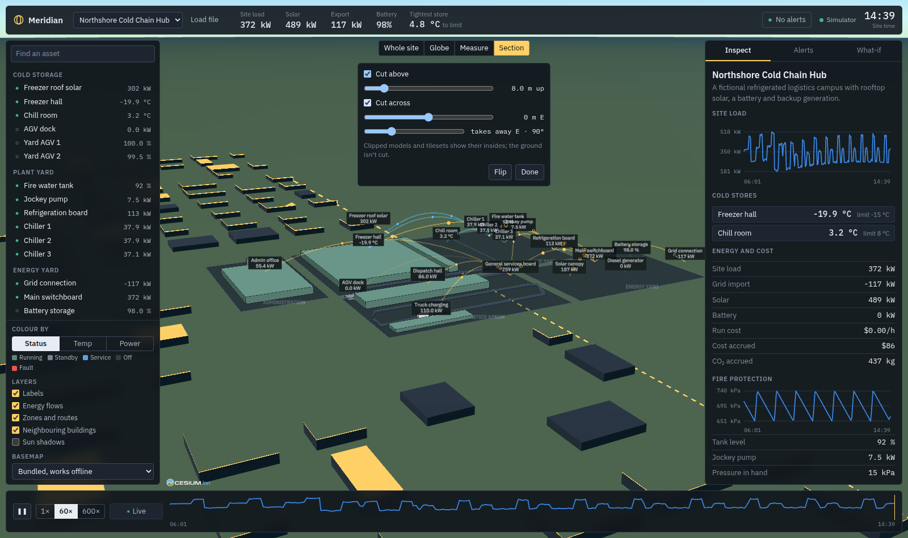

**Section** above the scene cuts away part of the site, so you can see inside building models, scans and tilesets. It starts by cutting everything above 6 m.

- **Cut above** takes away everything higher than **Cut height** above the ground: a floor plan, for a building model with floors.
- **Cut across** takes away everything on one side of a vertical cut, shown as a dashed line on the ground. **Cut position** moves the cut, in metres from the site's origin, and **Cut direction** turns it; the readout says which side it takes away. **Flip** keeps the other side instead, along the same line.

Both cuts can be on at once. Tilesets and placed models are clipped: they're drawn open where they're cut, with a gold edge, so their insides show. The blocks drawn for assets are cut to match, closed at the cut. The ground and terrain aren't cut.

Measuring works inside a section, so you can open up a model and then measure what's inside it. Like measurements, sections aren't saved, and anyone who can see the twin can make one. **Done** puts the site back together.

### See what can be seen

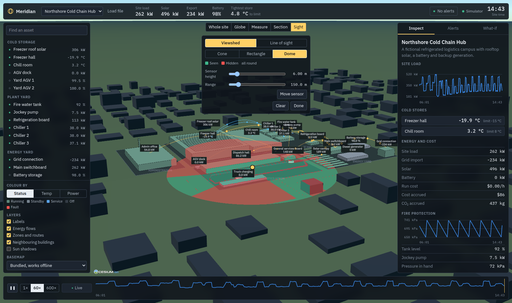

**Sight** above the scene answers what a camera, radio or person can see: for CCTV coverage, a radio link or a clear view.

**Viewshed** places a sensor and tints everything within its range: green where the sensor can see it, red where something is in the way. Click where it goes: the ground, a roof or the top of a mast. Then choose its shape:

| Shape         | Sees                                                | Settings                                                          |
| ------------- | --------------------------------------------------- | ----------------------------------------------------------------- |
| **Cone**      | A circle around where it looks, like a spotlight    | **Heading**, **Tilt** and **Cone angle**                          |
| **Rectangle** | A rectangle around where it looks, like a camera    | **Heading**, **Tilt**, **Angle across** and **Angle up and down** |
| **Dome**      | Everything around it, like a radio mast or a person |                                                                   |

**Sensor height** raises it above where you clicked, and **Range** is how far it sees. **Aim at…** turns a cone or rectangle to look at the next thing you click; **Move sensor** puts it somewhere else.

**Line of sight** says whether one point can see another. Click where the observer stands, then what they should see. **Eye height** and **Target height** raise the two ends above where you clicked; they start at a standing person's eye and a target 1.5 m up. The line is green as far as it's seen, and red past whatever blocks it, and the panel says how far away that is. The next click starts a new line.

Everything in the scene blocks the view: the ground and terrain, asset blocks, models, tilesets and scans. A surface facing away from a sensor counts as hidden. This is how each point in the scene is judged:

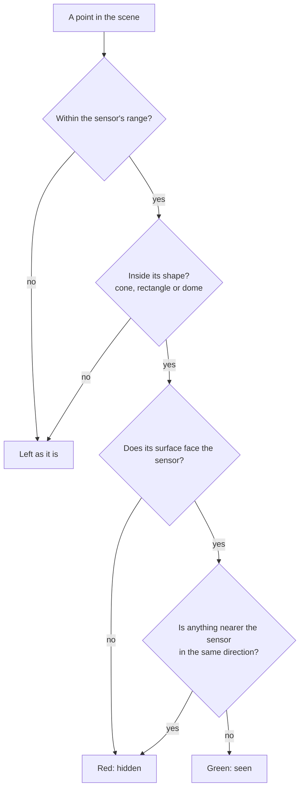

The viewshed is worked out on your computer's graphics card, like a shadow with the sensor as the light, so it updates as you drag the sliders. Like measurements, sight lines aren't saved, and anyone who can see the twin can use them. **Done** puts the tools away.

### The inspector (right)

With nothing selected, **Inspect** summarises the site: its description, site load over the last hours, every cold store against its limit, and energy and cost so far. A twin can add its own panels here, like Northshore's **Fire protection**; see [KPIs and panels](12-twin-definitions.md#kpis-and-panels).


Select an asset to see:

- **Its status and kind**, and the commands it takes, for operators and up:
    - **Cold stores**: **Setpoint**. Use **−** and **+**, then **Apply**.
    - **Chillers**: **Take out of service** and **Return to service**.
    - **Custom types with setpoints**, like the jockey pump's start and stop pressures: **−** and **+** for each, then **Apply**. Values stay within the type's range.
- **Readings**: every metric with a sparkline of the last six hours. A reading from a real sensor rather than the model is marked as measured.
- **Recorded**: what sensors actually reported over the last **24 h**, **7 days** or **30 days**, when the twin has a gateway sending history. See [Devices and MQTT](10-devices-and-mqtt.md#see-what-was-recorded).
- **Connected to**: what feeds it, what it feeds, and what it cools or is cooled by. Choose a name to jump to that asset.

Choose **← Site** to go back to the summary. The **Alerts** and **What-if** tabs are covered in [Alerts, time travel and what-if](07-alerts-time-and-what-if.md).

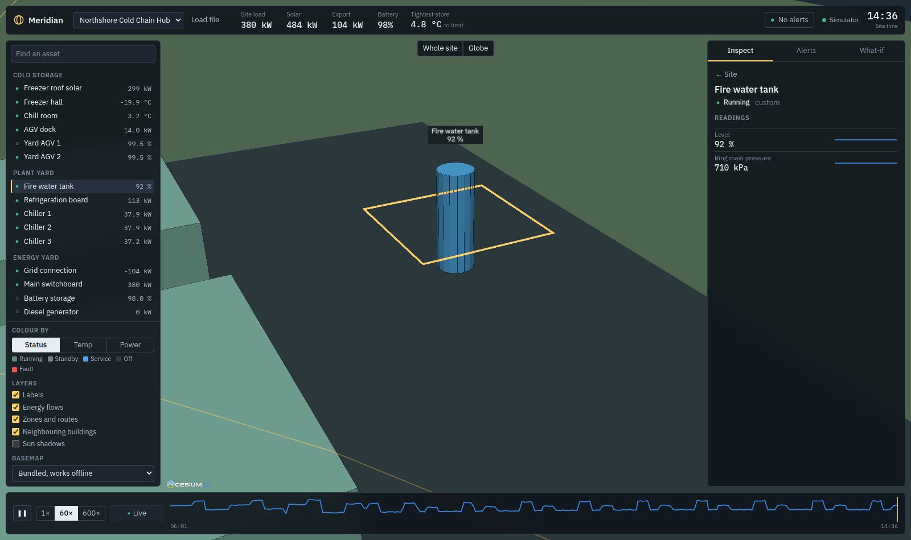

Equipment the model has no physics for, like this fire water tank, can still be described as a [custom type](12-twin-definitions.md#custom-asset-types). It shows its own metrics, takes readings from sensors and raises alerts like anything else. A type can also behave on its own: the jockey pump starts and stops on the tank's pressure, and draws power from its board.

### The timeline (bottom)

- **❚❚** pauses the model, and **▶** resumes it.
- **1×**, **60×** and **600×** set how fast site time runs: real time, a minute a second, or ten minutes a second.
- The chart is the site load over the last day, with a mark for each alert. Click or drag along it to **look back** to that moment: the scene, readings and clock all show the past. **Back to live** returns to now.


## Issues in the scene

An issue is a note or a problem pinned to a place in the twin: a loose guard on a pump, a camera's blind spot, a seal to replace. It keeps where it is, the view it was raised from, and a conversation with photos, so the people who deal with it see exactly what was meant. Anyone who can see the twin can raise one and join in, viewers included.

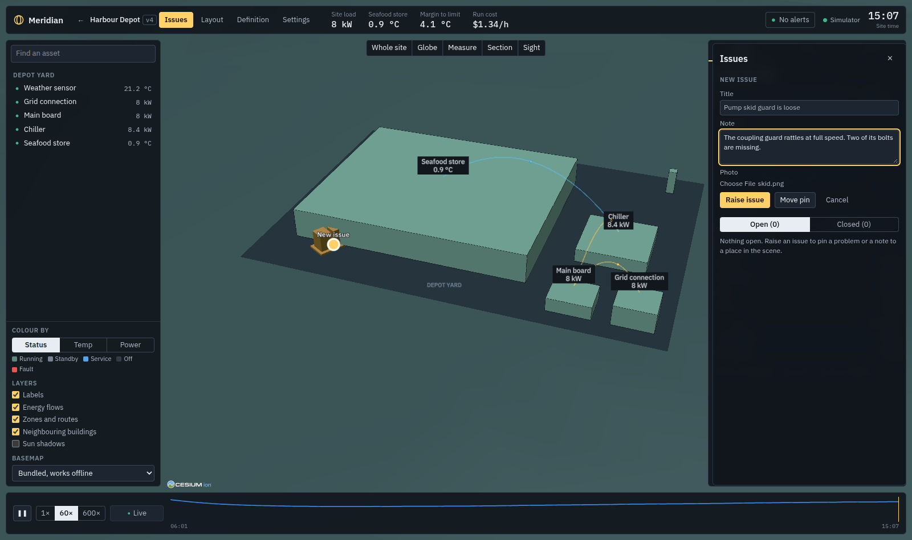

To raise one:

1. Choose **Issues** in the top bar, then **New issue**.
2. Move the camera so the problem is in view, then click the spot in the scene: the ground, a building, a model or a scan. A yellow pin marks it. The camera you're looking from is saved with the issue.
3. Give it a **Title**, and optionally a **Note** and a **Photo** (JPEG, PNG or WebP, up to 10 MB). **Move pin** lets you click somewhere else first.
4. Choose **Raise issue**. It's numbered after the twin's last issue and opens straight away.

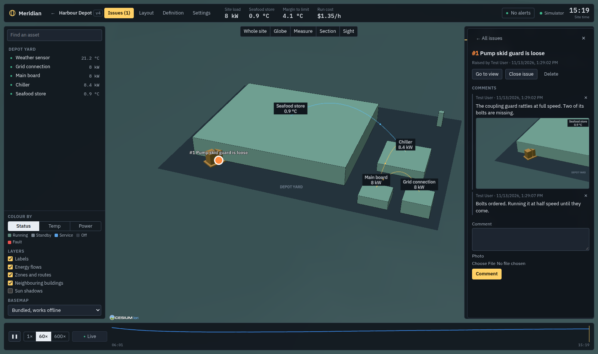

Each issue is a pin over its spot, drawn on top of everything so one inside a building still shows: orange while open, grey once closed. The open issue's pin is larger and shows its title.

- **Open an issue** by choosing it in the list, which flies the camera to the view it was raised from, or by clicking its pin. **Go to view** flies back to that view.
- **Share an issue** by copying the page's address while it's open: it ends in `?issue=…`, and opens the twin at that issue and its view for anyone in the organisation.
- **Comment** with words, a photo or both. Comments and new issues show for everyone within 15 seconds.
- **Close issue** once it's dealt with, and **Reopen** if it isn't. **Open**, **Mine** and **Closed** in the list switch between the open issues, the open ones assigned to you, and the closed ones.
- **Delete** removes the issue with its comments and photos. The ✕ on a comment deletes that comment.

### Assign an issue

An open issue shows **Assigned to** and **Due** to whoever raised it and to operators, admins and owners. Pick anyone in the organisation and, if you like, a date, then **Save assignment**; choose **Nobody** or clear the date to take them back. The list shows who has each issue (**For you** when it's yours) and when it's due, and **Overdue** in red once the date has passed while it's still open.

The person you assign gets an email with a link that opens the twin at the issue, unless they assigned it to themselves. Whoever has an issue can close it, even a viewer.

### Raise an issue from an alert

Each alert in the [alert log](07-alerts-time-and-what-if.md#the-alert-log) has **Raise issue**, for anyone who can see the twin. It opens the twin with the Issues panel, flies to the alert's asset and puts the pin on top of it, with the alert's message as the title. Move the pin if the problem is somewhere else, add a note or photo, and choose **Raise issue**. The issue says **From the alert** with a link back to the log, and the alert shows **Issue #n** in place of **Raise issue**.

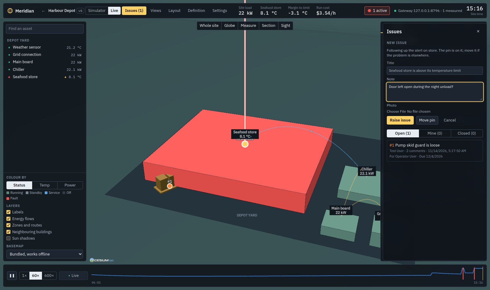

If the asset has no place in the scene, such as one fed only by a gateway, click the spot yourself.

### Tell a channel about issues

A project's [notification channels](07-alerts-time-and-what-if.md#who-is-told) can also take **issue updates**: a message when an issue is raised, assigned or closed, by email, Slack, Teams or webhook, with a link to the issue. Tick **Also issue updates** when adding the channel. Issues aren't urgent, so a channel in its quiet hours isn't told of them.

Who can do what:

|                                                      | Owner | Admin | Operator | Viewer |
| ---------------------------------------------------- | :---: | :---: | :------: | :----: |
| Raise issues, comment, and close or delete their own |   ✓   |   ✓   |    ✓     |   ✓    |
| Assign their own issues                              |   ✓   |   ✓   |    ✓     |   ✓    |
| Close an issue assigned to them                      |   ✓   |   ✓   |    ✓     |   ✓    |
| Assign, close and reopen anyone's issue              |   ✓   |   ✓   |    ✓     |        |
| Delete anyone's issue or comment                     |   ✓   |   ✓   |          |        |

How an issue goes:

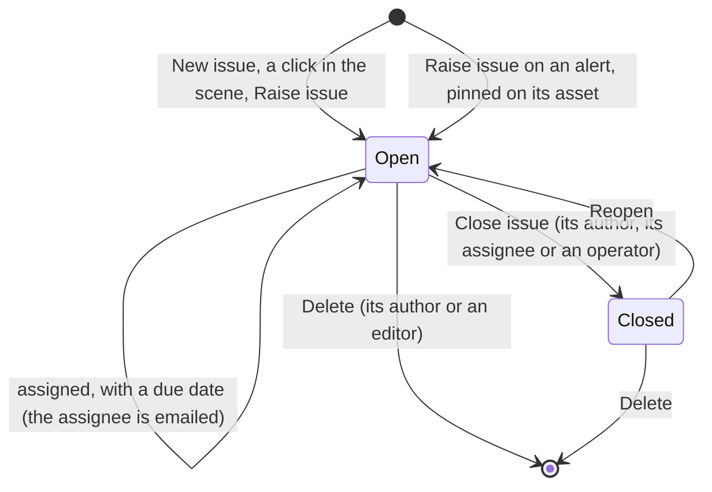

Who hears about it:

```
issue raised, assigned or closed:
    for each channel in the project that takes issue updates:
        in its quiet hours  -> skip
        otherwise           -> queue a message (tried 3 times)
when assigned to someone new, by someone else:
    email them: "Issue #n is yours: <title> (<twin>)"

What's kept for each issue:

```
issue #n of the twin
    title, who raised it, when
    pin:  longitude, latitude, height above the ellipsoid   (where it is)
    view: the camera's longitude, latitude, height, heading, pitch and roll
    closed: when and by whom, or still open
    assigned to: a member, or nobody; due: a date, or none
    alert: the alert it was raised from, if any
    comments, oldest first: who, when, words and/or a photo
photos are kept with the project's files, served only to its organisation,
and deleted with their comment, their issue or the twin
```

Issues belong to the twin, not to a version: saving a new version or restoring an old one leaves them where they are.

## Saved views and links

A view is how the twin looks to you: where the camera is, what the scene is coloured by, the basemap, which layers are on, any [section cut](#cut-the-site-open) and the selected asset. Save one to come back to it, or send a link that opens the twin looking just like that: "the chiller at night, coloured by temperature, with the roof cut away".

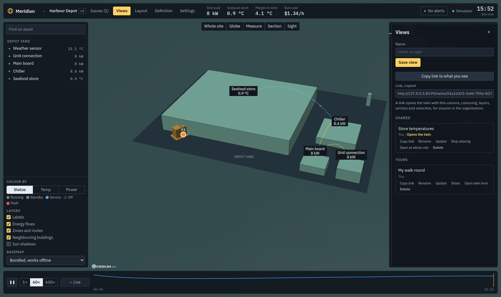

- **Save a view**: choose **Views** in the top bar, give it a **Name** and choose **Save view**. It's yours alone, under **Yours**, until an editor shares it.
- **Open a view** by choosing its name. The camera flies there and the colouring, layers, basemap, section and selection change to match.
- **Copy link to what you see** puts a link to the twin as it looks now on your clipboard, and shows it in case your browser won't copy. Nothing is saved: the view travels in the link (`?look=…`).
- **Copy link** on a saved view copies a shorter link (`?view=…`). It works for anyone in the organisation who has it, even while the view is still yours alone.
- **Rename**, or **Update** to save what's on screen over the view.
- **Share** a view so it shows under **Shared** for everyone; **Stop sharing** takes it back.
- **Open twin here** makes the twin open at that view, for everyone, instead of the whole site. It shares the view too. **Open at whole site** goes back.
- **Delete** removes the view. A link to it then opens the twin as usual.

Links open for people in the organisation only; anyone else signs in first and is turned away. A link to an [issue](#issues-in-the-scene) opens at the issue's view instead.

Who can do what:

|                                                                | Owner | Admin | Operator | Viewer |
| -------------------------------------------------------------- | :---: | :---: | :------: | :----: |
| Save views, copy links, and rename, update or delete their own |   ✓   |   ✓   |    ✓     |   ✓    |
| Share views, and change or delete shared ones                  |   ✓   |   ✓   |          |        |
| Choose the view the twin opens at                              |   ✓   |   ✓   |          |        |

Where the twin opens:

```
on opening a twin:
    if the link has ?issue=  -> fly to that issue's view
    elif it has ?look=       -> the view carried in the link
    elif it has ?view=       -> that saved view, if it's one of this twin's
    elif the twin has an opening view -> that one
    else                     -> the whole site
```

What's kept for each view:

```
saved view of the twin
    name, who saved it, shared or not
    camera: longitude, latitude, height, heading, pitch and roll
    colour by: status, temperature or power
    basemap: bundled, OpenStreetMap or custom
    layers: labels, energy flows, zones and routes, neighbouring buildings, sun shadows
    section: the cut above and the cut across, or none
    selected: the asset's id, or none
```

Views keep the time of day out: the simulator starts afresh each time it opens, and a gateway shows what is happening now. Like issues, views belong to the twin, not to a version.

## Share a twin by link

Admins and owners can show a twin to someone who isn't a member, such as a client, a contractor or a board, with a link that needs no account. Nobody can change anything through it.

1. Open the twin and choose **Share** in the top bar.
2. Under **Make a link**, say **Who it's for**, such as *Harbour board walkthrough*, so you know which link to revoke later.
3. Choose when it **Expires**: in 1, 7, 30 or 90 days. Every link expires.
4. Leave **Show live readings and history** on to show what the site is doing, as the twin page does. Turn it off to show only the scene, run by the simulator in their browser.
5. Choose **Make link**, and copy it straight away: it's shown once.

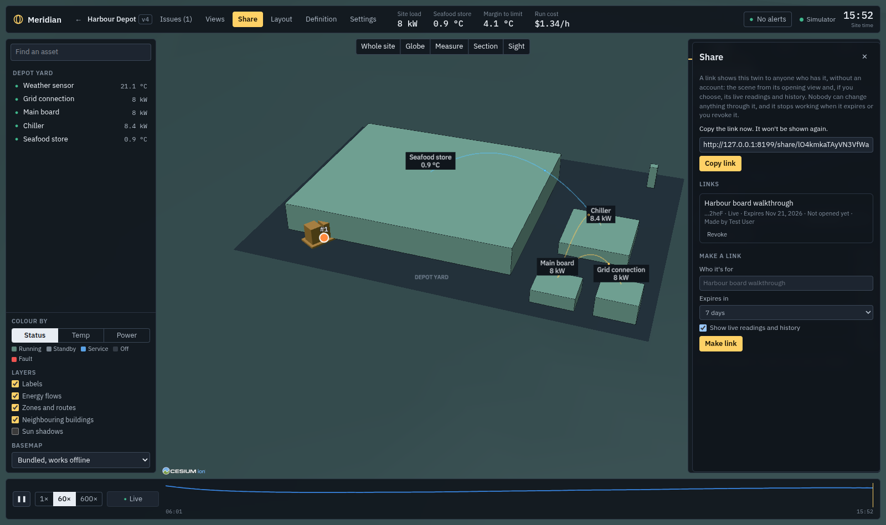

Someone opening the link sees the twin's latest version from its [opening view](#saved-views-and-links). They can move around, select assets, change the colouring and look at charts, as a viewer can. They see no issues, alerts, saved views, versions or editing, and can't send commands. Whatever they do stays in their browser.

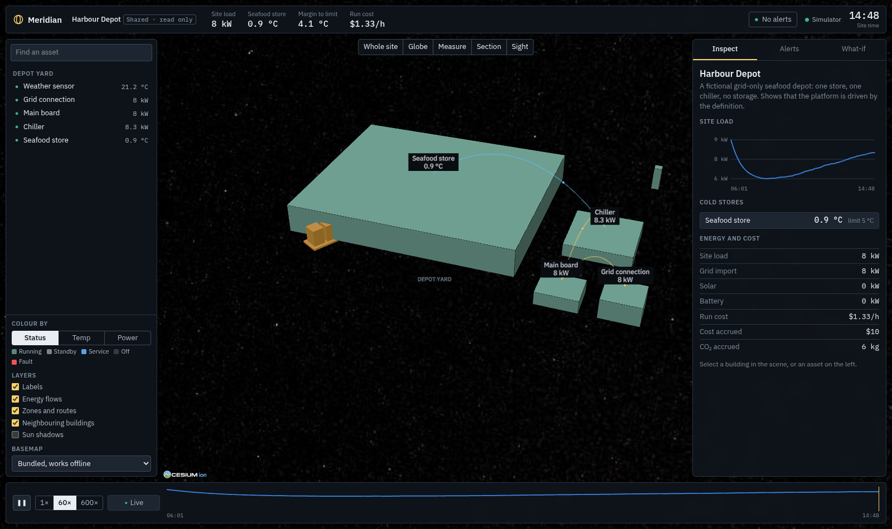

The list under **Links** shows each link's last four characters, whether it's live, when it expires, when it was last opened and who made it. **Revoke** stops it:

- The link stops opening the twin, and its models and tilesets stop loading, at once.
- A page already open stops following the gateway live within 10 minutes.

Making and revoking links are recorded in the [audit log](02-organisations-and-members.md#the-audit-log).

```
open /share/<token>   (not expired, not revoked; else "not found")
    the twin's latest version, its files loaded only through the link
    and only those it shows; its opening view
    live: a gateway ticket good for 10 minutes, asked for again on each
          reconnect; the gateway ends the connection when it runs out
    never: issues, alerts, views, versions, commands
```

## Without signing in

`/demo` runs the two sample twins without an account. Choose a twin from the menu in the top bar, or **Load file** to open a definition from your computer. Nothing is saved.

## Tips

- **Speed up to see a day.** At 600× a whole day passes in under two and a half minutes. Colour by **Power** and watch solar fade at dusk.
- **Share for a meeting, not for ever.** A link that expires the day after a walkthrough can't turn up in someone's inbox a year later.
- **Commands are shared.** When a gateway runs the twin, a setpoint you apply is applied for everyone watching, as it would be on site.

## See also

- [Alerts, time travel and what-if](07-alerts-time-and-what-if.md)
- [Layout and versions](08-layout-and-versions.md)
- [Gateways and live data](09-gateways-and-live-data.md)
