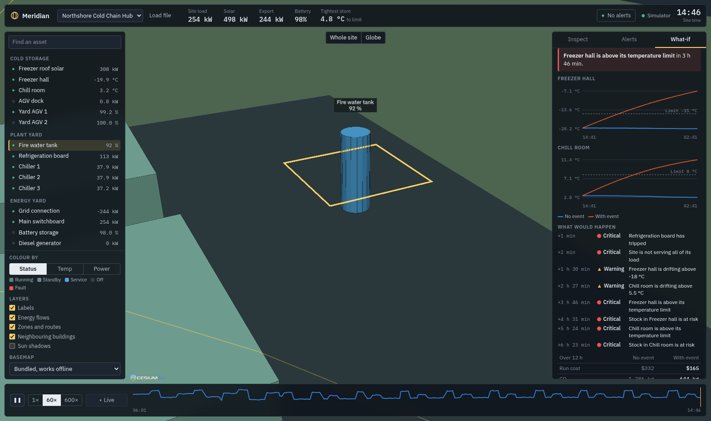
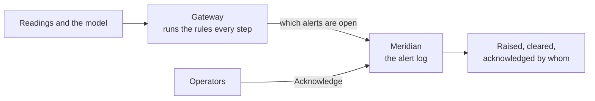
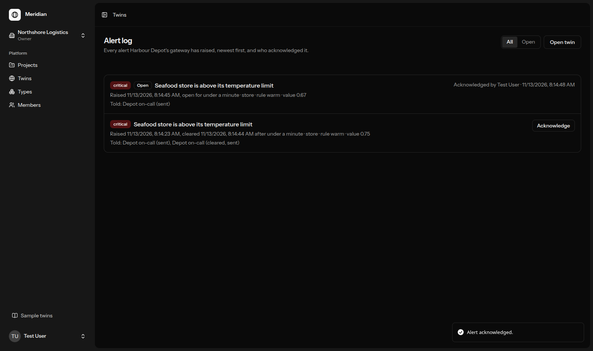
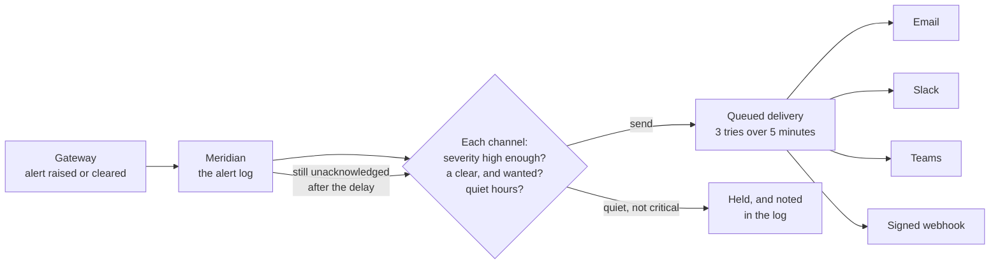
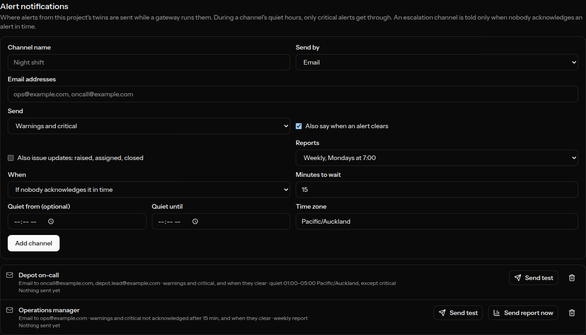
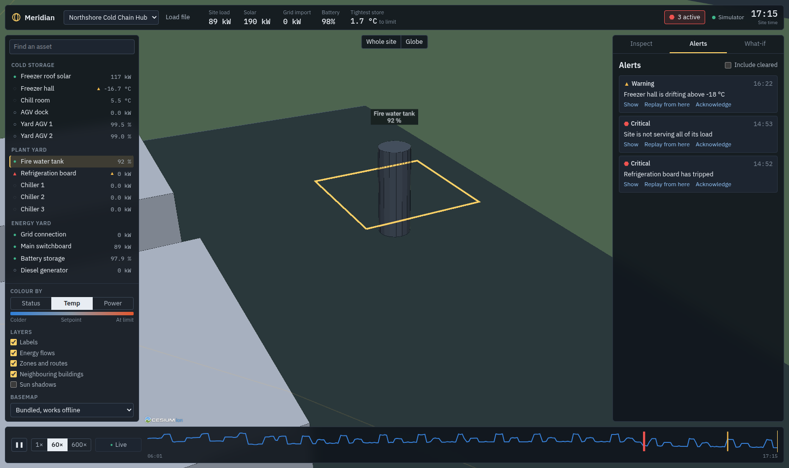

# Alerts, time travel and what-if

A twin watches its own readings. **Alerts** tell you when something passes a limit, the **timeline** lets you look back over the last day to see how it happened, and **what-if** runs the site ahead in time to show what an event would do before it happens.



## Alerts

Alerts come from the twin's **rules**, written in its [definition](12-twin-definitions.md#rules). A rule watches one metric, on one asset or on every asset of a kind, and raises an alert when it passes a threshold:

```text
Fire water low (warning):
    when fire-tank.levelPct < 60    → raise "Fire water tank is below 60%"
    clear when it's back above 65   → the gap stops it flickering on and off
```

A rule can also wait for a while (`forS`) before raising, so a door opened for a moment doesn't set it off. Two other kinds of rule watch how fast a metric changes (the freezer warming 2 °C in ten minutes) or an expression (the jockey pump running for more than 20 minutes); see [Rules](12-twin-definitions.md#rules).

When an alert is raised:

- The alerts button in the top bar turns amber for warnings, red for critical alerts, and counts them.
- A beacon rises over the asset in the scene, and the asset is marked in the list.
- A mark appears on the timeline at the moment it was raised.

### The Alerts tab

Choose the alerts button, or the **Alerts** tab in the inspector. Each alert shows its severity, the site time it was raised, and its message, with:

- **Show**: selects the asset and flies to it.
- **Replay from here**: moves the timeline back to the moment it was raised, so you can watch what led to it.
- **Acknowledge**: marks it as seen. It stays in the list until it clears. While you're following a gateway, it's recorded in the [alert log](#the-alert-log) with your name, and everyone sees **Acknowledged by** you.

With a gateway, **Alert log** at the top of the tab opens the twin's log.

Tick **Include cleared** to see alerts that have already cleared, with the time they did.

### The alert log

While a [gateway](09-gateways-and-live-data.md) runs the twin, it watches the rules itself, so alerts are raised even when nobody has the twin open, and each one is kept in the twin's **alert log**.





Open it from **Alert log** on the Alerts tab, or go to the twin's address followed by `/alerts`. Each entry shows:

- its **severity**, and **Open** while it hasn't cleared;
- its message, when it was raised and when it cleared, and how long it lasted;
- the asset and rule it came from, and the value when it was raised;
- who **acknowledged** it, and when;
- who was **told**, through which [channels](#who-is-told), and how it went;
- **Raise issue**, to follow it up as an [issue pinned on its asset](06-twins-and-the-viewer.md#raise-an-issue-from-an-alert), or a link to the issues already raised from it.

Choose **Open** at the top to see only what hasn't cleared, and **Older** and **Newer** to page back through the log, 50 at a time.

Anyone who can see the twin can read the log. Operators, admins and owners can **Acknowledge** an alert there or from the Alerts tab; the first person to acknowledge it is kept.

The times in the log are real times, when Meridian heard from the gateway, not the twin's site time. A twin without a gateway still raises alerts in your browser while it's open, but they aren't logged.

### Who is told

Alerts the gateway raises are also sent to the project's **notification channels**, so the cold store drifting at 3 a.m. reaches someone who can do something about it. Editors set channels up under **Alert notifications** on the [project page](03-projects-and-the-library.md); every twin in the project with a gateway uses them.





Each channel has:

| Setting | What it does |
| --- | --- |
| **Send by** | **Email** to up to 20 addresses; **Slack**, **Microsoft Teams** or a plain **Webhook** to a URL |
| **Send** | **Everything**, **Warnings and critical**, or **Critical only** |
| **When** | **As soon as it's raised**, or **If nobody acknowledges it in time**, after a number of **Minutes to wait** (up to a day) |
| **Also say when an alert clears** | Sends a second message when it clears, with how long it lasted |
| **Quiet from / until** and **Time zone** | Hours when only critical alerts are sent, such as 22:00 to 07:00. They may run past midnight |
| **Also issue updates** | Also tells the channel when an [issue](06-twins-and-the-viewer.md#tell-a-channel-about-issues) is raised, assigned or closed, outside its quiet hours |
| **Reports** | **Daily, at 7:00** or **Weekly, Mondays at 7:00**, in the channel's time zone: a [report](#reports) on the project's twins |

#### Escalation

A channel set to **If nobody acknowledges it in time** is an escalation channel: it's told of an alert only when it's still open and nobody has acknowledged it after its wait. That lets a project build a chain, for example:

| Channel | When |
| --- | --- |
| On-call team | As soon as it's raised |
| Shift manager | If nobody acknowledges it in 15 minutes |
| Operations director | If nobody acknowledges it in 60 minutes, critical only |

Meridian checks every minute, and tells each escalation channel about each alert once. Acknowledging the alert, in the alert log or the twin's Alerts tab, stops it going any further; so does its clearing. An escalation channel is told an alert has cleared only if it was told about the alert. During its quiet hours an escalation channel waits: a warning still unacknowledged when they end is sent then.

```
every minute, for each escalation channel:
    for each alert in its project:
        open, not acknowledged, raised at least <wait> minutes ago,
        severity at least the channel's, not yet escalated to it
        → quiet hours and not critical: try again next minute
        → otherwise: record it, and send "Not acknowledged: …"
```

#### Reports

A channel can also take the project's **report**: what happened in each of its twins over the day or the week, for the people who don't watch the alert log.

| For each twin | |
| --- | --- |
| **Alerts** | How many were raised, how many critical, how many were acknowledged and the median time it took, how many nobody acknowledged, and how many are open now |
| **Most alerts** | The three assets that raised most |
| **Issues** | How many were raised and closed, how many are open, and how many are overdue, with the first five overdue ones listed with who has them |

A daily report covers the 24 hours to 7:00 and arrives then; a weekly one covers Monday to Monday. If 7:00 falls in the channel's quiet hours, the report waits for them to end. A channel added after 7:00 gets its first report the next time one falls due. By email it's a table per twin; in Slack and Teams, a line per twin; a webhook gets the figures as JSON. Choose **Send report now** beside the channel to send the day or week up to now straight away.

```
every five minutes, for each channel that takes reports:
    due = the last 7:00 in its time zone (weekly: the last Monday's)
    not sent for this due time, not added since, and not in quiet hours
        → send the report on [due − a day or a week, due)
```

Choose **Send test** to send a made-up alert straight away; the page says whether it got there. Each channel shows when it last sent, or why its last attempt failed.

Every message names the alert, the twin and project, its severity, when it was raised (and cleared), and links to the alert log. The log lists, under each alert, who was **told**: each channel, and whether it was a raise, an **escalation** or a clear, and whether its message was **sent**, is still **sending**, **failed** (with the reason), or was **held for quiet hours**.

**Slack:** create an app with an [incoming webhook](https://api.slack.com/messaging/webhooks) for the channel, and paste its `https://hooks.slack.com/…` URL.

**Teams:** in the Teams channel, add the **Workflows** template "Post to a channel when a webhook request is received", and paste the URL it gives you. Messages arrive as Adaptive Cards.

**Webhook:** Meridian posts the alert as JSON to your URL:

```json
{
  "event": "alert.raised",
  "alert": { "id": "…", "severity": "critical", "message": "Seafood store is above its temperature limit",
             "asset": "store", "rule": "store-too-warm", "value": 8.1,
             "raisedAt": "2026-11-12T03:04:00+00:00", "clearedAt": null },
  "twin": "Harbour Depot", "project": "Pilot sites", "url": "https://meridian.example.com/twins/…/alerts"
}
```

`event` is `alert.raised`, `alert.escalated`, `alert.cleared` or `test`, or `report` for a [report](#reports):

```json
{
  "event": "report", "every": "weekly",
  "from": "2026-11-08T18:00:00+00:00", "to": "2026-11-15T18:00:00+00:00",
  "project": "Pilot sites", "url": "https://meridian.example.com/projects/…",
  "totals": { "alerts": 5, "critical": 1, "acknowledged": 4, "unacknowledged": 1, "openAlerts": 1,
              "raisedIssues": 2, "closedIssues": 1, "openIssues": 3, "overdue": 1 },
  "twins": [ { "name": "Harbour Depot", "url": "…/alerts",
               "alerts": { "raised": 5, "critical": 1, "warning": 3, "acknowledged": 4,
                           "medianAckMinutes": 6, "unacknowledged": 1, "open": 1 },
               "busiest": [ { "asset": "store", "alerts": 3 } ],
               "issues": { "raised": 2, "closed": 1, "open": 3, "overdue": 1 },
               "overdue": [ { "number": 4, "title": "Door seal", "assignee": "Ana Fitter",
                              "dueOn": "2026-11-10", "url": "…" } ] } ]
}
```
 A channel that takes issue updates also gets `issue.raised`, `issue.assigned` and `issue.closed`:

```json
{
  "event": "issue.assigned",
  "issue": { "id": "…", "number": 12, "title": "Fire water tank is below 60%",
             "assignee": "Ana Fitter", "dueOn": "2026-11-20", "alertId": "…" },
  "by": "Test User", "twin": "Harbour Depot", "project": "Pilot sites",
  "url": "https://meridian.example.com/twins/…?issue=…"
}
```
 When you add a webhook, the page shows its **signing secret** once: copy it then. Each request carries `X-Meridian-Signature: sha256=` and the HMAC-SHA256 of the body with the secret, so your receiver can check the request came from Meridian:

```
on request:
    expected = "sha256=" + hex(hmac_sha256(secret, raw request body))
    if not constant_time_equal(expected, header "X-Meridian-Signature"):
        answer 401 and stop
    handle the JSON body
    answer 2xx within 10 seconds
```

Answer with a 2xx status; anything else, a redirect or no answer within 10 seconds counts as a failure, and Meridian tries again after 10 seconds and then a minute before giving up. Webhook URLs must start with `https://` and may not point at private or internal addresses (Slack and Teams URLs must be on their own domains), so a channel can't be used to reach into the network Meridian runs in.

> Notifications come from the gateway's alerts, so a twin needs a gateway to send any. Opening a twin without one raises alerts only in your browser.



## Look back in time

The twin keeps the last 24 hours of site time. The timeline at the bottom is the site load over that day, with a mark for each alert.

1. Click or drag along the timeline. The clock in the top bar reads **Replay**, and the scene, list, readings and inspector all show that moment.
2. Use the alerts' **Replay from here** to jump straight to an alert.
3. Choose **Back to live** to return to now.

The model keeps running while you look back; nothing you see in the past changes it.

## What-if

What-if copies the twin exactly as it is now, runs the copy ahead twice, once as is and once with an event, and compares the two. Both runs share the same weather and the same random variation, so every difference between them comes from the event.

```text
now      ← the live state of the twin
baseline ← run now forward for the look-ahead, with nothing changed
event    ← run now forward for the look-ahead, with the event's faults applied
compare  ← cost, diesel used, load not served, stock at risk, critical alerts
show     ← each cold store's temperature in both runs, and the alerts the event raises
```

1. Choose the **What-if** tab in the inspector.
2. Under **Event**, choose what might happen. The samples include a grid outage, a chiller trip, a freezer door stuck open, a heatwave and bearing wear.
3. Choose how far to **Look ahead**: 2, 6, 12 or 24 hours.
4. Choose **Run forecast**. It takes a moment.

The results show:

- **The headline**: the first critical alert the event would cause, and how long until it does, or **No critical alerts** within the look-ahead.
- **Temperature forecasts** for each cold store, **No event** against **With event**, with the store's limit.
- **What would happen**: every alert the event would raise, in order.
- **The comparison**: **Run cost**, **Diesel**, **Load not served**, **Stock at risk** and **Critical alerts**, with and without the event.

### Apply an event to the live twin

**Apply to the live twin** makes the event happen for real in the running model. It's for drills and training: everyone watching the twin sees the cascade unfold, with the alerts it raises. Operators and up can apply events. While one is running, the What-if tab shows how many events are active in the model; choose **Clear** to end them early. Otherwise each fault ends when its duration does.

> When a gateway runs the twin, applying an event affects the shared model everyone sees, not just your browser.

## Tips

- **Forecast first, then decide.** "If Chiller 2's bearing goes, how long have we got?" is a two-click question.
- **Run a gateway for anything that matters.** Without one, nobody is told about an alert unless they have the twin open.
- **Give every project a channel, and send it a test.** A channel that has never sent shows **Nothing sent yet**; one that's failing says why.
- **Keep quiet hours for warnings.** Critical alerts always get through, so the night shift is only woken when it matters.
- **Send managers a weekly report.** They see how quickly alerts are acknowledged and what's overdue without being paged for each one.
- **Escalate rather than copy everyone.** Send alerts to the people on call, and let an escalation channel bring in a manager only when nobody responds.
- **Use replay after an incident.** Find the first alert, choose **Replay from here**, and step forward at 60× to see the order things happened in.

## See also

- [Twin definitions](12-twin-definitions.md): writing rules and scenarios.
- [Twins and the viewer](06-twins-and-the-viewer.md#the-timeline-bottom): the timeline controls.
