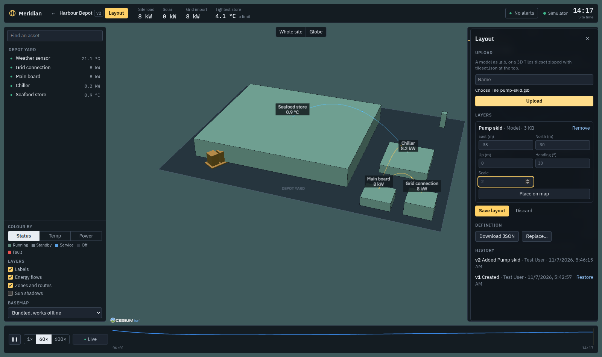
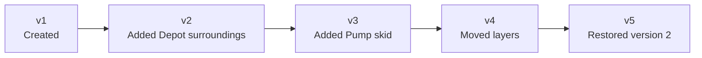
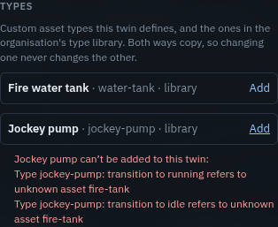
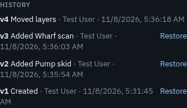

# Layout and versions

The **Layout** panel is where editors change a twin: add uploads from the project library, place them on the site, choose its terrain, take custom types from the type library, map sensor topics, and look back through every version. Every change is saved as a new **version**, so nothing is ever lost: you can download any version, or restore an old one.

## How versions work

- A version is the whole twin definition at that moment, with a note, who made it and when.
- Versions are never changed or deleted. **Restore** makes a _new_ version with an old one's contents, so the history keeps going forward.
- Every change is checked first. A definition with problems is refused, with every problem listed, and the twin stays as it was.
- A running [gateway](09-gateways-and-live-data.md) picks up each new version within a few seconds.

## Open the Layout panel

On the twin page, choose **Layout** in the top bar. Only editors see it. The panel opens on the right, over the inspector; choose **✕** to close it.

The panel has these sections, from the top: **Upload**, **Layers**, **Library**, **Types**, **Gateway**, **Telemetry**, **Definition** and **History**.

## Add an upload

From the project's library:

1. Under **Library**, find the upload. Every ready upload in the project is listed.
2. Choose **Add**. It's added to the twin's **Layers** and saved as a new version.

A converted DEM shows **Use as terrain** instead: the twin stands on it, replacing any terrain it had. See [Terrain](05-terrain.md).

Or upload something new straight into this twin:

1. Under **Upload**, choose a file and give it a name.
2. Choose **Upload**. It goes into the project's library and is added to this twin in one step.

## Place a layer

Models always need placing. Tilesets usually already know where they belong; if one was built in local metres, tick **Built in local metres (place it here)** to place it like a model.

1. Under **Layers**, find the layer. Its placement fields appear underneath:
    - **East (m)** and **North (m)**: how far from the twin's origin.
    - **Up (m)**: height above the ground.
    - **Heading (°)**: turned clockwise from north.
    - **Scale**: 1 is the size it was made at.
2. Change the numbers. The scene moves the layer as you type.
3. Or choose **Place on map**, then click the ground where it should go. **Click the ground…** shows while it's waiting.
4. Choose **Save layout** to save the new positions as one version, or **Discard** to put everything back.

## Remove a layer

Choose **Remove** beside the layer and confirm. It's taken out of this twin as a new version but **stays in the project library**, for this twin or others to use later. To delete an upload everywhere, delete it from the library on the [project page](03-projects-and-the-library.md#delete-an-upload).

## Types

The **Types** section compares the twin's [custom types](12-twin-definitions.md#custom-asset-types) with the organisation's [type library](02-organisations-and-members.md#the-type-library).

- The twin's own types come first. Each is marked **in the library** when the library has the same type, or **differs from the library** when the library's version is different.
- **Save to library** copies the twin's type into the library, replacing the library's version if there is one. Only owners and admins can change the library.
- **Take library's** replaces the twin's type with the library's version, as a new version of the twin.
- Below them, the library's other types each have **Add**, which copies the type into the twin as a new version.

A type has to fit the twin. The jockey pump reads `{fire-tank.pressureKpa}`, so adding it to a twin with no `fire-tank` is refused, and the reasons are listed under the types. Adding a type doesn't place any equipment: add assets of the type in the [definition](12-twin-definitions.md#custom-asset-types).

## Download or replace the definition

Under **Definition**:

- **Download JSON** saves the latest version as a twin definition file. Use it as a backup, to edit by hand, or to start another twin from it.
- **Replace…** loads a definition file as the next version. It's checked first; if it has problems, they're listed under the buttons and nothing changes.

See [Twin definitions](12-twin-definitions.md) for what's in the file.

## History and restoring

Under **History**, every version is listed newest first, with its note (**Created**, **Added Pump skid**, **Moved layers**, **Mapped telemetry**, **Replaced from site.json**…), who made it and when.

- Choose **Restore** beside an older version to make it the latest again. It's saved as a new version, noted **Restored version N**.
- The version chip in the top bar shows which version the twin is running.

## Tips

- **Place roughly, then refine.** Use **Place on map** to get close, then nudge **East** and **North** in half-metre steps.
- **Save once.** Move everything you need to, then **Save layout**: one version is easier to restore than ten.
- **Restoring is safe.** It never throws anything away, so if the restored version is wrong, restore the one after it.

## See also

- [Projects and the library](03-projects-and-the-library.md): uploading to the library.
- [Devices and MQTT](10-devices-and-mqtt.md#map-topics-onto-metrics): the **Telemetry** section.
- [Gateways and live data](09-gateways-and-live-data.md): the **Gateway** section.
