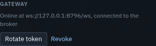
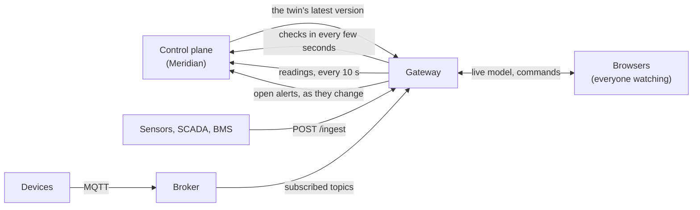
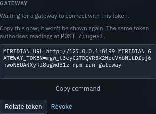

# Gateways and live data

On its own, a twin runs its model in your browser: everyone who opens it sees their own copy. A **gateway** runs the twin as a service instead. Everyone watching sees the same model, commands reach the one twin, and real readings from sensors replace the model's guesses wherever you have them.



## How it works



- The gateway fetches the twin's latest version, and follows each new version within a few seconds.
- A reading **pins** its metric: the model uses the measured value and works out the rest from it. Where sensors report, the twin follows reality; where they don't, the model fills the gaps.
- The gateway runs the twin's rules itself and tells Meridian which alerts are open, so they're [logged](07-alerts-time-and-what-if.md#the-alert-log) even when nobody is watching.
- Every reading is also sent back to Meridian and kept, so you can [chart what was recorded](10-devices-and-mqtt.md#see-what-was-recorded) long after the model's own 24-hour window. Readings that arrive in files, or from systems without a gateway, can be [imported](18-importing-readings.md) instead.
- The gateway is admitted by a **token**. Browsers get in with a pass Meridian signs for each visit, which says whether that person may send commands.

## Issue a token



1. Open the twin, choose **Layout**, and find **Gateway**. It reads **No token yet.**
2. Choose **Issue token**.
3. The command to run the gateway appears, with the token in it. **Copy it now: it won't be shown again.** Meridian only keeps a fingerprint of the token.

    ```bash
    MERIDIAN_URL=https://meridian.example.com MERIDIAN_GATEWAY_TOKEN=mgw_… npm run gateway
    ```

4. Run the command on the machine that will host the gateway (it needs Node and a copy of Meridian's code; see [Running Meridian](14-running-meridian.md#the-gateway)). The section changes to **Online at ws://…** within a few seconds.

## The gateway's state

The **Gateway** section always says how it's doing:

| It says                                               | Meaning                                                   |
| ----------------------------------------------------- | --------------------------------------------------------- |
| **No token yet.**                                     | Nothing has been issued                                   |
| **Waiting for a gateway to connect with this token.** | Issued, but nothing has checked in with it yet            |
| **Online at ws://…, connected to the broker**         | Checked in within the last 30 seconds, and receiving MQTT |
| **Online at ws://…, but not connected to the broker** | Running, but it can't reach or log in to the MQTT broker  |
| **Offline, last seen …**                              | It has stopped checking in                                |

While it's online, it also lists each [OPC UA server](11-opc-ua.md#see-the-connections) it's reading from, and whether it's connected.

## Live or simulator

While a gateway is online, the top bar shows a **Simulator / Live** switch:

- **Live** (the default) follows the gateway. The source in the top bar shows its address, and how many metrics are measured.
- **Simulator** runs the twin's model in your browser instead, as if there were no gateway. It's handy for trying a what-if or a command without touching the shared twin.

In **Live**, commands go to the gateway and everyone sees them. Viewers can watch but their commands are refused.

## Rotate or revoke the token

- **Rotate token** issues a new token and stops accepting the old one at once. Update the gateway's command and restart it. Use this if a token may have leaked.
- **Revoke** cuts the gateway off and leaves the twin without a token.

Both ask you to confirm first.

## Send readings over HTTP

Anything that can make an HTTP request can send readings to the gateway: a SCADA export, a building management system, a script. Send the same token as a bearer token:

```bash
curl -X POST http://gateway-host:8787/ingest \
  -H "authorization: Bearer mgw_…" \
  -H 'content-type: application/json' \
  -d '[{"asset":"store","metric":"tempC","value":1.4,"ttlS":900}]'
```

- Send one reading, or a list of them.
- **`asset`** and **`metric`** name what was measured: an asset's id from the twin's definition, and one of its metrics.
- **`ttlS`** (optional) is how long the reading holds before the model takes over again.
- The gateway answers **202** when it accepts the readings, or **422** with every problem it found, such as an asset that doesn't exist.

For sensors that speak MQTT, use [devices](10-devices-and-mqtt.md) instead, and for PLCs and SCADA systems, [OPC UA](11-opc-ua.md).

## Tips

- **One gateway per twin.** The token belongs to one twin; each twin you want live needs its own.
- **Keep the gateway close to the sensors.** It can run on a small machine on site, and only needs to reach Meridian and the broker.
- **Check the inspector.** A metric fed by a sensor is marked as measured, so you can tell real readings from modelled ones.

## See also

- [Devices and MQTT](10-devices-and-mqtt.md): sensors publishing over MQTT.
- [OPC UA](11-opc-ua.md): reading from PLCs and SCADA systems.
- [Running Meridian](14-running-meridian.md#the-gateway): gateway settings.
