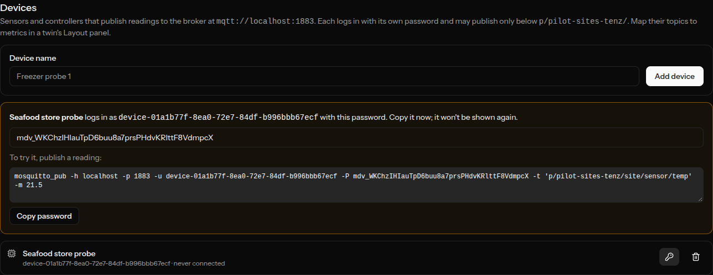
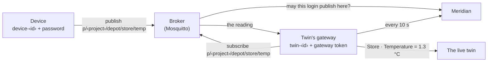
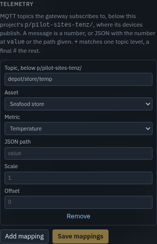
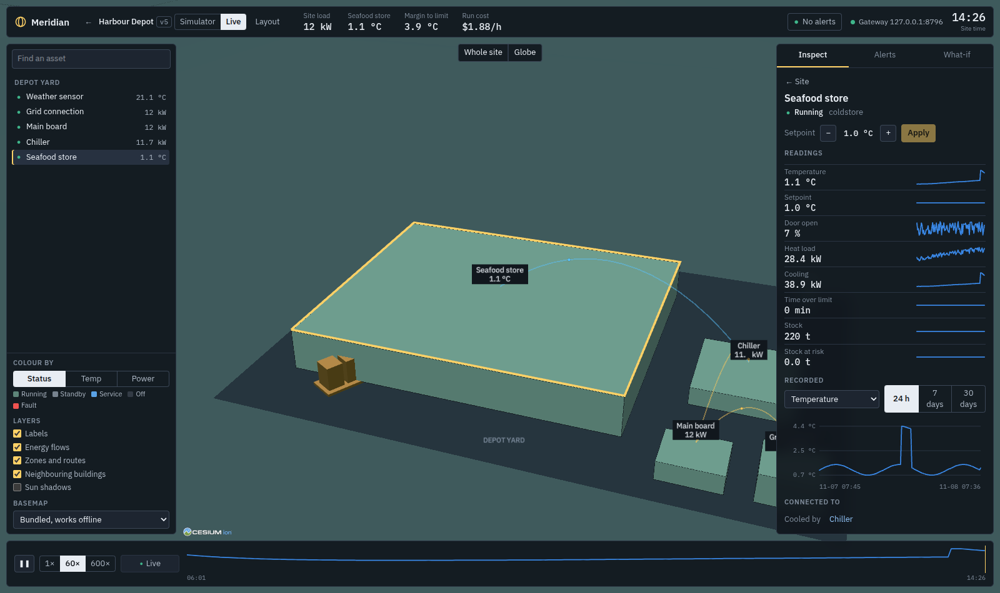

# Devices and MQTT

Most sensors and controllers send their readings over **MQTT**: a small, simple protocol where each device publishes messages to named **topics** (like `depot/store/temp`) on a server called a **broker**, and anything interested subscribes to them. Meridian runs a broker (Mosquitto), gives each device its own login, and lets you map topics onto the metrics of any asset in a twin. A twin's gateway subscribes to those topics, feeds the readings into the model, and sends them back to Meridian to keep.



## How it works



Every project has its own **topic prefix**, such as `p/pilot-sites-ayjl/`. Everything the project's devices publish sits below it, and the broker asks Meridian about every login and every topic:

```text
when someone logs in:
    a device?    → its password must match the one Meridian issued
    a gateway?   → its twin's gateway token must match
    anyone else  → refused

when they publish or subscribe to a topic:
    a device     → may publish below its own project's prefix; may not subscribe
    a gateway    → may subscribe below its twin's project's prefix; may not publish
    anything else, including other projects' topics and $SYS → refused
```

So a device can only ever put readings into its own project, and it can't listen to anyone else's.

## Add a device

Only editors can add devices.

1. On the project page, find **Devices**. It shows the broker's address, like `mqtt://localhost:1883`.
2. Enter a **Name** for the device, such as `Freezer probe 1`. Names are unique within a project.
3. Choose **Add device**.
4. Its **login** (`device-…`) and **password** (`mdv_…`) are shown, with an example command. **Copy the password now: it won't be shown again.** Meridian only keeps a fingerprint of it.

Set the device up with:

| Setting  | Value                                                                              |
| -------- | ---------------------------------------------------------------------------------- |
| Broker   | The address shown under **Devices**                                                |
| Username | The device's login, `device-…`                                                     |
| Password | The `mdv_…` password                                                               |
| Topic    | Anything below the project's prefix, such as `p/pilot-sites-ayjl/depot/store/temp` |

To try it from a terminal, use the example command shown with the password:

```bash
mosquitto_pub -h localhost -p 1883 -u device-… -P mdv_… \
  -t 'p/pilot-sites-ayjl/site/sensor/temp' -m 21.5
```

Each device shows **never connected** until it first logs in, then **last connected** with the time.

## Reset a password or delete a device

- **Reset its password** (the key button): issues a new password, shown once. The old one stops working within a minute, so update the device straight away.
- **Delete** (the bin button): the broker stops accepting the device within a minute.

Both ask you to confirm first.

## Map topics onto metrics



A reading only reaches a twin once the twin says what it means. Do this in the twin's **Layout** panel, under **Telemetry**:

1. Choose **Add mapping**.
2. Fill in:
    - **Topic, below p/…/**: the topic, without the prefix, such as `depot/store/temp`. `+` matches one level and a final `#` matches the rest, so `depot/+/temp` takes the temperature from every store.
    - **Asset** and **Metric**: what the reading is, such as **Seafood store** and **Temperature**.
    - **JSON path** (optional): for JSON messages, where the number is, such as `meter.w`. Without one, a message can be a bare number (`1.3`) or JSON with a `value` (`{"value": 1.3}`).
    - **Scale** and **Offset** (optional): to convert units. The reading is multiplied by the scale, then the offset is added. For watts to kilowatts, use a scale of `0.001`.
3. Choose **Save mappings**. They're checked, then saved as a new version; the gateway subscribes to new topics and drops old ones within a few seconds.

Messages without a number are skipped and counted on the gateway's `/health`. A mapping onto a metric the asset doesn't have is skipped with a warning.

## See what was recorded



Every reading the gateway receives is kept by Meridian, for a year unless your administrator changes it. Select an asset in the viewer and find **Recorded** in the inspector:

- Choose a metric, and **24 h**, **7 days** or **30 days**.
- The chart shows the average reading for each interval, in real time rather than the model's clock.
- Until a gateway has sent something for that metric, it says **No readings recorded in this range.**

## Tips

- **Check the gateway state.** If readings aren't arriving, the twin's **Gateway** section says whether its gateway is connected to the broker.
- **Name devices for where they are.** "Freezer probe 1" helps whoever has to go and find it.
- **One device, one login.** Don't share a password between devices; then one can be reset or removed without touching the others.
- **Use TLS outside your own network.** The broker speaks plain MQTT; see [Running Meridian](13-running-meridian.md#the-broker).

## See also

- [Gateways and live data](09-gateways-and-live-data.md): running the gateway that subscribes.
- [Layout and versions](08-layout-and-versions.md): the Layout panel.
