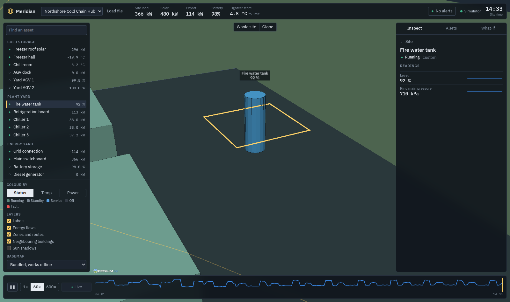
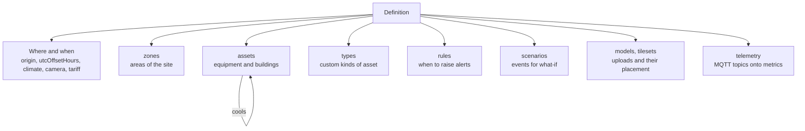

# Twin definitions

Behind every twin is a **definition**: one JSON file that describes the site. The control plane writes most of it for you (uploads, placements, telemetry), but some things, like custom equipment, alert rules and what-if scenarios, are written by hand. Download the definition, edit it, and load it back as a new version.



## Edit a definition

1. Open the twin, choose **Layout**, and under **Definition** choose **Download JSON**.
2. Edit the file in any text editor. One that checks JSON as you type helps.
3. Back under **Definition**, choose **Replace…** and pick the file.
4. Meridian checks it. If anything is wrong, every problem is listed and the twin is left as it was. Otherwise it's saved as a new version, **Replaced from your-file.json**.

You can also start a new twin from a file: **New twin → A definition file**.

## What's in it



| Part                 | What it says                                                                                           |
| -------------------- | ------------------------------------------------------------------------------------------------------ |
| `origin`             | The site's latitude and longitude. Every position is in metres east and north of it                    |
| `utcOffsetHours`     | The site's time zone, for the clock and the sun                                                        |
| `climate`            | The typical temperature and its daily swing, for the weather model                                     |
| `camera`             | Where the standard view looks from                                                                     |
| `tariff`             | Off-peak and peak power prices and hours, for the cost figures                                         |
| `zones`              | Named areas, drawn on the ground, that group assets in the list                                        |
| `assets`             | Everything on site: its `kind`, where it is, how big, what feeds it (`fedBy`), what it cools (`cools`) |
| `types`              | Custom kinds of equipment, with their own metrics                                                      |
| `rules`              | When to raise alerts                                                                                   |
| `scenarios`          | Events to try in what-if                                                                               |
| `models`, `tilesets` | Uploads shown in the twin, and their placement. Written by the Layout panel                            |
| `telemetry`          | MQTT topics mapped onto metrics. Written by the Layout panel                                           |

The built-in kinds of asset are `site`, `weather`, `grid`, `solar`, `battery`, `genset`, `bus`, `chiller`, `coldstore`, `building`, `charger`, `vehicle` and `custom`. Every twin needs one main `bus` (the main board) with no `fedBy`; power flows from it through each asset's `fedBy`. The [Northshore definition](../../public/samples/northshore.json) uses every feature, and [Harbour Depot](../../public/samples/harbour-depot.json) is close to the minimum.

## Custom asset types

The model has physics for power and cooling equipment. Anything else, like a fire water tank, a pump or an air quality sensor, can be described as a **custom type**: its metrics, their units and starting values, and how it looks. Its readings come from sensors, and rules can alert on them.

```jsonc
"types": [{
  "id": "water-tank", "name": "Fire water tank", "primary": "levelPct",
  "metrics": [
    { "key": "levelPct", "label": "Level", "unit": "%", "decimals": 0, "default": 92 },
    { "key": "pressureKpa", "label": "Ring main pressure", "unit": "kPa", "default": 710 }
  ],
  "visual": { "color": "#3a7ca5", "shape": "cylinder", "height": 9 }
}],
"assets": [
  { "id": "fire-tank", "name": "Fire water tank", "kind": "custom", "type": "water-tank",
    "zone": "plant", "position": [134, 70] }
]
```

- **`id`**: lowercase letters, digits, `-` and `_`.
- **`primary`**: the metric shown beside the asset in the list.
- **`metrics`**: each with a camelCase `key` (`state` is reserved), a `label`, a `unit`, and the value it starts at (`default`).
- **`visual`**: the colour, shape and height it's drawn with.

To feed it, [map a topic](09-devices-and-mqtt.md#map-topics-onto-metrics) onto one of its metrics, or post a reading to the gateway.

## Rules

A rule raises an alert when a metric passes a threshold, on one asset (`asset`) or on every asset of a kind (`kind`):

```jsonc
"rules": [
  { "id": "fire-water-low", "name": "Fire water low", "severity": "warning",
    "asset": "fire-tank", "metric": "levelPct", "op": "lt", "threshold": 60, "clearAt": 65,
    "message": "{asset} is below 60%" },
  { "id": "freezer-drift", "name": "Freezer drifting warm", "severity": "warning",
    "asset": "freezer", "metric": "tempC", "op": "gt", "threshold": -18, "forS": 300, "clearAt": -18.6,
    "message": "{asset} is drifting above -18 °C" }
]
```

Each step, for every asset the rule covers:

```text
if not raised:
    if value is past the threshold (op "gt" = above, "lt" = below)
       and has been for forS seconds (0 if not set):
        raise it, with {asset} in the message replaced by the asset's name
if raised:
    if value is back past clearAt (the threshold if not set):
        clear it
```

- **`severity`**: `info`, `warning` or `critical`. Critical alerts lead the what-if results.
- **`forS`**: how long it must stay past the threshold first, so brief blips don't raise it.
- **`clearAt`**: a value a little way back from the threshold, so an alert doesn't flicker on and off around it.

## Scenarios

A scenario is an event for [what-if](06-alerts-time-and-what-if.md#what-if): one or more faults.

```jsonc
"scenarios": [
  { "id": "grid-outage", "name": "Grid outage, 4 hours",
    "description": "The network feeder drops; the battery bridges to the generator.",
    "faults": [{ "type": "grid-outage", "durationS": 14400 }] },
  { "id": "trip", "name": "Chiller 1 trips",
    "faults": [{ "type": "trip", "target": "ch-1" }] },
  { "id": "heatwave", "name": "Heatwave, +11 °C",
    "faults": [{ "type": "heatwave", "magnitude": 11 }] }
]
```

The fault types are `grid-outage`, `trip` (any asset, named as `target`), `door-stuck`, `heatwave`, `bearing-wear`, `genset-fail` and `cloud-cover`. Each can start after `offsetS` seconds and last `durationS` seconds; some take a `target` (the door that sticks, the chiller that wears) or a `magnitude` (how many degrees hotter, how worn).

## When a definition is refused

Meridian lists every problem at once, so you can fix them in one go. Common ones:

- an unknown `kind`, `zone` or `type`
- a `fedBy` or `cools` that names an asset that doesn't exist, or power that feeds round in a circle
- no main `bus`, or more than one
- a rule or scenario aimed at an asset that doesn't exist
- a custom type with a bad `id` or metric `key`
- a model or tileset with no `url` or a bad placement

## See also

- The project [README](../../README.md#writing-a-twin) has the complete reference.
- [Layout and versions](07-layout-and-versions.md): downloading, replacing and restoring.
