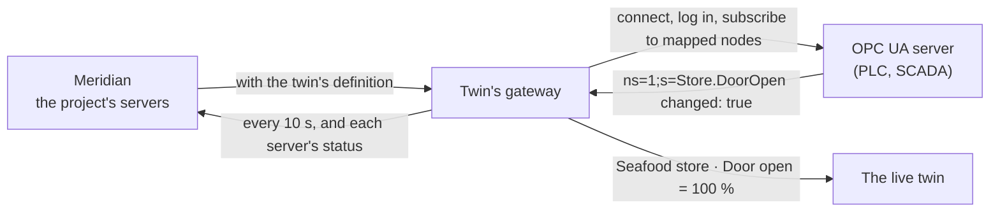
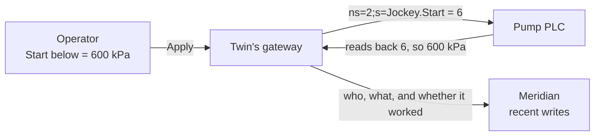
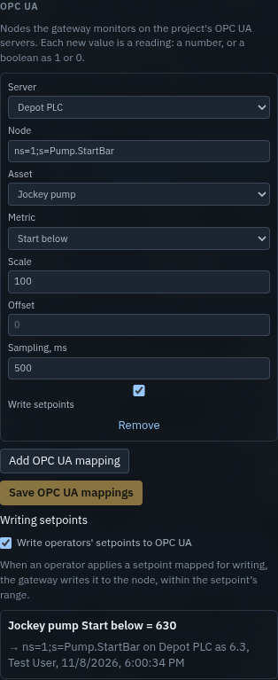

# OPC UA

Most PLCs, SCADA systems and building controllers speak **OPC UA**. A server publishes its data as **nodes**, each with an id such as `ns=2;s=Store.TempC`, and clients can subscribe to be told whenever a node's value changes. Meridian keeps a list of each project's OPC UA servers. A twin says which nodes feed which asset metrics, and the twin's gateway connects to the servers, watches those nodes, and treats every new value as a reading, just like one from MQTT.


## How it works



- The gateway connects to the servers your twin maps, not every server in the project.
- It keeps one connection per server, and reconnects on its own if the server restarts or the network drops.
- It's only told about changes, so a value that holds steady doesn't send anything. A reading lasts as long as its **TTL**; after that, the model carries on simulating the metric.
- Readings from OPC UA are kept and charted just like MQTT ones. See [what was recorded](10-devices-and-mqtt.md#see-what-was-recorded).

Meridian can also write an operator's setpoint back to a server, but only for mappings marked for writing, and only once an editor turns writing on for the twin. See [Write setpoints](#write-setpoints).

## Add a server

Only editors can add servers.

1. On the project page, find **OPC UA servers**.
2. Fill in:
    - **Server name**: what twins will call it, such as `Depot PLC`. Names are unique within a project.
    - **Endpoint**: the server's address, which starts with `opc.tcp://`, such as `opc.tcp://plc.local:4840`. Your controls engineer or the server's documentation will have it.
    - **Security**: **None**, **Sign** or **Sign and encrypt**. Use what the server is set up for; see [Secured servers](#secured-servers).
    - **Security policy**: the algorithms for **Sign** or **Sign and encrypt**. `Basic256Sha256` works with most servers.
    - **Username** and **Password** (optional): if the server wants a login rather than anonymous access.
3. Choose **Add server**.

The list shows each server's endpoint, security and login. The password is kept encrypted and is never shown again; it's only ever sent to the project's gateways. To change a server, delete it and add it again with the same name. Twins find servers by name, so their mappings keep working.

## Map nodes onto metrics


In the twin's **Layout** panel, under **OPC UA**:

1. Choose **Add OPC UA mapping**.
2. Fill in:
    - **Server**: one of the project's servers.
    - **Node**: the node id, such as `ns=2;s=Store.TempC` or `ns=3;i=1042`. Find it in the server's documentation, or browse the server with a client such as UaExpert.
    - **Asset** and **Metric**: what the value is.
    - **Scale** and **Offset** (optional): to convert units. The value is multiplied by the scale, then the offset is added.
    - **Sampling, ms** (optional): how often the server should check the node for changes, from 50 ms; 1000 ms by default.
3. Choose **Save OPC UA mappings**. They're checked, then saved as a new version, and the gateway follows them within a few seconds.

Numbers are used as they are. A switch (a boolean) counts as 1 when on and 0 when off, so a scale of `100` turns a door switch into **Door open** as a percentage. Text that isn't a number is skipped.

A node id is written as an optional namespace (`ns=2;`) followed by the kind of identifier and the identifier itself:

| Kind   | Example                                       |
| ------ | --------------------------------------------- |
| String | `ns=2;s=Store.TempC`                          |
| Number | `ns=3;i=1042`                                 |
| GUID   | `ns=2;g=5ce9dbce-5d79-434c-9ac3-1cfba9a6e92c` |
| Bytes  | `ns=2;b=M/RbKBsRVkePCePcx24oRA==`             |

A mapping to a server the project doesn't have is skipped, and so is one to a metric the asset doesn't have. The gateway logs a warning for each.

## Write setpoints

An operator applying a setpoint, such as the jockey pump's **Start below**, changes the model. With writing on, the gateway also writes the new setpoint to the PLC, so the real pump starts at the new pressure.



Only a custom type's setpoints can be written: the metrics an operator can change with **−** and **+** in the inspector. A temperature or a power reading can't.

To set it up (editors only):

1. In the **OPC UA** section of the **Layout** panel, map the setpoint's node as usual, such as the **Jockey pump**'s **Start below**.
2. Tick **Write setpoints** on that mapping. It's only available for a setpoint.
3. Choose **Save OPC UA mappings**.
4. Under **Writing setpoints**, tick **Write operators' setpoints to OPC UA**, and confirm.

From then on, when an operator applies that setpoint:

- It's kept within the type's range first, just as in the model. Asking for 900 kPa when the most is 720 writes 720.
- The mapping's **Scale** and **Offset** are undone, so the node is sent what it would report back. With a scale of `100` (the PLC holds bar, Meridian shows kPa), 600 kPa is written as `6`.
- It's written as the node's own type: a whole number for an integer node, rounded, or on or off for a switch (anything but 0 is on). A value that doesn't fit the node, such as 70,000 for a 16-bit counter, is refused.
- The mapping keeps reading the node, so the model shows what the PLC actually holds.

If the server refuses the write (the node is read-only, or the gateway's login can't write), the operator sees why, and the model keeps the new setpoint until the PLC's own value comes back. While writing is off, applying a mapped setpoint changes only the model, and the operator is told so.



Every write, good or not, is recorded: when, who asked, the node and server, the setpoint asked for and the one written, and any error. The last 20 are listed under **Writing setpoints**. Viewers can't apply setpoints, so they can never write.

## See the connections


While the gateway is online, the **Gateway** section of the Layout panel lists each OPC UA server it's using and how its connection is:

| It says          | Meaning                                                                      |
| ---------------- | ---------------------------------------------------------------------------- |
| **connecting**   | Trying to reach the server for the first time; it keeps trying               |
| **connected**    | Logged in and subscribed                                                     |
| **reconnecting** | The connection dropped; it's reconnecting and will pick the subscription up  |
| **failed**       | The server refused it, such as a wrong password or a certificate not trusted |

The gateway's `/health` page has more detail: the last error, and any nodes the server refused (such as a node id that doesn't exist).

## Secured servers

With **Sign** or **Sign and encrypt**, the gateway and the server each prove who they are with a certificate, and each has to trust the other's:

1. The gateway makes its own certificate the first time it starts, in its PKI folder (`OPCUA_PKI_DIR`; see [Running Meridian](14-running-meridian.md#the-gateway)).
2. On the server, trust the gateway's certificate. Most servers put a new client's certificate in a "rejected" or "pending" list for an administrator to approve.
3. In the gateway's PKI folder, move the server's certificate from `rejected/` to `trusted/certs/`. Or start the gateway with `OPCUA_ACCEPT_UNKNOWN_CERTIFICATES=1` to trust whatever certificate a server presents first.

Until both sides trust each other, the server shows as **failed**.

## Try it with the simulator

Meridian comes with a small OPC UA server to try things on:

```bash
npm run opcua-simulator
```

It listens at `opc.tcp://127.0.0.1:4840/meridian`, anonymous and unsecured, with:

| Node                     | What it is                                           |
| ------------------------ | ---------------------------------------------------- |
| `ns=1;s=Store.TempC`     | A freezer temperature, swinging slowly around −18 °C |
| `ns=1;s=Store.DoorOpen`  | A door switch, open for 10 seconds every 2 minutes   |
| `ns=1;s=Meter.EnergyWh`  | An energy meter, counting up                         |
| `ns=1;s=Pump.StartBar` | A pump's start pressure in bar, a writable Double: 6 |
| `ns=1;s=Fan.SpeedPct`    | A writable fan speed, a whole number from 0 to 65535 |

Add it to a project as a server, map `ns=1;s=Store.TempC` onto a cold store's **Temperature**, and start the twin's gateway on the same machine.

## Tips

- **Name servers for what they are.** "Depot PLC" is clearer to whoever maps nodes than "192.168.1.20".
- **Give the gateway a login of its own** on the server. Give it read-only access unless the twin writes setpoints, and then write access only to those nodes. You can see its sessions in the server's logs.
- **Write only what's safe to change remotely.** A setpoint's range in its type is the last check before the PLC, so keep it within what the plant can take, and keep the PLC's own interlocks.
- **Don't sample faster than you need.** Most building and cold chain values change over seconds or minutes. 1000 ms is plenty, and faster sampling loads the PLC.
- **Use security outside a closed network.** **None** sends values and passwords in the clear.

## See also

- [Devices and MQTT](10-devices-and-mqtt.md): readings from sensors over MQTT, and the recorded history.
- [Gateways and live data](09-gateways-and-live-data.md): running the gateway that connects.
- [Running Meridian](14-running-meridian.md#the-gateway): the gateway's settings.
