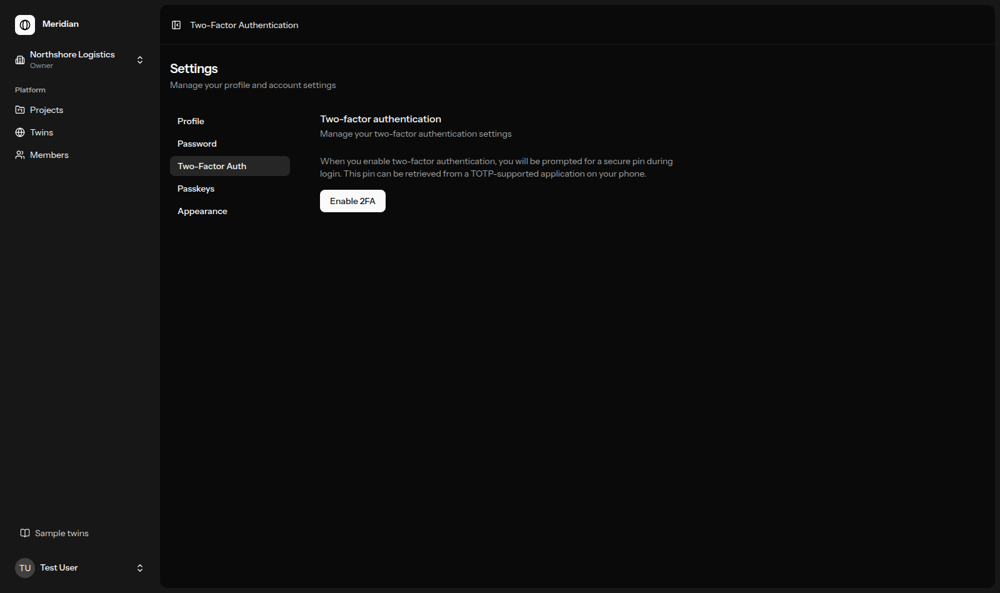

# Your account

Your account is yours across every organisation you belong to. Open it from **your name** at the bottom of the sidebar, then **Settings**.

## Profile

Under **Profile**, change your **Name** and **Email address**, then choose **Save**. If you change your email address, Meridian may ask you to verify the new one with a link sent to it.

**Delete account**, at the bottom, deletes your account for good after you confirm your password. Your organisations, projects and twins aren't deleted with it. If you're an organisation's only owner, [make someone else an owner](02-organisations-and-members.md#change-a-role-or-remove-someone) first, or nobody will be able to manage its members.

## Password

Under **Password**, enter your **Current password**, then a **New password** twice, and choose **Save password**. Use a long, random password from a password manager.

Forgotten it? On the sign-in page choose **Forgot password?**, enter your email, and follow the link that arrives.

## Two-factor authentication

With two-factor authentication on, signing in needs a six-digit code from an authenticator app on your phone as well as your password, so a stolen password alone isn't enough.

1. Under **Two-Factor Auth**, choose **Enable 2FA**. Meridian may ask for your password first.
2. Scan the QR code with an authenticator app (1Password, Google Authenticator, Microsoft Authenticator and others), or type in the setup key, then choose **Continue setup**.
3. Enter the six-digit code the app shows, and confirm.
4. Choose **View recovery codes** and keep them somewhere safe. Each one gets you in once if you lose your phone. **Regenerate codes** replaces them all.

To turn it off, choose **Disable 2FA**.

## Passkeys

A passkey signs you in with your device's fingerprint, face or PIN instead of a password. It can't be phished or reused on another site.

1. Under **Passkeys**, choose **Add passkey**.
2. Give it a name you'll recognise, such as `MacBook Pro` or `iPhone`, and follow your browser's prompts.

Next time, choose **Sign in with a passkey** on the sign-in page. To remove one, choose **Remove passkey** beside it. If your browser says **Passkeys are not supported in this browser.**, use your password instead.

## Appearance

Under **Appearance**, choose **Light**, **Dark** or **System** (follow your computer's setting). It applies to the control plane's pages; the twin viewer is always dark, so the 3D scene and its colours read the same for everyone.

## See also

- [Getting started](01-getting-started.md#sign-in): signing in.
- [Organisations and members](02-organisations-and-members.md): your role in each organisation.
