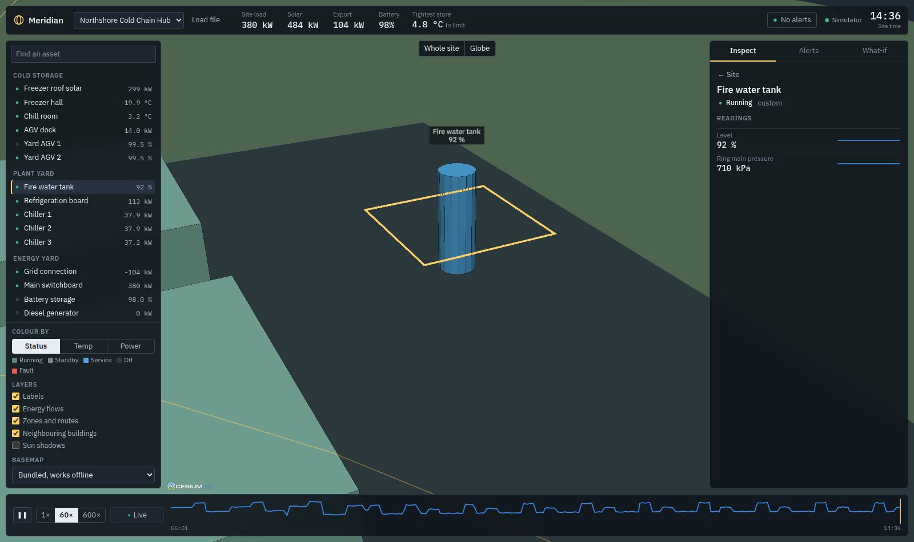
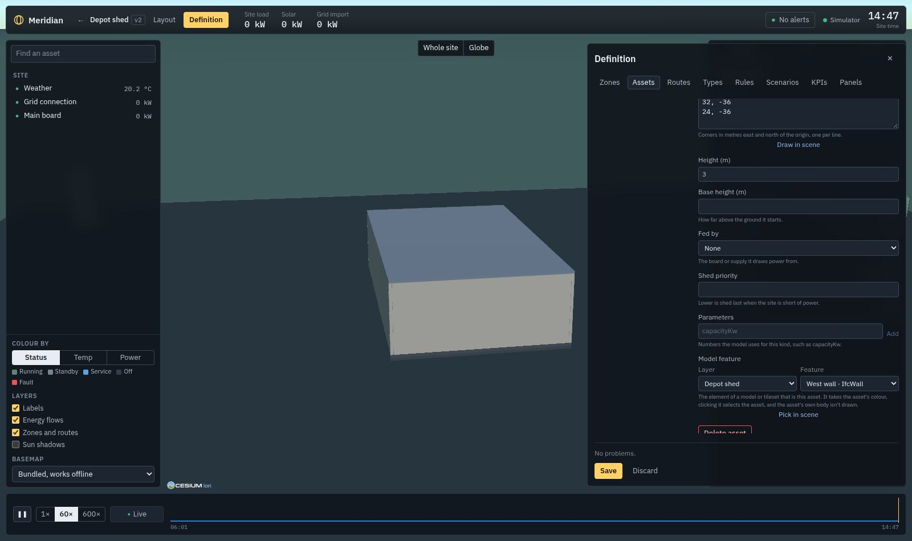
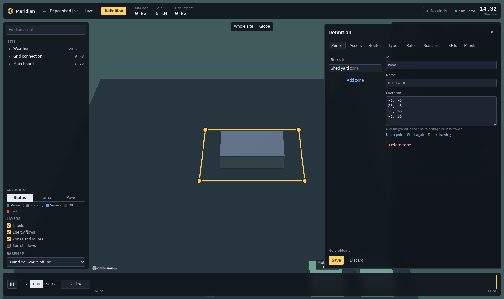
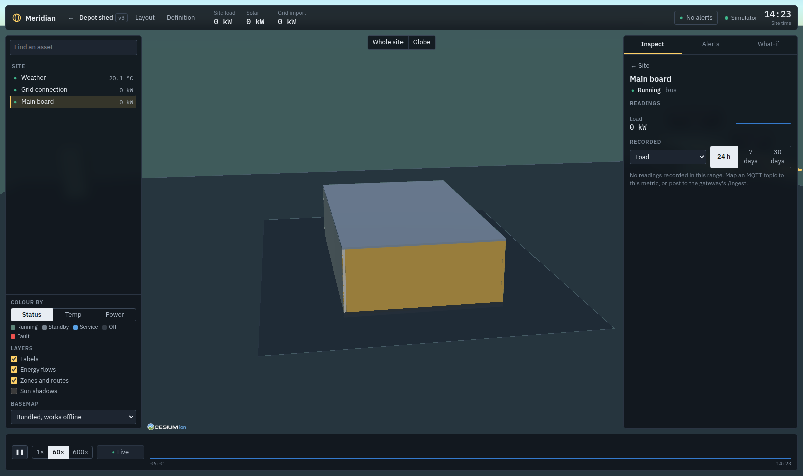
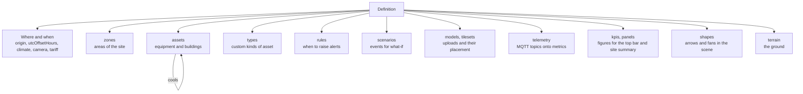
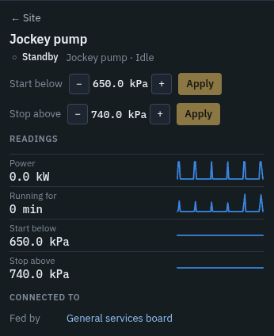
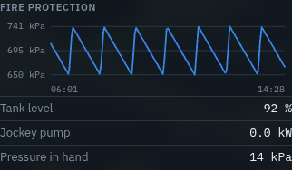
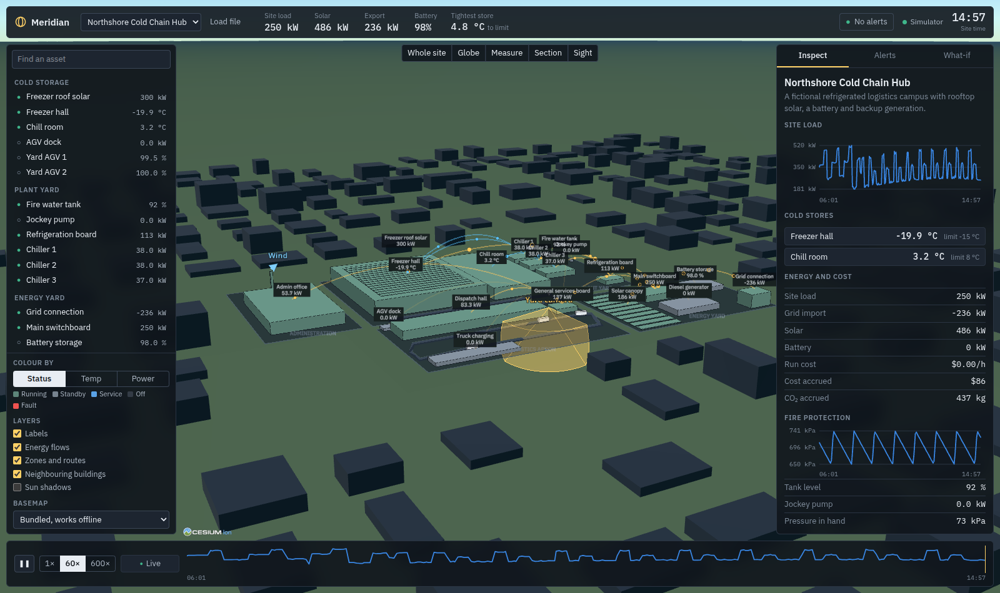
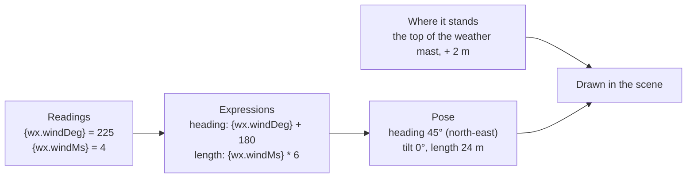

# Twin definitions

Behind every twin is a **definition**: one JSON file that describes the site: its zones and assets, how they're powered, custom equipment and how it behaves, alert rules, the top bar's figures and what-if scenarios. You edit all of it in the **Definition** panel, with forms that check what you enter as you type, and draw zones and routes on the ground. Or download the JSON, edit it by hand, and load it back. Either way, every save is a new version.



## Edit a definition



Only editors can change a definition.

1. On the twin page, choose **Definition** in the top bar. The panel opens on the right.
2. Choose a tab for the list you want: **Zones**, **Assets**, **Routes**, **Types**, **Rules**, **Scenarios**, **KPIs**, **Panels** or **Shapes**.
3. Choose an item in the list to edit it, or **Add zone** (**Add asset**, and so on) for a new one.
4. Change the form. It shows only the fields that apply: a vehicle gets a route, a custom asset a type, a chiller the stores it cools. Lists inside an item, such as a route's stops or a type's metrics, are edited in place. Where a field refers to something else, such as a zone, a route or a rule's metric, it offers what the definition has.
5. Choose **Save**. Everything you changed, on every tab, is saved as one version, with a note naming the lists that changed, such as **Edited zones and assets**.

While you edit:

- **Everything is checked as you type**, with the same checks the server makes. Problems are listed at the bottom of the panel, and **Save** stays off until there are none. Deleting a zone that assets are in, for example, lists each of those assets until you move them.
- **The scene shows your changes** before you save.
- **Discard** drops everything you changed since the last save, after asking. **Delete asset** (or zone, and so on) removes the item you're editing.

### Draw in the scene



A zone's **Footprint** and a route's **Path** are lists of points, one per line, as `east, north` in metres from the twin's origin. Type them, or draw them:

1. Choose **Draw in scene** under the field.
2. Click the ground for each point, in order. Each click adds one.
3. Drag a point to move it. **Undo point** takes off the last one, and **Start again** clears them all.
4. Choose **Done drawing**.

An asset's position works the same way: choose **Place in scene**, click where it stands (click again to move it), and **Done placing**.

### Bind an asset to an element



An asset can stand for one element of a model or tileset, such as a wall, a pump or a switchboard in a [BIM model](03-projects-and-the-library.md#bim-models). The element then takes the asset's colour (by status, temperature or power, as you've chosen in the viewer), clicking it selects the asset, and the asset's own box isn't drawn.

1. In the **Definition** panel, edit the asset.
2. Under **Model feature**, either:
    - choose **Pick in scene**, then click the element in the scene; or
    - choose the **Layer**, then the element from **Feature**. A BIM model lists its elements by name; for a tileset, type the element's id.
3. **Save**.

To unbind it, set **Layer** to **None**. Removing the layer from the twin unbinds its assets for you.

A tileset's elements can only be bound if its metadata gives each one an id. Elements are matched on the layer's `featureProperty`, which is `id` unless the JSON says otherwise, such as `"featureProperty": "GlobalId"`.

## Edit the JSON

For changes in bulk, or to copy a definition between twins:

1. Open the twin, choose **Layout**, and under **Definition** choose **Download JSON**.
2. Edit the file in any text editor. One that checks JSON as you type helps.
3. Back under **Definition**, choose **Replace…** and pick the file.
4. Meridian checks it. If anything is wrong, every problem is listed and the twin is left as it was. Otherwise it's saved as a new version, **Replaced from your-file.json**.

You can also start a new twin from a file: **New twin → A definition file**. The rest of this chapter describes what's in the file, which is also what the editor's forms are built from.

## What's in it



| Part                 | What it says                                                                                           |
| -------------------- | ------------------------------------------------------------------------------------------------------ |
| `origin`             | The site's latitude and longitude. Every position is in metres east and north of it                    |
| `utcOffsetHours`     | The site's time zone, for the clock and the sun                                                        |
| `climate`            | The typical temperature and its daily swing, for the weather model                                     |
| `camera`             | Where the standard view looks from                                                                     |
| `tariff`             | Off-peak and peak power prices and hours, for the cost figures                                         |
| `zones`              | Named areas, drawn on the ground, that group assets in the list                                        |
| `assets`             | Everything on site: its `kind`, where it is, how big, what feeds it (`fedBy`), what it cools (`cools`) |
| `types`              | Custom kinds of equipment, with their own metrics                                                      |
| `rules`              | When to raise alerts                                                                                   |
| `scenarios`          | Events to try in what-if                                                                               |
| `models`, `tilesets` | Uploads shown in the twin, and their placement. Written by the Layout panel                            |
| `telemetry`          | MQTT topics mapped onto metrics. Written by the Layout panel                                           |
| `kpis`, `panels`     | The figures in the top bar, and extra panels in the site summary                                       |
| `shapes`             | Arrows and fans drawn in the scene, which can follow readings                                          |
| `terrain`            | The ground the site stands on. Written by the Layout panel                                             |

The built-in kinds of asset are `site`, `weather`, `grid`, `solar`, `battery`, `genset`, `bus`, `chiller`, `coldstore`, `building`, `charger`, `vehicle` and `custom`. Every twin needs one main `bus` (the main board) with no `fedBy`; power flows from it through each asset's `fedBy`. The [Northshore definition](../../public/samples/northshore.json) uses every feature, and [Harbour Depot](../../public/samples/harbour-depot.json) is close to the minimum.

## Custom asset types

The model has physics for power and cooling equipment. Anything else, like a fire water tank, a pump or an air quality sensor, can be described as a **custom type**: its metrics, their units and starting values, and how it looks. Its readings come from sensors, and rules can alert on them.

```jsonc
"types": [{
  "id": "water-tank", "name": "Fire water tank", "primary": "levelPct",
  "metrics": [
    { "key": "levelPct", "label": "Level", "unit": "%", "decimals": 0, "default": 92 },
    { "key": "pressureKpa", "label": "Ring main pressure", "unit": "kPa", "default": 710 }
  ],
  "visual": { "color": "#3a7ca5", "shape": "cylinder", "height": 9 }
}],
"assets": [
  { "id": "fire-tank", "name": "Fire water tank", "kind": "custom", "type": "water-tank",
    "zone": "plant", "position": [134, 70] }
]
```

- **`id`**: lowercase letters, digits, `-` and `_`.
- **`primary`**: the metric shown beside the asset in the list.
- **`metrics`**: each with a camelCase `key` (`state` is reserved), a `label`, a `unit`, and the value it starts at (`default`).
- **`visual`**: the colour, shape and height it's drawn with.

To feed it, [map a topic](10-devices-and-mqtt.md#map-topics-onto-metrics) onto one of its metrics, or post a reading to the gateway.

Types you use in more than one twin belong in the organisation's [type library](02-organisations-and-members.md#the-type-library), where any twin can take a copy.

### Behaviour

A type can also say how its asset behaves, with no code. Northshore's jockey pump keeps the fire main's pressure between two setpoints an operator can change:

```jsonc
{
    "id": "jockey-pump",
    "name": "Jockey pump",
    "primary": "powerKw",
    "metrics": [
        {
            "key": "powerKw",
            "label": "Power",
            "unit": "kW",
            "expr": "running ? 7.5 : 0",
        },
        {
            "key": "runMin",
            "label": "Running for",
            "unit": "min",
            "expr": "running ? runMin + dt / 60 : 0",
        },
        {
            "key": "startKpa",
            "label": "Start below",
            "unit": "kPa",
            "default": 650,
            "setpoint": { "min": 550, "max": 720, "step": 10 },
        },
        {
            "key": "stopKpa",
            "label": "Stop above",
            "unit": "kPa",
            "default": 740,
            "setpoint": { "min": 680, "max": 820, "step": 10 },
        },
    ],
    "states": [
        { "id": "idle", "label": "Idle", "status": "standby" },
        { "id": "running", "label": "Running", "status": "running" },
    ],
    "transitions": [
        {
            "from": "idle",
            "to": "running",
            "when": "{fire-tank.pressureKpa} < startKpa && powered",
        },
        {
            "from": "running",
            "to": "idle",
            "when": "{fire-tank.pressureKpa} >= stopKpa || !powered",
        },
    ],
    "visual": { "color": "#5b8fb9", "shape": "box", "height": 3 },
}
```

- **`expr`** works a metric out each step from other values. Its own name gives last step's value, so `runMin + dt / 60` counts up.
- **`states`** and **`transitions`** move the asset between states. The first transition whose `from` matches (or is `*`) and whose `when` holds is taken. Each state has a `status` (`running`, `standby`, `off`, `fault` or `maintenance`), which colours the asset.
- **`setpoint`** gives a metric **−**, **+** and **Apply** in the inspector, for operators. Values are kept within `min` and `max`.
- A `powerKw` metric on an asset with a `fedBy` is drawn from that board, so it's shed, tripped and blacked out like any built-in load.



What an expression can use:

| In an expression      |                                                                                               |
| --------------------- | --------------------------------------------------------------------------------------------- |
| Numbers and operators | `+ - * / % ^`, `< <= > >= == !=`, `&& \|\| !` and `c ? a : b`. True is 1 and false is 0       |
| Functions             | `min`, `max`, `abs`, `clamp(x, lo, hi)`, `round`, `floor`, `ceil`, `sqrt`                     |
| Plain names           | The asset's own metrics and states, `dt` (seconds per step), `hour`, `ambientC` and `powered` |
| `{asset.metric}`      | Another asset's metric, such as `{fire-tank.pressureKpa}` or `{wx.ambientC}`                  |

If an expression can't be worked out (it reads something with no value yet, or divides by zero), the metric keeps its last value.

## Rules

A rule raises an alert on one asset (`asset`) or on every asset of a kind (`kind`). The simplest kind compares a metric with a threshold:

```jsonc
"rules": [
  { "id": "fire-water-low", "name": "Fire water low", "severity": "warning",
    "asset": "fire-tank", "metric": "levelPct", "op": "lt", "threshold": 60, "clearAt": 65,
    "message": "{asset} is below 60%" },
  { "id": "freezer-drift", "name": "Freezer drifting warm", "severity": "warning",
    "asset": "freezer", "metric": "tempC", "op": "gt", "threshold": -18, "forS": 300, "clearAt": -18.6,
    "message": "{asset} is drifting above -18 °C" }
]
```

Each step, for every asset the rule covers:

```text
if not raised:
    if value is past the threshold (op "gt" = above, "lt" = below)
       and has been for forS seconds (0 if not set):
        raise it, with {asset} in the message replaced by the asset's name
if raised:
    if value is back past clearAt (the threshold if not set):
        clear it
```

- **`severity`**: `info`, `warning` or `critical`. Critical alerts lead the what-if results.
- **`forS`**: how long it must stay past the threshold first, so brief blips don't raise it.
- **`clearAt`**: a value a little way back from the threshold, so an alert doesn't flicker on and off around it.

Two more kinds of rule:

```jsonc
// How much a metric changed over a window: the freezer warming 2 °C in ten minutes.
{ "id": "freezer-warming-fast", "name": "Freezer warming fast", "severity": "warning",
  "asset": "freezer", "metric": "tempC", "change": { "overS": 600 }, "op": "gt", "threshold": 2,
  "message": "{asset} has warmed 2 °C in ten minutes" },
// An expression, raised while it holds.
{ "id": "jockey-long-run", "name": "Jockey pump running long", "severity": "warning",
  "asset": "jockey", "when": "running && runMin > 20",
  "message": "{asset} has run for 20 minutes: check the ring main for a leak" }
```

- A **change** rule waits until it has a full window of readings.
- An **expression** rule uses the same expressions as types, and clears when it stops holding, or once its `clearWhen` expression holds if it has one.

## KPIs and panels

The figures across the top bar can be your own. Each is an expression over `{asset.metric}` values:

```jsonc
"kpis": [
  { "label": "Site load", "value": "{site.loadKw}", "unit": "kW" },
  { "label": "Seafood store", "value": "{store.tempC}", "unit": "°C", "decimals": 1 },
  { "label": "Margin to limit", "value": "5 - {store.tempC}", "unit": "°C", "decimals": 1 }
]
```


Up to eight fit. Without `kpis`, the top bar shows site load, solar, grid, battery and the store closest to its limit.

**Panels** are added to the site summary in the inspector, shown when no asset is selected. Each has a title, figures, and optionally a chart drawn from the twin's history, so it works when you look back in time too:

```jsonc
"panels": [{
  "title": "Fire protection",
  "chart": { "label": "Ring main pressure", "value": "{fire-tank.pressureKpa}", "unit": "kPa" },
  "items": [
    { "label": "Tank level", "value": "{fire-tank.levelPct}", "unit": "%" },
    { "label": "Pressure in hand", "value": "{fire-tank.pressureKpa} - {jockey.startKpa}", "unit": "kPa" }
  ]
}]
```



## Shapes

Shapes are drawn in the scene for everyone who can see the twin. There are two kinds:

- A **vector** is an arrow, such as the wind, a flow or a crane's reach.
- A **fan** is a sweep of directions out to a radius, such as what a camera, radar or sprinkler covers.

A shape stands on top of an `asset` or at a `position`, raised by its `height`. Its `heading` (degrees clockwise from north), `tilt` (degrees above the level) and, for a vector, `length` (metres) are expressions over `{asset.metric}`, as KPIs are. So a shape can follow readings, or just be a number in quotes:

```jsonc
"shapes": [
  { "id": "wind", "name": "Wind", "kind": "vector", "asset": "wx", "height": 2,
    "heading": "{wx.windDeg} + 180", "length": "{wx.windMs} * 6" },
  { "id": "yard-camera", "name": "Yard camera", "kind": "fan", "position": [10, -112], "height": 9.5,
    "heading": "215", "tilt": "-20", "radius": 70, "across": 70, "up": 40 }
]
```



A fan's `radius` is how far it reaches; `across` is how wide it sweeps, in degrees (360 goes all the way round); and `up` is how tall it is, in degrees (0, the default, gives a flat fan). `color` is a `#rrggbb` colour; vectors are light blue and fans gold by default. A shape whose readings are missing isn't drawn. Every frame, a shape works out where it points from that moment's readings:



Headings wrap past north (405° is 45°), tilts stop at straight up or down, and lengths at nothing. Replaying the last day or forecasting moves the shapes too, since they follow whatever readings the scene is showing.

A weather station reports the wind as `windMs` (metres a second) and `windDeg` (degrees the wind comes from, clockwise from north), so `{wx.windDeg} + 180` points the arrow downwind.

## Terrain

```jsonc
"terrain": { "name": "Depot ground survey", "url": "/assets/…/files/layer.json", "assetId": "…" }
```

**Use as terrain** in the Layout panel writes this for you. See [Terrain](05-terrain.md).

## Scenarios

A scenario is an event for [what-if](07-alerts-time-and-what-if.md#what-if): one or more faults.

```jsonc
"scenarios": [
  { "id": "grid-outage", "name": "Grid outage, 4 hours",
    "description": "The network feeder drops; the battery bridges to the generator.",
    "faults": [{ "type": "grid-outage", "durationS": 14400 }] },
  { "id": "trip", "name": "Chiller 1 trips",
    "faults": [{ "type": "trip", "target": "ch-1" }] },
  { "id": "heatwave", "name": "Heatwave, +11 °C",
    "faults": [{ "type": "heatwave", "magnitude": 11 }] }
]
```

The fault types are `grid-outage`, `trip` (any asset, named as `target`), `door-stuck`, `heatwave`, `bearing-wear`, `genset-fail` and `cloud-cover`. Each can start after `offsetS` seconds and last `durationS` seconds; some take a `target` (the door that sticks, the chiller that wears) or a `magnitude` (how many degrees hotter, how worn).

## When a definition is refused

Meridian lists every problem at once, so you can fix them in one go. Common ones:

- an unknown `kind`, `zone` or `type`
- a `fedBy` or `cools` that names an asset that doesn't exist, or power that feeds round in a circle
- no main `bus`, or more than one
- a rule or scenario aimed at an asset that doesn't exist
- a custom type with a bad `id` or metric `key`
- an expression that doesn't parse, uses a name the type doesn't have, or reads `{asset.metric}` from an asset that doesn't exist
- a setpoint without a `min` below its `max`, or a transition to a state that doesn't exist
- more than eight KPIs, or a figure with no `label`
- a model or tileset with no `url` or a bad placement

## See also

- The project [README](../../README.md#writing-a-twin) has the complete reference.
- [Layout and versions](08-layout-and-versions.md): downloading, replacing and restoring.
