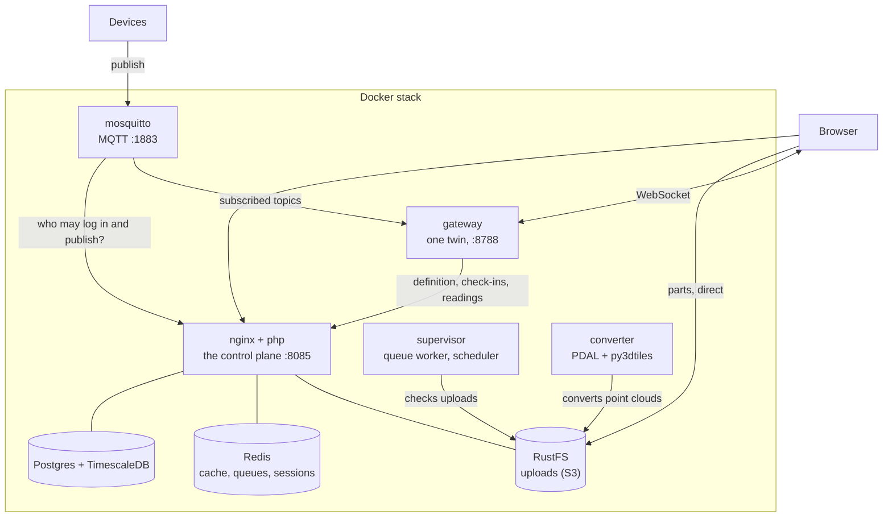

# Running Meridian

This chapter is for whoever installs and looks after Meridian for a team. Meridian is a Laravel app with a few helpers around it: a queue worker for uploads, a converter for point clouds, a gateway per live twin, and an MQTT broker for devices. The Docker stack runs all of them.

## What runs where



| Service        | Job                                                                              | Needed for               |
| -------------- | -------------------------------------------------------------------------------- | ------------------------ |
| `php`, `nginx` | The control plane                                                                | Everything               |
| `supervisor`   | The queue worker (checks direct uploads) and the scheduler (prunes old readings) | Direct uploads, history  |
| `converter`    | Works the `conversions` queue with PDAL and py3dtiles                            | Point clouds             |
| `postgres`     | The database, with TimescaleDB for readings                                      | Everything               |
| `redis`        | Cache, queues and sessions                                                       | Everything               |
| `rustfs`       | S3-compatible storage for uploads                                                | Uploads in Docker        |
| `gateway`      | Runs one twin live (profile `gateway`)                                           | Live twins               |
| `mosquitto`    | The MQTT broker (profile `gateway`)                                              | Devices                  |
| `mailpit`      | Catches outgoing mail for local testing                                          | Password resets, locally |

## Start the stack

```bash
cd docker
cp .env.example .env
# Merge app.env.example into the project's own .env (database, Redis, RustFS hosts).

docker compose up -d --build
docker compose exec php composer install
docker compose exec php npm install
docker compose exec php php artisan key:generate
docker compose exec php php artisan migrate --seed
docker compose exec php npm run build
```

Open `http://localhost:8085` and sign in as `test@example.com` with the password `password`. For a real installation, skip `--seed`, register, and create your organisation from the switcher.

## Uploads and storage

By default uploads are kept on the server's disk. In Docker they go to RustFS, and browsers upload straight to it in parts:

| Setting                            | What it does                                                                                     |
| ---------------------------------- | ------------------------------------------------------------------------------------------------ |
| `MERIDIAN_ASSETS_DISK=s3`          | Keep uploads in S3-compatible storage (RustFS, AWS S3, MinIO…)                                   |
| `MERIDIAN_DIRECT_UPLOADS=true`     | Browsers send files straight to storage in parts, up to `MERIDIAN_DIRECT_UPLOADS_MAX_GB` (20 GB) |
| `MERIDIAN_DIRECT_UPLOADS_ENDPOINT` | Storage's address as browsers see it, if different from the server's view                        |
| `MERIDIAN_MAX_UPLOAD_KB`           | Largest upload through the server itself, default 512 MB. PHP's limits must allow it too         |

Direct uploads need the bucket to allow cross-origin `PUT` requests from Meridian's address and to expose the `ETag` header (in Docker, `rustfs-buckets` sets this up), and a queue worker to check each file once it arrives.

## The converter

Point clouds, DEMs, map layers, imagery and IFC models are converted by a worker on the `conversions` queue, in its own image because PDAL, GDAL and py3dtiles are large. In Docker it's the `converter` service and starts with the stack. Without Docker, install PDAL, GDAL, pydelatin and quantized-mesh-encoder (from conda-forge) and `pip install "py3dtiles[las]"`, put [`docker/converter/meridian-terrain`](../../docker/converter/meridian-terrain), [`meridian-vector`](../../docker/converter/meridian-vector) and [`meridian-imagery`](../../docker/converter/meridian-imagery) on the path, then run:

```bash
php artisan queue:work conversions --queue=conversions --timeout=14400
```

| Setting                                | What it does                                                       |
| -------------------------------------- | ------------------------------------------------------------------ |
| `MERIDIAN_POINT_CLOUD_JOBS`            | Processes py3dtiles tiles with, default 2                          |
| `MERIDIAN_POINT_CLOUD_TIMEOUT_MINUTES` | Longest each conversion step may run, default 240                  |
| `MERIDIAN_PDAL`, `MERIDIAN_PY3DTILES`  | Where the tools are, default `pdal` and `py3dtiles` on the path    |
| `MERIDIAN_TERRAIN_JOBS`                | Processes terrain tiles are made with, default 2                   |
| `MERIDIAN_TERRAIN_TIMEOUT_MINUTES`     | Longest a terrain conversion may run, default 240                  |
| `MERIDIAN_TERRAIN_TILER`               | Where the terrain tiler is, default `meridian-terrain` on the path |
| `MERIDIAN_VECTOR_CONVERTER`            | Where the map layer converter is, default `meridian-vector` on the path |
| `MERIDIAN_VECTOR_MAX_FEATURES`         | Most shapes a map layer may have, default 250,000                  |
| `MERIDIAN_VECTOR_TIMEOUT_MINUTES`      | Longest a map layer conversion may run, default 30                 |
| `MERIDIAN_IMAGERY_TILER`               | Where the imagery tiler is, default `meridian-imagery` on the path |
| `MERIDIAN_IMAGERY_JOBS`                | Processes imagery tiles are made with, default 2                   |
| `MERIDIAN_IMAGERY_TIMEOUT_MINUTES`     | Longest an imagery conversion may run, default 240                 |

Give the converter memory and shared memory to match your largest scans; the Docker service has 2 GB of `/dev/shm`.

## The broker

The broker checks every login and topic with Meridian, using a secret they share.

1. Choose a long random secret:

    ```bash
    openssl rand -hex 32
    ```

2. Put it in **both** `docker/.env` and the app's `.env` as `MERIDIAN_MQTT_AUTH_SECRET`. It may only use letters, digits, `-` and `_`. Without it, the broker won't start, and the app's broker routes answer 404.
3. Set `MERIDIAN_MQTT_BROKER_URL` in the app's `.env` to the address devices should use, such as `mqtts://mqtt.example.com:8883`. The project page shows it.
4. Start it with `docker compose --profile gateway up -d mosquitto`.

The broker speaks plain MQTT on port 1883. **Before devices connect over networks you don't control, put it behind TLS** (port 8883), for example with a TLS-terminating proxy, or a `listener 8883` with your certificate in [`docker/mosquitto/mosquitto.conf`](../../docker/mosquitto/mosquitto.conf).

Logins are limited to 30 a minute per username, and each answer is cached for about 30 seconds, so a deleted device or reset password is shut out within a minute.

## The gateway

Each live twin needs a gateway. In Docker:

1. Issue a token in the twin's **Layout → Gateway** (see [Gateways and live data](09-gateways-and-live-data.md#issue-a-token)).
2. Put it in `docker/.env` as `MERIDIAN_GATEWAY_TOKEN`.
3. Start it:

    ```bash
    docker compose --profile gateway up -d gateway
    ```

Elsewhere, run `npm run gateway` from a copy of the code with these set:

| Setting                             | What it does                                                                                                          |
| ----------------------------------- | --------------------------------------------------------------------------------------------------------------------- |
| `MERIDIAN_URL`                      | Meridian's address                                                                                                    |
| `MERIDIAN_GATEWAY_TOKEN`            | The twin's token                                                                                                      |
| `GATEWAY_HOST`, `GATEWAY_PORT`      | Where it listens, default `127.0.0.1:8787`                                                                            |
| `GATEWAY_PUBLIC_URL`                | Where browsers reach its socket, such as `wss://twin1.example.com/ws`                                                 |
| `GATEWAY_ORIGINS`                   | Meridian's address, so browsers from it may open the socket                                                           |
| `MQTT_URL`                          | The broker, such as `mqtt://localhost:1883`                                                                           |
| `OPCUA_PKI_DIR`                     | Where it keeps its OPC UA certificate and the servers' it trusts; see [Secured servers](11-opc-ua.md#secured-servers) |
| `OPCUA_ACCEPT_UNKNOWN_CERTIFICATES` | `1` to trust an OPC UA server's certificate the first time it's seen                                                  |

## Alert notifications

Notifications are delivered by the queue worker, so it must run for alerts to reach anyone, and escalations are checked by the scheduler every minute (in Docker, `supervisor` runs both). Email goes through Laravel's mailer: set `MAIL_MAILER`, `MAIL_HOST`, `MAIL_PORT`, `MAIL_USERNAME`, `MAIL_PASSWORD` and `MAIL_FROM_ADDRESS` in `.env`. With the default `log` mailer, emails are only written to the log. `MERIDIAN_NOTIFICATIONS_QUEUE` names another queue connection for deliveries, if they shouldn't wait behind other work.

Webhooks may only reach public `https://` addresses. For development, with a receiver on the same machine, `MERIDIAN_ALLOW_PRIVATE_WEBHOOKS=true` allows private addresses and plain `http://`; never set it in production.

## Single sign-on

Meridian talks to an organisation's identity provider itself, to find its endpoints and swap sign-in codes for who signed in, so, like webhooks, it only reaches public `https://` addresses. An identity provider on your own network, such as an on-premises Keycloak or AD FS, needs `MERIDIAN_SSO_ALLOW_PRIVATE_ISSUERS=true`, which also allows plain `http://`; set it only when the people who can be owners are trusted with what Meridian's server can reach. The redirect URI an identity provider needs is `APP_URL` followed by `/sso/callback`, so set `APP_URL` to the address people use.

## Readings and history

Readings are kept for `MERIDIAN_READINGS_RETENTION_DAYS` (365 by default). On TimescaleDB they're stored in day chunks, compressed after a week, and old chunks are dropped automatically. On plain Postgres or SQLite, the scheduler trims them each day, so make sure the scheduler runs.

The [audit log](02-organisations-and-members.md#the-audit-log) is kept for `MERIDIAN_AUDIT_RETENTION_DAYS` (730 by default), and the scheduler removes older entries each day.

## Basemaps

The default basemap is bundled with Meridian and makes no outside requests. To offer your own tiles in the **Basemap** menu, set `VITE_BASEMAP_URL` (a `{z}/{x}/{y}` address) and `VITE_BASEMAP_ATTRIBUTION`, then rebuild with `npm run build`.

## Upgrading

```bash
git pull
docker compose exec php composer install
docker compose exec php npm install
docker compose exec php php artisan migrate
docker compose exec php npm run build
docker compose restart supervisor converter
docker compose --profile gateway restart gateway mosquitto
```

## Tips

- **Back up two things:** the database and the uploads bucket. Everything else can be rebuilt.
- **Check health at a glance:** `docker compose ps` shows each service's health, and a gateway's `/health` shows its MQTT connection and message counts.
- **Look at the logs:** `docker compose logs -f php supervisor converter gateway mosquitto`.

## See also

- The project [README](../../README.md#configuration) lists every setting.
- [`docker/README.md`](../../docker/README.md): the Docker stack in detail.
