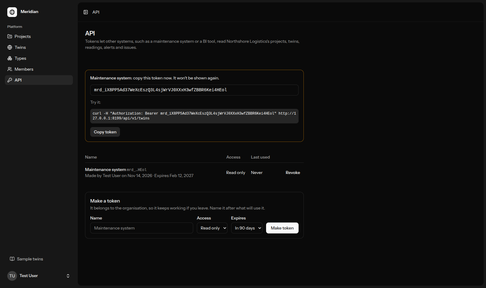
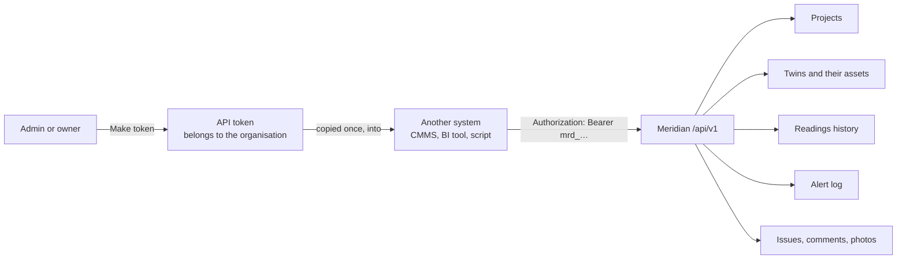

# The API

Other systems can read what Meridian knows: a maintenance system pulling open issues into work orders, a BI tool charting a freezer's temperature over the month, or a script checking every morning for alerts nobody acknowledged. They do it through the **API**, a set of JSON addresses under `/api/v1`, using an **API token** made for the organisation.



## How it fits together



A token belongs to the **organisation**, not to whoever made it, so an integration keeps working when that person leaves. It reads everything in the organisation, in every project, and nothing in any other.

## Make a token

Admins and owners make and revoke tokens; everyone else in the organisation can see which tokens exist and when they were last used.

1. Choose **API** in the sidebar.
2. Under **Make a token**, give it a **Name** after what will use it, such as *Maintenance system*.
3. Choose when it **Expires**: in 30 days, 90 days, a year, or never.
4. Choose **Make token**.

The token is shown **once**, starting `mrd_`, with a `curl` command to try it. Copy it into the other system straight away: Meridian keeps only a fingerprint of it, so it can't be shown again. If it's lost, make a new one and revoke the old.

The list shows each token's name, its last four characters (`mrd_…a1b2`), who made it and when, when it expires, and when it was **Last used** (to the minute).

### Revoke a token

Choose **Revoke** beside it. Anything still using it gets `401` from then on. Revoke a token as soon as the system using it is retired, or if it may have leaked.

## Use the API

Send the token as a bearer token, and ask for JSON:

```bash
curl -H "Authorization: Bearer mrd_…" -H "Accept: application/json" \
     https://meridian.example.com/api/v1/twins
```

| Address | What it gives |
| --- | --- |
| `GET /api/v1/token` | The token's name, access and expiry, and its organisation: a quick check that the setup works |
| `GET /api/v1/projects` | The organisation's projects, by name, with how many twins each has |
| `GET /api/v1/projects/{project}` | One project |
| `GET /api/v1/twins` | The organisation's twins, by name. Add `?project={id}` for one project's |
| `GET /api/v1/twins/{twin}` | One twin, with its latest version number, its assets, whether its gateway is online, and how many alerts and issues are open |
| `GET /api/v1/twins/{twin}/readings` | A metric's recorded history: `asset`, `metric`, `from` and `to` (Unix milliseconds), and `buckets` (10 to 1000, default 300) |
| `GET /api/v1/twins/{twin}/alerts` | The twin's alert log, newest first. `?open=1` for those not yet cleared; `?since=2026-11-01T00:00:00Z` for those raised since |
| `GET /api/v1/twins/{twin}/issues` | The twin's issues, newest first: `?state=open` (the default), `closed` or `all` |
| `GET /api/v1/twins/{twin}/issues/{issue}` | One issue with its comments |
| `GET /api/v1/twins/{twin}/issues/{issue}/comments/{comment}/photo` | A comment's photo |

Every answer has its content under `data`. Times are ISO 8601 in UTC, except readings, which use Unix milliseconds like the [recorded history](10-devices-and-mqtt.md#see-what-was-recorded).

### Assets and readings

A twin's assets are what readings, alerts and issues name things by:

```json
{
  "data": {
    "id": "…", "name": "Harbour Depot", "projectId": "…", "version": 3,
    "gateway": { "connected": true, "online": true, "seenAt": "2026-11-14T03:00:05+00:00" },
    "openAlerts": 1, "openIssues": 2,
    "assets": [ { "id": "store", "name": "Seafood store", "kind": "coldstore", "zone": "yard" }, … ]
  }
}
```

Readings come averaged into equal time buckets, each with its lowest and highest value, the same as the twin's charts:

```bash
curl -H "Authorization: Bearer mrd_…" -H "Accept: application/json" \
  "https://meridian.example.com/api/v1/twins/{twin}/readings?asset=store&metric=tempC&from=1763078400000&to=1763164800000&buckets=96"
```

```json
{ "data": { "bucketMs": 900000,
            "points": [ { "t": 1763078400000, "mean": -18.2, "min": -18.6, "max": -17.9, "count": 180 }, … ] } }
```

### Alerts and issues

```json
{
  "data": [ { "id": "…", "twinId": "…", "rule": "warm", "asset": "store", "severity": "critical",
              "message": "Seafood store is above its temperature limit", "value": 8.1,
              "raisedAt": "2026-11-12T03:04:00+00:00", "clearedAt": null,
              "acknowledgedAt": "2026-11-12T03:09:12+00:00", "acknowledgedBy": "Test User" } ],
  "links": { "next": "https://meridian.example.com/api/v1/twins/…/alerts?cursor=…" }
}
```

An issue gives its number and title, where it's pinned (`at`: longitude, latitude and height), its author, assignee, due date and whether it's **overdue**, the alert it came from, when it was closed and by whom, and a `url` that opens it in Meridian. One issue on its own adds its `comments`, each with a link to its photo.

### Pages

Lists come 50 at a time. Projects, twins and issues have numbered pages: follow `links.next` until it's `null`; `meta.total` says how many there are. The alert log, which only grows, pages by cursor: follow `links.next` the same way.

```
url = /api/v1/twins/{twin}/alerts?since=<last run>
while url:
    page = GET url
    handle page.data
    url = page.links.next
```

### Errors and limits

| Status | Means |
| --- | --- |
| `401` | No token, an unknown or revoked one, or one that has expired |
| `404` | Nothing with that id in the token's organisation (another organisation's twin looks the same as one that doesn't exist) |
| `422` | A parameter is wrong; `errors` says which |
| `429` | More than 120 requests in a minute with this token. Wait the seconds in `Retry-After` |

## Tips

- **One token per system.** Name it after what uses it, so **Last used** tells you whether it's still needed, and revoking one doesn't break the others.
- **Let tokens expire.** A token that expires in 90 days limits the harm if it leaks; set a reminder to make the next one.
- **Poll the alert log with `since`.** Remember when you last asked, and ask only for what's new.
- **Open issues where they live.** Each issue's `url` opens the twin flown to it, so a work order can link straight back to the scene.

## See also

- [Organisations and members](02-organisations-and-members.md#roles): who can make tokens.
- [Alerts, time travel and what-if](07-alerts-time-and-what-if.md#the-alert-log): the alert log the API reads, and webhooks, which push alerts and issue updates instead of waiting to be asked.
- [Twins and the viewer](06-twins-and-the-viewer.md): issues in the scene.
