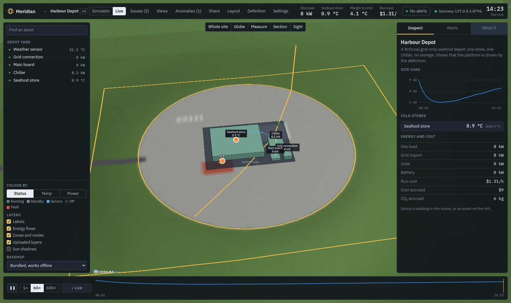
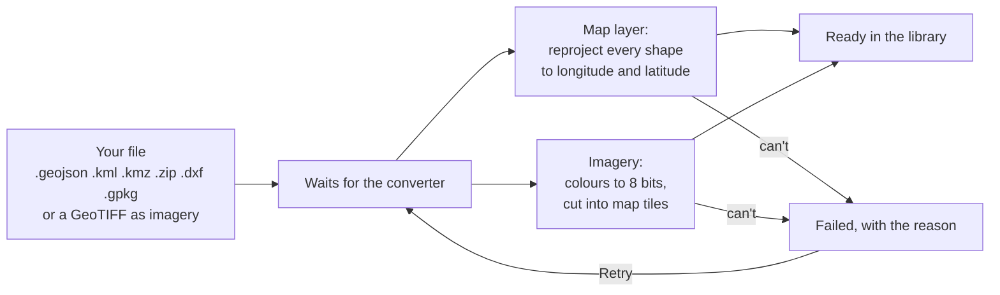
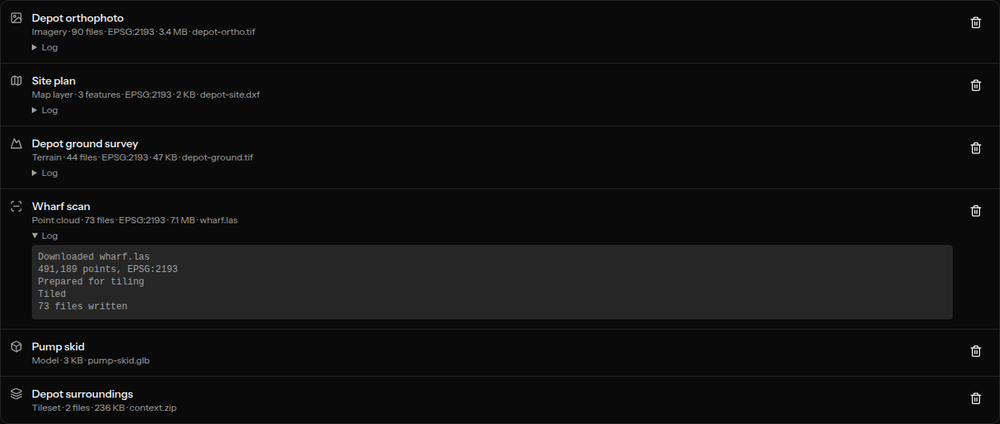

# Map layers and imagery

Most sites already have maps: lot boundaries from the council, a site plan from the engineers, survey control in a GeoPackage, a pipe route in KML, a drone orthophoto from last week's flight. Upload them to the library and any twin in the project draws them on the ground, under the site and over the terrain.



- A **map layer** is points, lines and areas: GeoJSON, KML or KMZ, a zipped shapefile, a DXF drawing or a GeoPackage. It's drawn on the ground in one colour, areas lightly filled.
- **Imagery** is a picture of the ground: a GeoTIFF orthophoto, drone mosaic or scanned plan. It's laid over the basemap and the terrain like a map.

Neither needs placing: each says where on Earth it belongs.

## How it works



The converter that does [point clouds](04-point-clouds.md) and [terrain](05-terrain.md) does these too, with GDAL:

```text
map layer:
    open the file (a .zip as a shapefile's parts together)
    for each layer in it, each shape with a geometry:
        reproject from the layer's coordinate system (or the EPSG code given) to longitude and latitude
        drop heights, so it lies on the ground
        keep its fields, and the layer it came from
    write one GeoJSON file

imagery:
    take the image's coordinate system (or the EPSG code given)
    keep up to three colour bands; scale 16-bit or float bands to 8 bits
    reproject to web mercator, transparent outside the image
    deepest zoom ← where a 256-pixel tile is as fine as the image's pixels
    cut tiles for that zoom and eight above it, so it shows from further out
```

## Upload a map layer or an image

1. On the project page, under **Library**, choose the file. The **Name** fills in from the file name.
2. Two kinds of file could be more than one thing, so **It is** appears:
    - a `.tif` or `.tiff` is **Terrain (an elevation model)** or **Imagery (an orthophoto or drone image)**;
    - a `.zip` is **A 3D Tiles tileset** or **A map layer (a zipped shapefile)**.
3. **EPSG code**: leave it empty if the file has a coordinate system. GeoJSON, KML and GeoPackages always do, as do shapefiles with a `.prj` and most GeoTIFFs. **DXF drawings never do**, so enter the code of the coordinates they were drawn in, such as `2193` for New Zealand Transverse Mercator.
4. Choose **Upload**.

The item shows **Converting** while it works. Open **Log** to see what was made. For a site plan:

```text
Downloaded depot-site.dxf
EPSG:2193, 3 features in 1 layers (3 Line String)
GeoJSON written
```

and for an orthophoto:

```text
Downloaded depot-ortho.tif
EPSG:2193, 1,600 × 1,600 pixels, 89 tiles at zooms 9 to 17
90 files written
```

When it's done, the item reads **Map layer · 3 features · EPSG:2193** or **Imagery · 90 files · EPSG:2193**.



A zipped shapefile needs its `.shp`, `.shx`, `.dbf` and, for its coordinate system, `.prj`, at the top of the zip or in one folder. A map layer can have up to 250,000 shapes; simplify or split bigger ones.

## When a conversion fails

| Reason                                                             | What to do                                                                                                     |
| ------------------------------------------------------------------ | -------------------------------------------------------------------------------------------------------------- |
| **Layer … has no coordinate system. Give the file's EPSG code.**   | Usually a DXF, or a shapefile without its `.prj`. Enter the code under the item and choose **Retry**.          |
| **The shapes land off the globe. Check the file's EPSG code.**     | The code given doesn't match the coordinates. Find the right one and retry.                                    |
| **The file has no features with a shape.**                         | The file has only attributes, or every shape is empty.                                                         |
| **The file has no map layers that can be read.**                   | Not a format GDAL reads, or a zip without a shapefile in it.                                                   |
| **The file has over 250,000 features.**                            | Split it, or simplify it in QGIS first.                                                                        |
| **That is not a GeoTIFF image.**                                   | Only GeoTIFFs can be imagery. Export the image again as one.                                                   |
| **The image has no coordinate system. Give its EPSG code.**        | Enter the code and retry.                                                                                      |
| **The image isn't georeferenced: it has no position on the ground.** | The TIFF has no world file or tags placing it. Georeference it in QGIS, then upload it again.                |

## Show it in a twin

1. Open a twin in the same project and choose **Layout**.
2. Under **Library**, choose **Add** beside the map layer or image. The twin saves a new version, **Added…**.
3. It's listed under **Layers** as **Map layer** or **Imagery**. **Remove** takes it out again; the file stays in the library.

**Uploaded layers** in the scene's layer list hides and shows them, with the twin's models, tilesets and scans. Imagery stays above whichever **basemap** you choose. A twin can show any number of each; imagery added later lies on top.

To give a map layer its own colour, or make imagery see-through, set `color` or `opacity` in the [definition](12-twin-definitions.md#map-layers-and-imagery).

## Tips

- **Use the coordinate system the file was drawn in**, not the one you'd like it in. Meridian reprojects; it needs to know where it's starting from.
- **Heights are dropped.** Map layers lie on the ground, terrain or not. For lines with real heights, such as a pipe at depth, draw them as a [route or shape](12-twin-definitions.md) instead.
- **Big orthophotos take a while.** A 5 cm drone mosaic of a square kilometre is about a hundred thousand tiles at its deepest zoom. It's done on the conversions queue, so nothing else waits.
- **Combine with terrain.** Upload the same flight's DEM as terrain and its orthophoto as imagery, and the twin stands on the ground as it was that day.

## See also

- [Projects and the library](03-projects-and-the-library.md): uploading.
- [Terrain](05-terrain.md): DEMs, which can be the other half of a drone survey.
- [Layout and versions](08-layout-and-versions.md): adding uploads to a twin.
- [Running Meridian](14-running-meridian.md#the-converter): the converter service.
