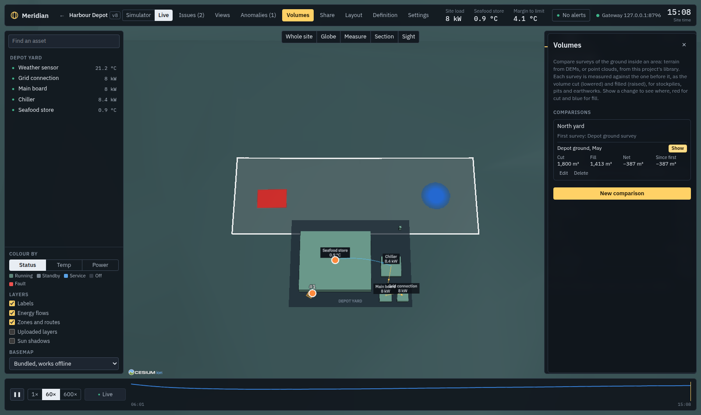
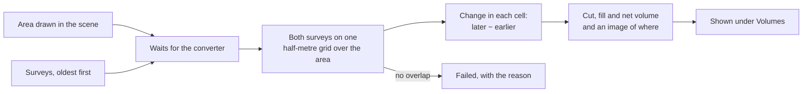

# Comparing surveys

Survey the same ground twice, and the difference is what moved: a stockpile grown, a pit dug, a batter cut back, fill placed on a building pad. **Volumes** on a twin compares surveys of the ground inside an area you draw, and gives the volume **cut** (ground lowered) and **filled** (ground raised) between each survey and the one before, with an image of where.



## What can be compared

Any **survey of the ground** in the project's library:

- **Terrain**, converted from a DEM (see [Terrain](05-terrain.md)): Meridian keeps the DEM's heights as given, beside the terrain tiles.
- **Point clouds** that have a coordinate system (see [Point clouds](04-point-clouds.md)): Meridian keeps the mean height of the points in each half-metre cell.

The surveys can be in different coordinate systems and at different resolutions: each comparison puts them on one grid. Terrain and point clouds converted before Meridian kept heights can't be compared. Upload them again.

## How it works



```text
for each survey after the first:
    put it and the one before on a grid of 0.5 m cells, in metres, centred on the area
    keep only the cells inside the area where both have a height
    change = later height − earlier height, in each cell
    cut  = Σ (lowering × 0.25 m²) over cells lowered more than 5 cm
    fill = Σ (raising  × 0.25 m²) over cells raised more than 5 cm
    net  = fill − cut
    draw lowered cells red and raised cells blue, stronger the deeper
since first = the nets added up, survey by survey
```

Changes under 5 cm are taken as no change, so the noise between two surveys of the same ground doesn't add up to a volume.

## Compare surveys

Editors (owners and admins) make comparisons; everyone who can see the twin can read them.

1. Open the twin and choose **Volumes**, then **New comparison**.
2. Enter a **Name**, such as the stockpile or pad.
3. Choose **Draw in scene** and click the ground around the area, point by point. Drag a point to move it, and **Undo point** takes the last one away. Choose **Done drawing**.
4. Under **Surveys, oldest first**, tick the surveys in the order they were surveyed. The number beside each shows its place.
5. Choose **Compare**. It shows **Measuring…** while the converter works, usually for seconds.

Each survey after the first gets an entry, with **Show** beside its name:

| Figure          | What it is                                                            |
| --------------- | --------------------------------------------------------------------- |
| **Cut**         | Volume lowered since the survey before it                             |
| **Fill**        | Volume raised since the survey before it                              |
| **Net**         | Fill less cut: positive when material arrived                         |
| **Since first** | The nets so far added up: how much has changed since the first survey |

An entry that says **· 72% covered** compared surveys that overlap only part of the area; the rest isn't counted.

**Show** lays that change over the scene, red where the ground was lowered and blue where it was raised, with the area outlined in white. Choose it again, or close the panel, to take it away.

**Edit** renames a comparison, or changes its area or surveys (add the latest survey to the end to follow a stockpile over time). Changing the area or surveys measures it again; renaming doesn't. **Delete** removes it; the surveys stay in the library.

## When it fails

| Reason                                                                         | What to do                                                                       |
| ------------------------------------------------------------------------------ | -------------------------------------------------------------------------------- |
| **… could not be measured: The two surveys don't both cover any of the area.** | The area is outside one of the surveys. Redraw it where both have ground.        |
| **… could not be measured: The area crosses itself.**                          | Redraw the area without its edges crossing.                                      |
| **… could not be measured: The area is too big …**                             | The area has over 25 million half-metre cells (about 6 km²). Draw a smaller one. |
| **A survey in the comparison is no longer in the library.**                    | It was deleted. Edit the comparison and choose the surveys again.                |

## Tips

- **Use the same vertical datum.** Two surveys whose heights are measured from different datums differ by a constant everywhere, and that reads as cut or fill over the whole area. Export them alike.
- **Point clouds see everything.** A cloud's heights include vehicles, plant and vegetation, which come and go between surveys. Clean or classify the cloud to ground before uploading it, or use a DEM.
- **Draw tight areas.** An area just around the stockpile keeps unrelated changes (a truck parked nearby) out of its volume.
- **For a stockpile's total volume**, compare a survey of the bare ground before it was tipped with each survey since; **Since first** is then the volume of the pile.

## See also

- [Terrain](05-terrain.md) and [Point clouds](04-point-clouds.md): uploading surveys.
- [Map layers and imagery](16-map-layers-and-imagery.md): an orthophoto from the same flight shows what the change was.
- [Running Meridian](14-running-meridian.md#the-converter): the converter, which does the measuring.
