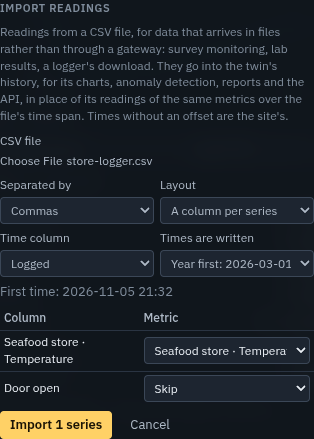
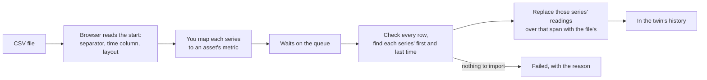
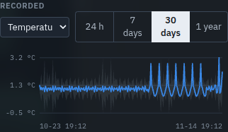

# Importing readings

Not every site streams its data. A survey monitoring contractor emails prism and piezometer results, a laboratory sends assay results as a spreadsheet, and a data logger is downloaded once a week. **Import readings** puts readings from a CSV file into a twin's history, and other systems can add them through the [API](15-the-api.md#write-through-the-api) instead. Either way, no gateway is needed.

Imported readings are the same as any others in the twin's history:

- the asset's [**Recorded** chart](10-devices-and-mqtt.md#see-what-was-recorded) shows them;
- [anomaly detection](07-alerts-time-and-what-if.md#anomalies) learns from them and watches them;
- [reports](07-alerts-time-and-what-if.md#reports) and the [API](15-the-api.md) include them.



## How it works



```text
read the header; find the time column and each series' column (or the name and value columns)
for each row:
    time = the time column, read as chosen; without an offset, in the site's time
    for each series in the row with a value:
        skip it if the value isn't a number, or the time can't be read,
        is older than readings are kept, or is in the future
        otherwise count it, and widen its series' span to include the time
for each series: delete the twin's readings of that metric between its first and last time
store the file's readings
```

Because each series replaces what the twin had over the file's span, **importing the same file again doesn't double it**, and a corrected file replaces the wrong one.

## Lay out the file

The first row names the columns. One column holds the time; the rest are laid out one of two ways.

**A column per series**: each column after the time is one series.

```csv
Logged,Seafood store · Temperature,Door open
2026-11-01 06:00,1.42,0
2026-11-01 06:30,4.91,0
```

**A row per reading**: one column names the series, another holds its value. This suits files from monitoring systems, where each instrument has its own rows.

```csv
Instrument,Reading,Taken
PZ-01,12.48,01/11/2026 6:00 am
PZ-02,3.10,01/11/2026 6:00 am
```

| Part of the file | What's read |
| --- | --- |
| **Separator** | Commas, semicolons, tabs or bars. With semicolons, tabs or bars, a decimal comma (`12,5`) is read as `12.5` |
| **Times** | Year first (`2026-11-01 06:30`, with seconds, fractions, `T` and an offset such as `Z` or `+13:00` if it has them); day first or month first (`01/11/2026 6:30 pm`, with a two- or four-digit year); or Unix seconds or milliseconds |
| **Time zone** | A time with an offset is used as it is. One without is the **site's time**, the twin's UTC offset |
| **Values** | Numbers. An empty cell is no reading |

## Import a file

Editors (owners and admins) import readings.

1. Open the twin, choose **Layout**, and find **Import readings**.
2. Choose the **CSV file**. Meridian reads its start, up to 2 MB, and guesses:
    - what it's **Separated by**;
    - its **Layout**: **A column per series** or **A row per reading**;
    - the **Time column**, and how **Times are written**;
    - for a row per reading, which column the series are **named in** and which holds the **values**.

    **First time** shows the first row's time, to check it's read the way you mean. Change any guess that's wrong.
3. Under **Series**, choose the **Metric** for each column or name, or **Skip** it. A series named like `store.tempC`, like **Seafood store · Temperature**, or after an asset with only one metric is matched already.
4. Choose **Import**. The import is listed with **Importing…** while the queue works through the file, then with how many readings it imported, between which times, and how many it skipped.

For a row per reading, the names listed are those in the start of the file. Rows naming others are skipped and listed under **Why some were skipped**, with the first ten problems, such as **Row 4: “warm” in Seafood store · Temperature isn't a number.** Fix the file and import it again; it replaces the first import's readings.



## Remove an import

**Remove** takes an import away, and with it the twin's readings of its series between its first and last time. That includes readings it replaced, so a gateway's readings for those metrics over that span go too. Removing a failed import removes only the entry.

Importing and removing are recorded in the organisation's [audit log](02-organisations-and-members.md#the-audit-log).

## When it fails

| Reason | What to do |
| --- | --- |
| **The file has no column “…”.** | The column was renamed, or the wrong separator was chosen. Check the first row |
| **The file has no readings for the columns chosen.** | The columns mapped are empty. Choose others |
| **The file has no readings that could be imported. Row 2: …** | No row could be read; the first reason is given. Usually the time format: choose **Day first** or **Month first** |
| **The file has more than 2,000,000 readings.** | Split it, by time, into smaller files |
| **Importing stopped unexpectedly.** | The queue stopped. Upload the file again |

Files are up to 50 MB. Readings older than Meridian keeps them (365 days unless your administrator changed it) or more than a day in the future are skipped.

## Add readings through the API

A system that measures without a gateway, such as a laboratory system or a contractor's monitoring portal, can send readings with an [API token](15-the-api.md) that may write:

```bash
curl -X POST -H "Authorization: Bearer mrd_…" -H "Accept: application/json" \
     -H "Content-Type: application/json" \
     -d '{"readings": [{"asset": "pz1", "metric": "levelM", "value": 12.48, "at": 1793512800000}]}' \
     https://meridian.example.com/api/v1/twins/{twin}/readings
```

Each reading names an asset in the twin's latest version, a metric, its value, and when it was taken in Unix milliseconds, within the time readings are kept. Up to 1,000 go in one request. They're added to the history as they are: sending the same reading twice keeps it twice. The answer is `202` with how many were stored.

## Tips

- **Imported readings don't drive the scene.** The twin's model and its rules run on live readings from a [gateway](09-gateways-and-live-data.md). Imported readings are history: charts, anomaly detection, reports and the API.
- **One file per instrument set.** A file per monitoring round, or per logger, keeps each import's span small, so removing or replacing one touches only what it covered.
- **Keep the names stable.** A monitoring system's instrument names (`PZ-01`) are matched by the asset's name, so naming assets the same way saves mapping them each time.

## See also

- [Devices and MQTT](10-devices-and-mqtt.md#see-what-was-recorded): the Recorded chart.
- [OPC UA](11-opc-ua.md) and [Gateways and live data](09-gateways-and-live-data.md): live readings.
- [The API](15-the-api.md): reading the history back.
