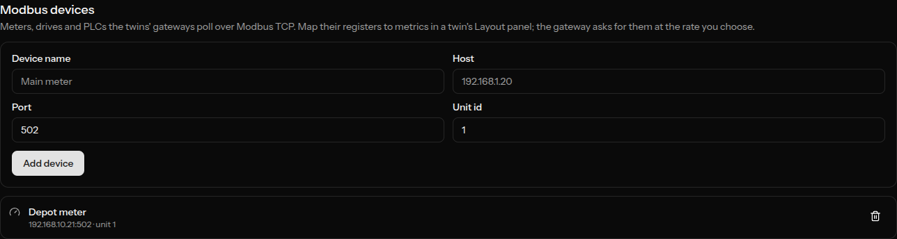
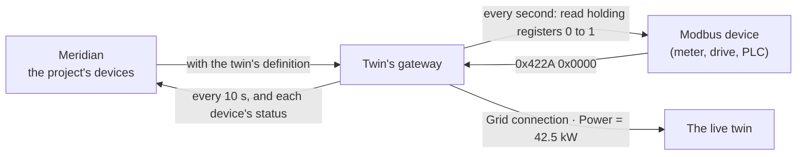
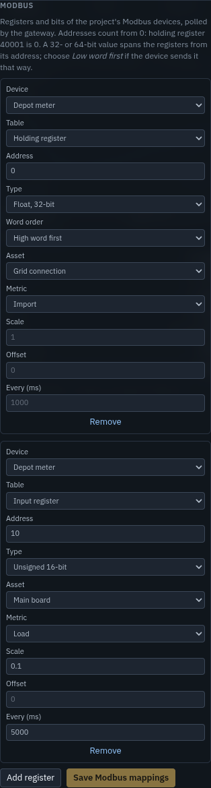

# Modbus

Power meters, variable-speed drives, gas detectors and many small PLCs speak **Modbus TCP**, an older and simpler protocol than [OPC UA](11-opc-ua.md). A Modbus device holds its data in numbered **registers** (16-bit numbers) and **bits**, and answers when it's asked for a range of them. It never says what a register means; that comes from the device's manual, its **register map**.

Meridian keeps a list of each project's Modbus devices. A twin says which registers feed which asset metrics, and the twin's gateway asks each device for them at the rate you choose, treating every answer as a reading.



## How it works



```text
for each device the twin maps:
    group its mappings by table and rate
    within each group, read neighbouring addresses together,
        up to 125 registers or 2,000 bits per request
    every rate:
        ask the device for each range, one request at a time
        for each mapping in the answer:
            value = the registers decoded as the mapping's type
            reading = value × scale + offset
```

- The gateway only talks to devices your twin maps, not every device in the project.
- It keeps one connection per device and sends one request at a time, as many devices and serial gateways only handle one. If the connection drops, it reconnects on its own, waiting a little longer each time, up to 10 seconds.
- Mappings close together are read in one request, so mapping twenty registers of one meter usually costs one or two requests per poll.
- Readings from Modbus are kept and charted like any others. See [what was recorded](10-devices-and-mqtt.md#see-what-was-recorded).

Meridian only reads from Modbus devices. It never writes to them.

## Add a device

Only editors can add devices.

1. On the project page, find **Modbus devices**.
2. Fill in:
    - **Device name**: what twins will call it, such as `Depot meter`. Names are unique within a project.
    - **Host**: the device's name or IP address on the network, such as `192.168.10.21`, without a port.
    - **Port**: `502` for almost every device.
    - **Unit id**: which device to read behind the address. A device on the network directly is usually `1` (some want `255` or `0`); behind a Modbus TCP to serial gateway, it's the serial device's address.
3. Choose **Add device**.

To change a device, delete it and add it again with the same name. Twins find devices by name, so their mappings keep working. Adding and deleting devices are recorded in the [audit log](02-organisations-and-members.md#the-audit-log).

The gateway must be able to reach the device: Modbus TCP has no login or encryption, so devices are normally on a plant network that only the gateway's machine can reach. Run the gateway there.

## Map registers onto metrics



In the twin's **Layout** panel, under **Modbus**:

1. Choose **Add register**.
2. Fill in, from the device's register map:
    - **Device**: one of the project's Modbus devices.
    - **Table**: **Holding register** (most values), **Input register** (read-only measurements), **Coil** or **Discrete input** (on or off).
    - **Address**: counting from 0. Register maps often number from 1 with the table's digit in front, so holding register `40001` is address `0`, `40011` is `10`, and input register `30005` is `4`.
    - **Type**, for registers: how the number is stored. **Unsigned 16-bit** unless the map says otherwise. A **32-bit** value or **Float, 32-bit** takes two registers from the address, **Float, 64-bit** four. **On or off** reads 1 for anything but 0.
    - **Word order**, for 32- and 64-bit values: **High word first** is the standard; if a value comes out wildly wrong, try **Low word first**.
    - **Asset** and **Metric**: where the reading goes.
    - **Scale** and **Offset**: many devices send whole numbers in tenths or hundredths. A load in tenths of a kW has a scale of `0.1`. The reading is the value × scale + offset.
    - **Every (ms)**: how often to ask. `1000` (once a second) unless given; at least `100`.
3. Choose **Save Modbus mappings**. This saves a new version of the twin, and the gateway starts polling within a few seconds.

| Problem | What's shown |
| --- | --- |
| An address that isn't a whole number from 0 to 65535 | **A Modbus mapping's address must be a whole number from 0 to 65535** |
| A poll faster than every 100 ms | **Modbus 4: pollMs must be at least 100** |
| A device the project doesn't have any more | Nothing on saving; the gateway skips the mapping and says so in its log |

## See the connections

While the twin's gateway is online, the **Gateway** section of the Layout panel lists each Modbus device it polls with its status: **connecting**, **connected**, **reconnecting** or **failed** (it couldn't connect the first time, and is still trying). The gateway's `/health` page has more: how many ranges it reads from each device, the last connection error, and any ranges the device refused, such as **holding 998-1001: illegal data address**.

| A device says | Usually means |
| --- | --- |
| **illegal data address** | The address isn't in the device's map, or a 32-bit value runs past it. Check the address counts from 0 |
| **illegal function** | The device doesn't have that table. Try **Holding register** for **Input register**, or the other way |
| **gateway target failed to respond** | A serial gateway can't reach the unit id. Check the unit id and the wiring |
| **no answer within 3 s** | The device is busy, or something else is talking to it. Slow the polling down |

## Without Meridian

A gateway without a control plane takes its devices from `MODBUS_DEVICES`, as JSON, and its mappings from the definition file:

```bash
MODBUS_DEVICES='[{"name": "Depot meter", "host": "192.168.10.21"}]' npm run gateway -- my-twin.json
```

Each device is on port 502 and unit 1 unless it gives `port` and `unitId`. `npm run modbus-simulator` starts a test device at `127.0.0.1:5020`, unit 1, with a meter's kW as a float in holding registers 0 and 1, a store's temperature in tenths of a degree in input register 0, and its door in discrete input 0.

## Tips

- **Start slow.** Once a second is plenty for most meters. Many small devices struggle with several clients asking quickly, and a building management system may already be polling the same one.
- **Check one value against the device's own display** before mapping the rest: it shows straight away whether the address, type and word order are right.
- **Bits of a register**: in the definition's `modbus` list, a mapping can take one bit of a register with `"bit": 0` to `15`, read as 1 or 0, and hold each reading for `ttlS` seconds. The panel keeps both when you save. See [Twin definitions](12-twin-definitions.md).

## See also

- [OPC UA](11-opc-ua.md): for PLCs and SCADA systems that speak it, with browsing and writing setpoints.
- [Gateways and live data](09-gateways-and-live-data.md): running the gateway.
- [Importing readings](18-importing-readings.md): readings that arrive in files instead.
