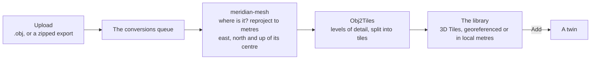
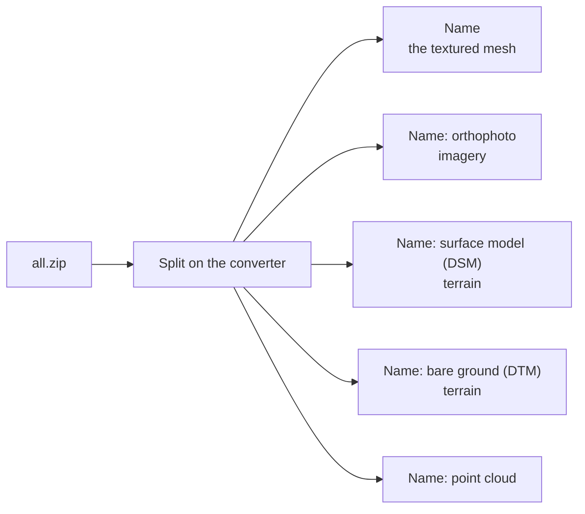
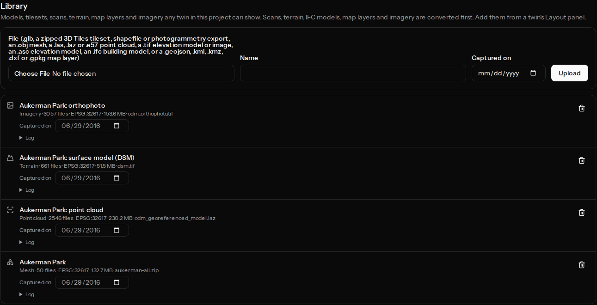
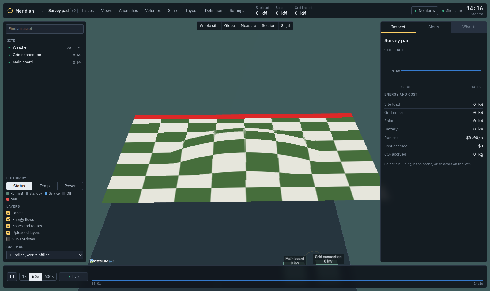

# Photogrammetry meshes

Drone surveys and photo scans are often delivered as a **textured mesh**: the ground, stockpiles, buildings and plant as triangles with the photos draped over them. Photogrammetry software (ContextCapture, DJI Terra, Pix4D, Metashape, RealityCapture, OpenDroneMap) exports one as an **OBJ** file with its materials (`.mtl`) and texture images.

Meridian converts a mesh in the library to 3D Tiles, so a twin streams only the detail the camera needs, and places it where the survey says it is.


## How it works



```text
unpack the zip (refusing paths outside it, links, too many files or too many bytes)
take its largest .obj (from OpenDroneMap, its 3D model)
where is it?
    the EPSG code given at upload, with the offset from metadata.xml or the Pix4D files
    metadata.xml (ContextCapture, DJI Terra): its SRS and SRSOrigin, or ENU:lat,lon
    odm_georeferencing/coords.txt (OpenDroneMap): its UTM zone and offset
    <name>_offset.xyz with <name>.prj (Pix4D)
    otherwise nowhere: the mesh is in local metres
if it's somewhere:
    every vertex, offset and reprojected through Earth-centred coordinates
        to metres east, north and up of the mesh's centre
        (so grid north is turned to true north: about a degree in NZTM)
tile it with Obj2Tiles: 3 levels of detail, each split in a grid,
    the textures packed into each tile
print the triangles, size, tiles and where it is
```

A mesh's heights are taken as they are in the file, as heights above the ellipsoid. If the survey was reduced to a local datum, the mesh may sit a few tens of metres above or below the terrain: move it up or down in the twin's Layout panel.

## Uploading a mesh

1. Open the project, and under **Library** choose the file:
    - an **.obj** on its own, if its materials and textures aren't needed (it's tiled untextured, in a plain colour), or
    - a **.zip** of the whole export folder: the OBJ, its `.mtl`, its texture images, and `metadata.xml`, OpenDroneMap's `odm_georeferencing` folder, or Pix4D's `_offset.xyz` and `.prj` files if there are any.
2. For a zip, set **It is** to **A photogrammetry mesh (an OBJ export)**. For everything OpenDroneMap made, see the next section.
3. If the export doesn't say where it is, and its coordinates are in a projected coordinate system, enter the **EPSG code** (for example `2193` for NZTM2000, or the UTM zone's code). Longitudes and latitudes are refused: export in a projected system.
4. Tick **Y is up** if the mesh is in local metres and was written with Y as the up axis (some scanning apps do). Survey exports are Z-up and don't need it.
5. Choose **Upload**. The library shows **Converting** with progress, and **Mesh · N files · EPSG:…** when it's done, or **local metres** if it wasn't georeferenced. **Log** shows the triangles, size and tiles, and how it was placed.

If it fails, **Log** says why, and **Retry** runs it again, with a new EPSG code if that was the problem.

## An OpenDroneMap export

[OpenDroneMap](https://opendronemap.org) (and WebODM, its web app) turns drone photos into a mesh, an orthophoto, surface and bare-ground models and a point cloud. Upload them all at once:

1. In WebODM, open the task and choose **Download Assets** → **All Assets** (`all.zip`). From OpenDroneMap on the command line, zip the project folder.
2. In the project's **Library**, choose the zip and set **It is** to **An OpenDroneMap export**. Give it a name and the date the photos were taken.
3. Choose **Upload**.



The upload becomes the **mesh**, and Meridian adds a library item for each of the other outputs it finds, all dated as the upload is. Each converts on its own, with its own **Converting** progress. The mesh is placed where OpenDroneMap's `coords.txt` says; the others carry their own coordinate systems. The upload's log lists what was added.

- OpenDroneMap only makes a bare-ground model (`dtm.tif`) when asked (`--dtm`). Without one, there's no DTM item. For the terrain under a mesh, a DTM suits better than the DSM: see [Terrain](05-terrain.md).
- The report, camera positions, 2.5D mesh and the rest of the export are left out.
- If the export has no textured mesh (`odm_texturing`), the other outputs are still added, and the upload fails saying so. Delete it.



## Adding it to a twin

In the twin's **Layout** panel, choose **Add** beside the mesh in the library.

- A **georeferenced** mesh appears where it was surveyed.
- A mesh in **local metres** starts at the twin's origin, and can be placed like a model: moved, turned and raised in the scene or by its numbers. See [Layout and versions](08-layout-and-versions.md).



The mesh is a tileset like any other: **Uploaded layers** hides it, and measurements and sight lines land on it.

A mesh has its own ground, at the same height as the twin's terrain. So that its ground always shows over the terrain's, instead of the two flickering through each other, it's drawn a hair nearer the camera than it is. Points measured on the mesh are nearer by 0.3% of how far away you're looking from: about 15 cm at 50 m, so zoom in to measure. For the terrain under a survey mesh, a bare-ground model (DTM) suits better than a surface model (DSM): the mesh shows the trees and buildings, and the terrain carries the ground beyond them.

## Limits

| Setting                          | Default         | What it limits                               |
| -------------------------------- | --------------- | -------------------------------------------- |
| `MERIDIAN_MESH_MAX_EXTRACTED_MB` | 20480           | The unzipped export, in MB                   |
| `MERIDIAN_MESH_TIMEOUT_MINUTES`  | 240             | How long one conversion may run              |
| `MERIDIAN_MESH_CONVERTER`        | `meridian-mesh` | The converter script, on the worker's `PATH` |

Large surveys take a while: a mesh of tens of millions of triangles can take an hour or more. Big exports can go straight to object storage in parts (see [Large uploads](03-projects-and-the-library.md#large-uploads)).

## About Obj2Tiles

The tiling is done by [Obj2Tiles](https://github.com/OpenDroneMap/Obj2Tiles) 1.9.0 from OpenDroneMap, which is licensed under the **AGPL-3.0**. It's shipped unmodified in the converter image as a separate program in `/opt/obj2tiles`, with its licence, its third-party notices and where to get its source; Meridian only runs it.

## See also

- [Point clouds](04-point-clouds.md): scans as points rather than a mesh.
- [Comparing surveys](17-comparing-surveys.md): volumes between terrain or point cloud surveys.
- [Projects and the library](03-projects-and-the-library.md): uploads, large uploads and deleting.
