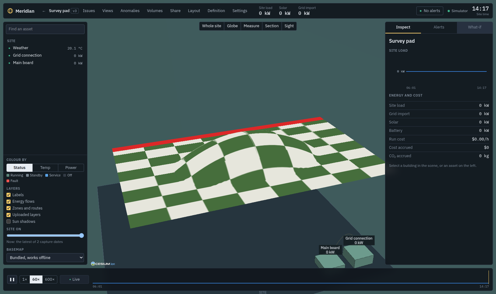
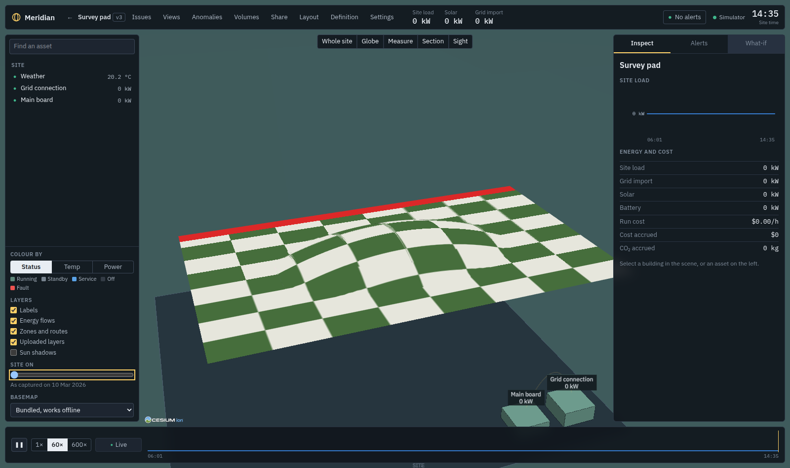

# The site over time

A site changes: stockpiles grow and shrink, pits deepen, buildings go up. Survey it every month and the library fills with scans, meshes and orthophotos of the same ground. Date each one by when it was **captured**, and a twin can show the site as it was on any of those dates.



## How it works

Each upload in the library can have a **capture date**: the day the drone flew, the scanner ran or the model was issued. It's kept on the upload, not in a twin, so dating it once dates it in every twin that shows it, without a new version.

A twin with dated layers shows **Site on** in its left panel: a slider over the dates its layers were captured, with **now** at the far right.

```text
at a date (or now):
    an undated layer always shows
    a dated layer captured after the date doesn't show
    a scan, mesh, tileset or image shows until the next capture of the same kind:
        of the twin's point clouds, the newest one captured on or before the date
        likewise its meshes, its tilesets and its imagery, each on its own
        (all those captured on that same day)
    a model or map layer shows from its date on: a building, once built, stays
```

So stepping the slider through the dates steps through the surveys, while a building modelled in April appears in April and stays.

- **Context that never changes**, such as a city model or a site plan, shouldn't be dated: it always shows.
- **Terrain** changes too: a twin with several dated [terrains](05-terrain.md) stands on the newest captured by the date, or on its undated terrain before the first survey. The site stays at the height it was built at. Compare the ground between surveys with [Comparing surveys](17-comparing-surveys.md).
- **Two areas surveyed on different days** replace each other, because they're the same kind. Date them the same day if both should show together.
- **Uploaded layers** still hides every scan, mesh, tileset, map layer and image, whatever the date.



## Dating an upload

1. When you upload, fill in **Captured on** beside the name. It's optional, and it can't be in the future.
2. To date an upload already in the library, or to put a date right, change **Captured on** under its name. Clear it to undate it.

Only editors can date uploads, and each change is in the [audit log](02-organisations-and-members.md#the-audit-log) as **Dated an upload**. Everyone else sees the date under the upload's name.

## Stepping through the dates

1. Open the twin. **Site on** appears in the left panel once any of its layers is dated, saying how many capture dates there are.
2. Drag the slider, or click it and use the arrow keys: each step is a capture date, and the panel says **As captured on** that date.
3. Move it to the far right, or press **End**, for **Now**: the newest of each kind.

A [saved view or look link](06-twins-and-the-viewer.md#saved-views-and-links) keeps the date too, so it opens on the same survey. Views saved before this open at **Now**.

The slider also works on a [share link](06-twins-and-the-viewer.md#share-a-twin-by-link), so someone without an account can step through the surveys too. It changes only what you see: the twin's readings, alerts and history carry on as they were.

## See also

- [Point clouds](04-point-clouds.md), [Photogrammetry meshes](20-photogrammetry-meshes.md) and [Map layers and imagery](16-map-layers-and-imagery.md): what can be surveyed and uploaded.
- [Comparing surveys](17-comparing-surveys.md): how much the ground changed between surveys.
- [Projects and the library](03-projects-and-the-library.md): uploading.
