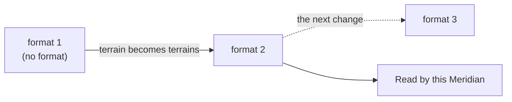

# Upgrading and stability

Meridian is changed often, and other systems are built on it: integrations reading the API, gateways running on site, definitions kept in version control. This chapter says which parts are kept stable across versions, how versions are numbered, and how to upgrade without breaking what's built on it.

## What's kept stable

From 1.0, these parts change only in ways that keep working with what was built for them:

| Part                                                    | Kept stable by                                                                        |
| ------------------------------------------------------- | ------------------------------------------------------------------------------------- |
| [Twin definitions](12-twin-definitions.md)              | Its **format version**. Older formats are always read and moved up                    |
| [The API](15-the-api.md) under `/api/v1`                | Its **OpenAPI description**, [`/openapi.json`](../../public/openapi.json)             |
| [The gateway](09-gateways-and-live-data.md)'s addresses | Only adding to them, so a gateway one version behind keeps running                    |
| [Settings](../../README.md#configuration)               | A setting is renamed or removed only in a major version, with the CHANGELOG saying so |

Everything else may change in any version: the pages and how they look, the database's tables (changed only through migrations, which `php artisan migrate` runs), and the PHP and TypeScript code inside. Build on the parts above, not on these.

## Version numbers

Versions follow [Semantic Versioning](https://semver.org/spec/v2.0.0.html), and every change is in the [CHANGELOG](../../CHANGELOG.md).

| Version          | May                                                                                                    |
| ---------------- | ------------------------------------------------------------------------------------------------------ |
| **Patch**, 1.0.1 | Fix, document or maintain                                                                              |
| **Minor**, 1.1.0 | Add: new features, new API addresses and fields, a new definition format that's read alongside the old |
| **Major**, 2.0.0 | Remove or change something the table above keeps stable, after a minor version warned of it            |

```text
a change to something kept stable:
    does what was built for it still work?   -> a minor version
    otherwise:
        warn in a minor version: the CHANGELOG's Deprecated section,
            and for the API, a Deprecation header on the old address
        remove it in the next major version
```

## Definitions

A definition says which format it's in, as `"format": 2`, and one without it is in format 1. Each new format comes with a **migration**: a small step that moves a definition from the format before it. Meridian applies them in turn whenever it reads a definition, in the control plane, the viewer and the gateway, so a twin saved years ago opens as it did. A version is saved in the newest format.



- **A definition file kept elsewhere**, such as in version control, keeps working as it is. Download a version from the Layout panel to have it in the newest format.
- **A definition newer than this Meridian** is refused, saying which format it is: a twin exported from a newer Meridian needs that version or later to import.
- **Old versions** of a twin are moved up when they're opened or restored, not rewritten in the database, so the history stays as it was saved.

The formats, and what changed in each, are listed in [Twin definitions](12-twin-definitions.md#format-versions).

## The API

The API's version is in its address, `/api/v1`. Within v1, Meridian only adds: new addresses, new optional parameters and new fields in answers. So that an integration keeps working:

- **ignore fields you don't know**, as new ones may appear;
- **follow `links.next`** rather than building page addresses;
- **treat lists of choices as open**: a new severity, audit area or action may appear.

A change that would break an integration goes into a `/api/v2` alongside v1, and v1 keeps answering for at least one major version after.

[`/openapi.json`](../../public/openapi.json) describes every v1 address, parameter and answer in OpenAPI 3.1. Load it into an API client (Postman, Insomnia, Bruno) or a code generator to start an integration. Meridian's own tests check every address is described and that the answers match, so the description stays true.

## Gateways

The control plane is upgraded before the gateways that talk to it. A gateway one version behind keeps running: it reads definitions in a newer format (ignoring what it doesn't use), and the control plane still takes readings, alerts and writes the way it did. Upgrade the gateways after, at a convenient time.

## Upgrading

```text
before:
    read the CHANGELOG from your version to the new one,
        especially Deprecated, Removed and anything about settings
    back up the database and the uploads bucket
upgrade the control plane (see Running Meridian)
    php artisan migrate moves the database on
    definitions move on as they're read: nothing to run
check: sign in, open a twin, and GET /api/v1/token with a token
then upgrade the gateways
```

The commands are in [Running Meridian](14-running-meridian.md#upgrading). Going back a version means restoring the backup: migrations aren't written to be undone, and a newer definition format can't be read by an older Meridian.

## See also

- [Running Meridian](14-running-meridian.md#upgrading): the upgrade commands.
- [Twin definitions](12-twin-definitions.md#format-versions): the formats.
- [The API](15-the-api.md): tokens and addresses.
- The [CHANGELOG](../../CHANGELOG.md): what changed in each version.
