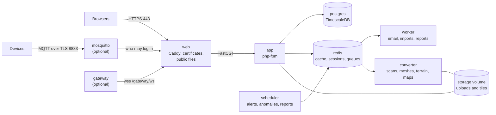
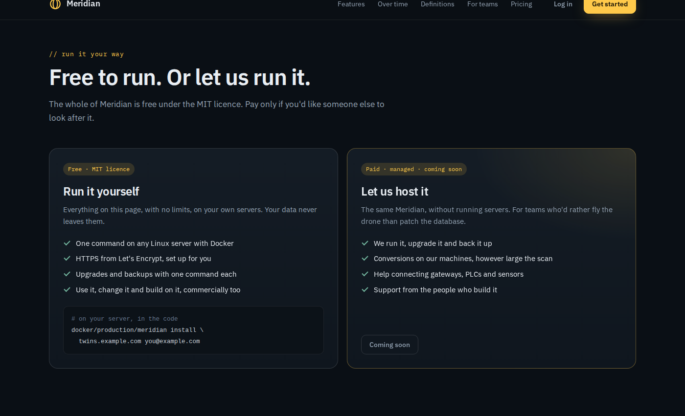

# Deploying Meridian

Meridian runs on one Linux server with Docker: a cloud machine (AWS, Azure, Google Cloud, DigitalOcean, Hetzner), or one in your own building. One script sets it up with HTTPS, and the same script upgrades and backs it up. This chapter is for whoever looks after that server.

Running it locally to develop is in [Running Meridian](14-running-meridian.md); this is the production setup.

## What runs



| Container   | Runs                                                                           | Always |
| ----------- | ------------------------------------------------------------------------------ | :----: |
| `web`       | Caddy: HTTPS on 80 and 443, the website's files, PHP through FastCGI           |   ✓    |
| `app`       | PHP for the website and the API                                                |   ✓    |
| `worker`    | The default queue: notifications, imports, reports                             |   ✓    |
| `scheduler` | Alerts, escalation, anomaly checks, scheduled reports, clean-up                |   ✓    |
| `converter` | The conversions queue: point clouds, meshes, IFC, terrain, map layers, volumes |   ✓    |
| `postgres`  | The database, with TimescaleDB for readings                                    |   ✓    |
| `redis`     | Cache, sessions and queues                                                     |   ✓    |
| `migrate`   | Updates the database at each start, then stops                                 |        |
| `mosquitto` | The MQTT broker, for devices that publish readings to the server               | if on  |
| `gateway`   | One twin's gateway, run on the server rather than on site                      | if on  |

The images are built on the server from the code, so nothing has to be published to a registry first.

## What you need

- **A Linux server** with Docker Engine and Docker Compose v2. For most sites, 2 CPUs, 8 GB of memory and 100 GB of disk. Converting a large scan wants more memory; see [Sizing](#sizing-and-cost).
- **A domain name**, such as `twins.example.com`, with its DNS `A` record pointing at the server.
- **Ports open** to the internet: 80 and 443, and 8883 if devices send MQTT to it. Nothing else needs to be reachable.
- **An email account** to send from (SMTP), for invitations, password resets and alert emails.

## Install

```bash
git clone <the Meridian repository> meridian
cd meridian
docker/production/meridian install twins.example.com ops@example.com
```

```text
install:
    write docker/production/.env from .env.example, with
        the domain, APP_URL and the email
        a new app key, database password and broker secret
    build the images (the converter's tools take a while the first time)
    start everything: migrate runs, then the rest
    Caddy gets a certificate for the domain from Let's Encrypt
```

Then open `https://twins.example.com` and choose **Get started** to make the first account and organisation.

**Keep a copy of `docker/production/.env`** somewhere safe. Its `APP_KEY` encrypts stored secrets, such as gateway and OPC UA credentials, and they can't be read without it.

### After installing

1. **Email**: until a mail server is set, emails (such as the link confirming a new account's address) are written to the app's log, `docker/production/meridian logs app`, instead of sent. To send them, set `MAIL_MAILER=smtp` with `MAIL_HOST`, `MAIL_PORT`, `MAIL_USERNAME`, `MAIL_PASSWORD` and `MAIL_FROM_ADDRESS` in `docker/production/.env`, then `docker/production/meridian start`.
2. **Devices over MQTT**: set `MERIDIAN_RUN_MQTT=true` and start again. Devices connect to `mqtts://twins.example.com:8883` with the logins Meridian gives them, using the same certificate as the website. See [Devices and MQTT](10-devices-and-mqtt.md).
3. **A gateway on the server**: issue a gateway token in the twin, set `MERIDIAN_GATEWAY_TOKEN`, and start again. Browsers reach it at `wss://twins.example.com/gateway/ws`. A gateway on site, next to the PLCs, is set up as in [Gateways and live data](09-gateways-and-live-data.md).
4. **Single sign-on**: works as it is, since `APP_URL` is the address people use. See [Single sign-on](02-organisations-and-members.md).

Every other setting is in the [README's Configuration](../../README.md#configuration) section.

## Day to day

| Command                                        | Does                                                                         |
| ---------------------------------------------- | ---------------------------------------------------------------------------- |
| `docker/production/meridian status`            | Lists the containers and whether they're healthy                             |
| `docker/production/meridian logs [container]`  | Follows the logs, of everything or of one container                          |
| `docker/production/meridian start` / `stop`    | Starts or stops everything; start again after changing `.env`                |
| `docker/production/meridian backup`            | Saves the database, the uploads and `.env` into `backups/<time>`             |
| `docker/production/meridian restore <folder>`  | Puts a backup back, replacing what's there (it asks first)                   |
| `docker/production/meridian upgrade`           | Backs up, pulls the latest code, rebuilds and restarts; migrations run first |
| `docker/production/meridian artisan <command>` | Runs an artisan command, such as `about` or `queue:failed`                   |

### Backups

Back up every day, and copy the backups **off the server**: a backup on the disk it protects is lost with it. With cron:

```text
15 2 * * *  cd /srv/meridian && docker/production/meridian backup && rsync -a backups/ backup-host:meridian/
```

A backup holds the database (`database.dump`, from `pg_dump`), the uploads and their converted tiles (`uploads.tar.gz`) and the settings (`env`). Old folders in `backups/` can be deleted once they're copied away.

### Upgrading

Read the [CHANGELOG](../../CHANGELOG.md) first, then `docker/production/meridian upgrade`. It takes a backup before anything changes. The site is down for the minute or so the new containers take to start. What stays stable between versions, and the order to upgrade gateways in, is in [Upgrading and stability](22-upgrading-and-stability.md).

## Uploads in object storage

Uploads and their tiles are kept on the server's `storage` volume, which suits most installations. For a lot of survey data, or to keep it apart from the server, use S3-compatible storage (Amazon S3, Cloudflare R2, Backblaze B2, MinIO):

```text
MERIDIAN_ASSETS_DISK=s3
AWS_ACCESS_KEY_ID=…  AWS_SECRET_ACCESS_KEY=…  AWS_DEFAULT_REGION=…  AWS_BUCKET=…
AWS_ENDPOINT=…       (for anything but Amazon S3)
MERIDIAN_DIRECT_UPLOADS=true   (browsers upload large files straight to the bucket)
```

With direct uploads, allow `PUT` from `https://twins.example.com` in the bucket's CORS settings. See [Large uploads](03-projects-and-the-library.md#large-uploads).

## Sizing and cost

The converter decides the size: tiling a point cloud of a few hundred million points or a large photogrammetry mesh wants 8–16 GB of memory while it runs. Everything else is light.

| Site                                       | Server             | Disk                       |
| ------------------------------------------ | ------------------ | -------------------------- |
| A pilot: a few twins, small scans          | 2 CPUs, 4 GB       | 50 GB                      |
| Most sites                                 | 2 CPUs, 8 GB       | 100 GB                     |
| Monthly surveys, large scans, many devices | 4–8 CPUs, 16–32 GB | 250 GB+, or object storage |

On AWS, as a rough guide (on-demand, before tax; check the AWS Pricing Calculator for your region, as Sydney is about a fifth dearer than US East):

| Item                          | About, per month (US$) |
| ----------------------------- | ---------------------- |
| EC2 `t3.large` (2 CPUs, 8 GB) | 60–77                  |
| EBS gp3, 100 GB               | 8–10                   |
| A public IPv4 address         | 4                      |
| Data out, 100 GB              | 9–11                   |
| Snapshots or S3 for backups   | 2–5                    |
| **Total**                     | **about 85–110**       |

A one- or three-year Savings Plan takes 35–60% off the server. Any provider's comparable machine works the same way, and many cost less.

Meridian can also be split onto managed services (ECS or Kubernetes, RDS or another managed Postgres, a managed Redis, S3), which costs more (from about US$200–300 a month on AWS) but scales each part on its own. Managed Postgres services rarely offer TimescaleDB; Meridian works without it, but long readings histories are slower.

## When something's wrong

| Problem                                         | Look at                                                                                                  |
| ----------------------------------------------- | -------------------------------------------------------------------------------------------------------- |
| The site doesn't load, or the certificate fails | DNS points at the server, ports 80 and 443 are open, and `meridian logs web` for what Let's Encrypt said |
| 500 errors                                      | `meridian logs app`                                                                                      |
| Uploads stay **Converting**                     | `meridian logs converter`; a large scan may need more memory                                             |
| No emails                                       | `MAIL_MAILER=smtp` and the `MAIL_*` settings, and `meridian logs worker`                                 |
| Devices can't connect                           | `MERIDIAN_RUN_MQTT=true`, port 8883 open, and `meridian logs mosquitto`                                  |
| Alerts or reports don't go out                  | `meridian logs scheduler` and `meridian logs worker`                                                     |

## Licences

Meridian is free and open source under the [MIT licence](../../LICENSE): use it, change it and build on it, commercially too, keeping the copyright notice.

The home page says so, beside hosting for those who'd rather not run it. Set `MERIDIAN_SOURCE_URL` to link **Get the code** and the deployment guide, and `MERIDIAN_HOSTED_URL` to link **Talk to us**; until then hosting shows **Coming soon**.



The images also contain other projects' software, each under its own licence. Among them: CesiumJS (Apache-2.0), PDAL (BSD), GDAL (MIT), py3dtiles (Apache-2.0), IfcOpenShell (LGPL-3.0), Caddy (Apache-2.0), Eclipse Mosquitto (EPL-2.0 / EDL-1.0), PostgreSQL (PostgreSQL licence), TimescaleDB (the Timescale License: free to use in an application like Meridian, but not to offer the database itself as a service) and Obj2Tiles (AGPL-3.0, run unmodified as a separate program, with its licence and where to get its source in `/opt/obj2tiles`; see [Photogrammetry meshes](20-photogrammetry-meshes.md#about-obj2tiles)).

## See also

- [Running Meridian](14-running-meridian.md): the development stack, workers and settings.
- [Upgrading and stability](22-upgrading-and-stability.md): what's kept stable between versions.
- [Gateways and live data](09-gateways-and-live-data.md): gateways on site.
