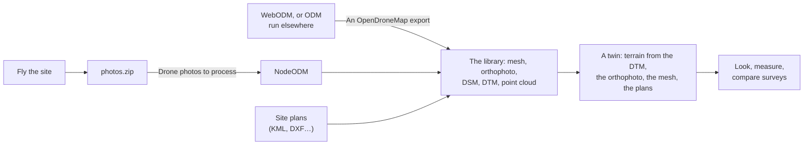
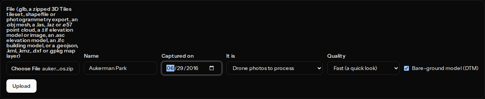
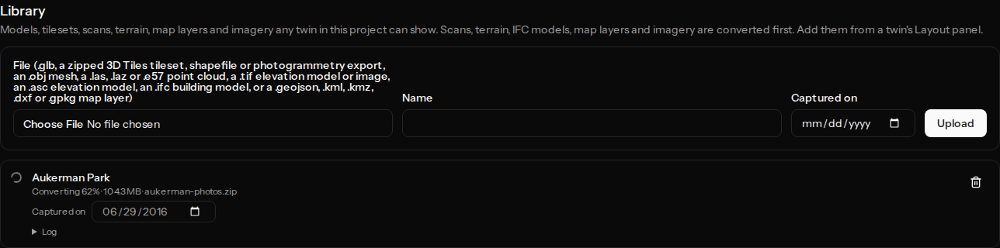
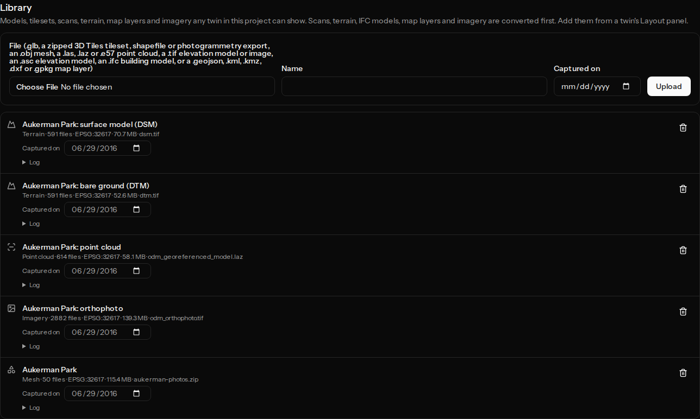
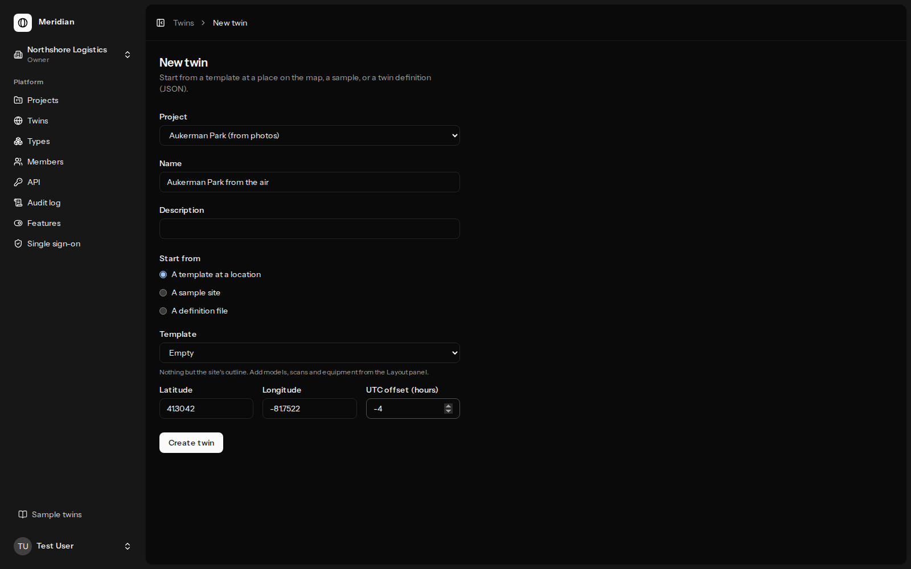
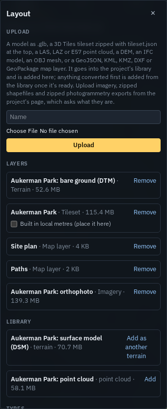
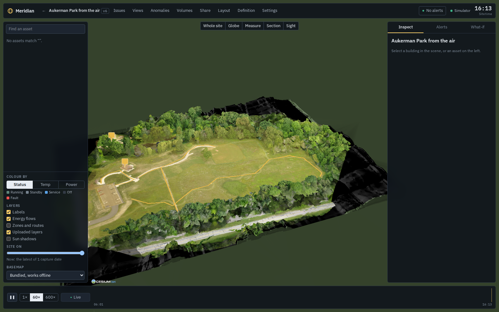
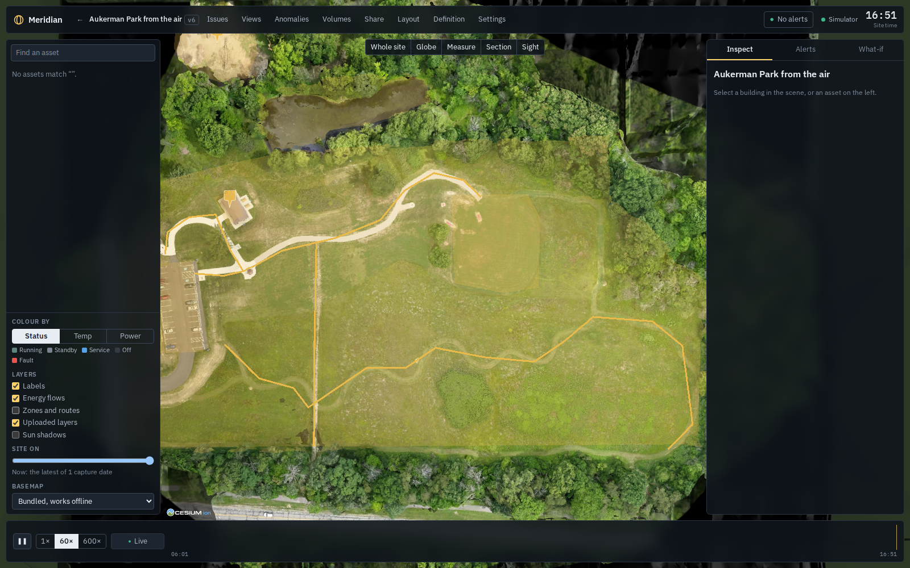
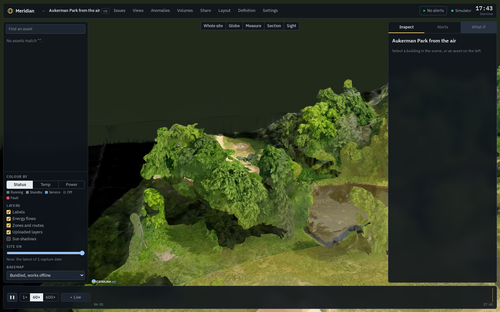
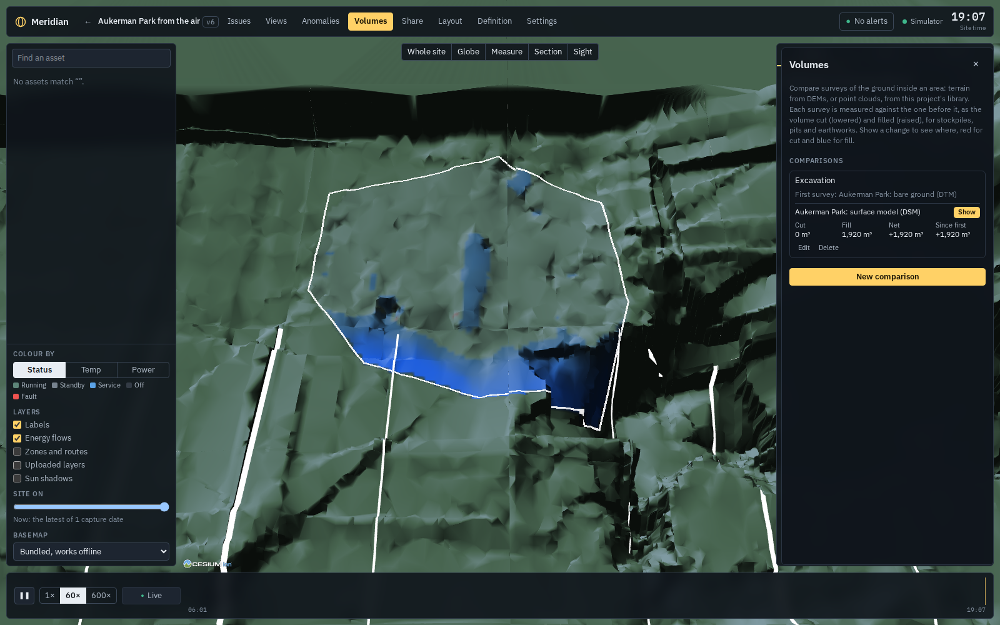

# From drone photos to a twin

This chapter follows one survey from start to finish: drone photos of a site, processed into a 3D survey, and built into a twin to look around, measure and keep up to date. Each step is covered in more detail in its own chapter; this one shows how they fit together.

The example is [OpenDroneMap](https://opendronemap.org)'s public-domain (CC0) sample of **Aukerman Park** in Brunswick, Ohio: 77 photos taken by a drone on 29 June 2016. Download it from [OpenDroneMap's datasets](https://github.com/OpenDroneMap/odm_data_aukerman) to follow along.

## What you need

- **Photos with overlap.** Photogrammetry finds each spot of the ground in several photos. Fly a grid, with each photo overlapping the next by about 75% and the next line by about 65%, straight down or slightly angled, at one height. Most drone planning apps do this for you. Each photo needs the GPS position the drone stores in it.
- **Somewhere to process them**, either:
    - **Meridian itself**, where the server runs NodeODM and your organisation has **Photo processing** on. Owners and admins turn it on under **Features** (see [Features](02-organisations-and-members.md#features)). If it isn't offered, ask whoever runs Meridian ([About NodeODM](20-photogrammetry-meshes.md#about-nodeodm)).
    - **Or WebODM, or another OpenDroneMap**, whose **all.zip** download Meridian imports whole.
- **An editor's role** (owner or admin) to upload and build twins. See [Roles](02-organisations-and-members.md#roles).
- **Optionally, your site's drawings**: boundaries, plans and paths as KML, KMZ, GeoJSON, DXF, shapefiles or GeoPackages.

## 1. Make a project

A project holds a site's uploads; its twins are built from them. On **Projects**, choose **New project**, name it after the site (here **Aukerman Park (from photos)**), and choose **Create project**. See [Projects and the library](03-projects-and-the-library.md).

## 2. Upload the photos

Zip the flight's photos, as the drone took them. A `geo.txt` or `gcp_list.txt` (ground control points) can go beside them.

1. On the project's page, under **Library**, choose the zip.
2. Enter a **Name**, and the **Captured on** date of the flight.
3. Set **It is** to **Drone photos to process**.
4. Choose a **Quality**: **Fast** for a first look, **Standard** usually, **High** for the most detail.
5. Leave **Bare-ground model (DTM)** ticked: it's the best ground to stand the twin on.
6. Choose **Upload**.

The upload shows **Converting** while NodeODM works on the photos, then while Meridian converts what NodeODM made. You can leave the page; it carries on.

For the Aukerman Park photos, at half size and **Fast**, NodeODM took 32 minutes on an 8-core server, and Meridian 7 more. See [Processing drone photos](20-photogrammetry-meshes.md#processing-drone-photos) for what's sent and what to do if it fails.

**Processed elsewhere?** Upload WebODM's **all.zip** with **It is** set to **An OpenDroneMap export (all.zip)** instead, and carry on from step 3. See [An OpenDroneMap export](20-photogrammetry-meshes.md#an-opendronemap-export).

## 3. What comes back

The upload becomes the 3D mesh, and NodeODM's other outputs appear beside it, each converted, dated and placed:

| Library item                         | What it is                                                      | In the twin                                   |
| ------------------------------------ | --------------------------------------------------------------- | --------------------------------------------- |
| **Aukerman Park** (mesh)             | The textured 3D model: ground, trees and buildings as they look | What you look at                              |
| **…: orthophoto** (imagery)          | One straight-down photo of the whole site, true to scale        | Draped over the terrain, for a plan view      |
| **…: bare ground (DTM)** (terrain)   | The ground's height, with trees and buildings taken away        | The twin's terrain                            |
| **…: surface model (DSM)** (terrain) | The height of whatever is on top: treetops, roofs               | For measuring what stands on the ground       |
| **…: point cloud**                   | The millions of points the mesh was made from                   | For measuring, and comparing with laser scans |

## 4. Add your drawings

Upload the site's plans to the same project: a boundary, planned works, paths, services. They're converted into map layers and draped over the ground. Here, a site plan (KML) and the park's paths (KMZ). See [Map layers and imagery](16-map-layers-and-imagery.md).

## 5. Build the twin

1. On the project's page, choose **New twin**.
2. Name it, and under **Start from** choose **A template at a location** with the **Empty** template.
3. Enter a **Latitude** and **Longitude** in the middle of the survey, and the site's **UTC offset (hours)**. Meridian levels the twin at the ground's height there.
4. Choose **Create twin**.

Then choose **Layout**, and under **Library**:

1. **Use as terrain** beside the **bare ground (DTM)**.
2. **Add** beside the **orthophoto**, the mesh, and each drawing.

Each one saves a new version of the twin. See [Layout and versions](08-layout-and-versions.md).

**Why the DTM, not the DSM?** The terrain carries the ground beyond the mesh's edges, and under everything the mesh doesn't cover. The bare ground keeps that ground at ground level; a surface model would raise it to the treetops. See [Terrain](05-terrain.md).

**The point cloud** shows the same surface as the mesh, as dots. Leave it out unless you want it: it's in the library to measure with and to compare.

## 6. Look around

The survey is now the site. Fly over it, look from any side, and switch layers on and off under **Layers**: **Uploaded layers** hides the mesh, the orthophoto and the drawings together.

The Empty template draws the site's outline as a zone, a square around the origin. Untick **Zones and routes** to hide it, as here, or redraw it around the real site in **Definition** (see [Twin definitions](12-twin-definitions.md)).

**Measure** finds distances, heights and areas on the mesh, and **Section** and **Sight** cut it open and see what can be seen from a spot. See [Twins and the viewer](06-twins-and-the-viewer.md#measure-in-the-scene).

## 7. Measure volumes

**Volumes** compares surveys of the ground inside an area you draw. With one flight, compare its bare ground (DTM) with its surface (DSM): the difference is everything that stands on the ground. That's not only heaps of material: trees count too.

Here, around the sandy excavation in the north-west of the park, it came to **1,920 m³** of fill. The blue shows where: mostly the trees along the area's southern edge, not the excavation itself.

So:

- **For a stockpile or a heap**, draw around it alone, keeping clear of trees and buildings.
- **For earthworks over time**, fly again, and compare the bare ground of each flight: the change is what was dug or tipped. See the next step.

See [Comparing surveys](17-comparing-surveys.md).

## 8. Fly again

Each new flight goes into the same project the same way, with its own **Captured on** date. Then:

- **Site on**, on the twin, steps through the flights by date: the terrain and layers of the date chosen. See [The site over time](21-the-site-over-time.md).
- In **Volumes**, choose **Edit** on a comparison and tick the new survey after the others: each flight is measured against the one before it, and **Since first** adds them up.

## When something goes wrong

| Problem                                                       | What to do                                                                                                                                            |
| ------------------------------------------------------------- | ----------------------------------------------------------------------------------------------------------------------------------------------------- |
| No **Drone photos to process** under **It is**                | Photo processing is off: owners and admins turn it on under **Features**. If it can't be turned on, the server doesn't run NodeODM                    |
| **The zip has 3 photos…**                                     | Processing needs at least 5 photos, and in practice dozens, with plenty of overlap                                                                    |
| **NodeODM couldn't process the photos**, with its last lines  | Often too little overlap, or photos without GPS positions. Try **Fast**, or smaller photos if it ran out of memory, and choose **Retry**              |
| **NodeODM, the photo processor, can't be reached**            | Whoever runs Meridian checks NodeODM is running (`meridian logs nodeodm`)                                                                             |
| The survey is in the wrong place, or the mesh floats or sinks | The twin's origin should be inside the survey; Meridian levels the site at the ground's height there. See [Terrain](05-terrain.md#stand-a-twin-on-it) |
| The terrain beyond the survey looks like treetops             | Use the **bare ground (DTM)** as the terrain, not the surface model                                                                                   |

## See also

- [Photogrammetry meshes](20-photogrammetry-meshes.md): meshes, OpenDroneMap exports, and processing photos.
- [Terrain](05-terrain.md) and [Map layers and imagery](16-map-layers-and-imagery.md): the ground and what's drawn on it.
- [Comparing surveys](17-comparing-surveys.md) and [The site over time](21-the-site-over-time.md): surveys over time.
- [Deploying Meridian](23-deploying.md#photo-processing): running NodeODM.
