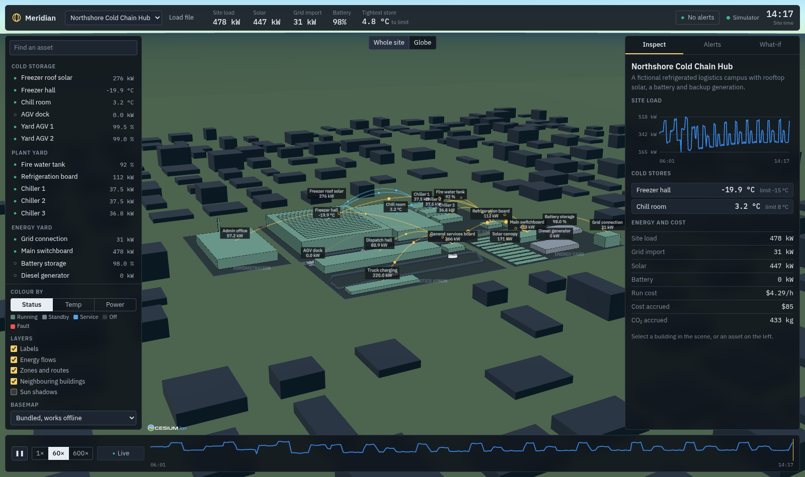

# Meridian user manual

Everything Meridian does, one part at a time: what it's for, how it works, and how to use it, step by step. New to Meridian? Start with **Getting started**, then read whichever chapter you need.



## Contents

|     | Page                                                             | What's in it                                                                                  |
| --- | ---------------------------------------------------------------- | --------------------------------------------------------------------------------------------- |
| 🧭  | [Getting started](01-getting-started.md)                         | Signing in, how organisations, projects and twins fit together, finding your way around       |
| 👥  | [Organisations and members](02-organisations-and-members.md)     | Organisations, switching between them, adding people, and what each role can do               |
| 📁  | [Projects and the library](03-projects-and-the-library.md)       | Projects, uploading models and tilesets, large uploads, and deleting                          |
| ☁️  | [Point clouds](04-point-clouds.md)                               | Uploading LAS, LAZ and E57 scans, coordinate systems, thinning, progress, logs and retries    |
| 🌏  | [Twins and the viewer](05-twins-and-the-viewer.md)               | Creating a twin, the scene, the asset list, the inspector, colours, layers and basemaps       |
| ⏱️  | [Alerts, time travel and what-if](06-alerts-time-and-what-if.md) | Alerts and acknowledging them, replaying the last day, forecasting an event before it happens |
| 📐  | [Layout and versions](07-layout-and-versions.md)                 | Adding uploads to a twin, placing them, saving, downloading and restoring versions            |
| 📡  | [Gateways and live data](08-gateways-and-live-data.md)           | Running a twin as a service, tokens, the Live switch, and sending readings over HTTP          |
| 🔌  | [Devices and MQTT](09-devices-and-mqtt.md)                       | Registering devices, the broker, mapping topics onto metrics, and the recorded history        |
| 🧾  | [Twin definitions](10-twin-definitions.md)                       | The JSON behind a twin: assets, custom types, rules and scenarios                             |
| 🔐  | [Your account](11-your-account.md)                               | Profile, password, two-factor authentication, passkeys and appearance                         |
| 🛠️  | [Running Meridian](12-running-meridian.md)                       | The Docker stack, workers, the broker, configuration and upgrading                            |

## Conventions

- **Bold** names a button, menu item, field or heading as it appears in Meridian.
- **Editors** means owners and admins: the roles that can change projects and twins. **Operators** can also send commands to a twin. See [Roles](02-organisations-and-members.md#roles).
- Commands you type in a terminal look like this:

    ```bash
    npm run gateway
    ```

- The examples use the seeded demo: the **Northshore Logistics** organisation, its **Pilot sites** project, and the two sample twins, **Northshore Cold Chain Hub** and **Harbour Depot**.

## About the screenshots

The screenshots are taken by a Playwright walkthrough of a freshly seeded app, using the real MQTT broker and point cloud converter, so they can be brought up to date whenever the app changes:

```bash
npm run build
npm run screenshots
```

That writes the images into [`docs/images`](../images), which the project README also uses. The walkthrough is [`tests/screenshots/screenshots.spec.ts`](../../tests/screenshots/screenshots.spec.ts); it needs Docker and the converter image (`docker compose -f docker/docker-compose.yml build converter`, tagged `meridian-converter:dev`).
